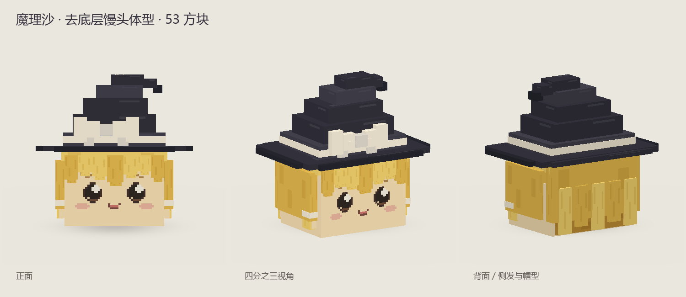
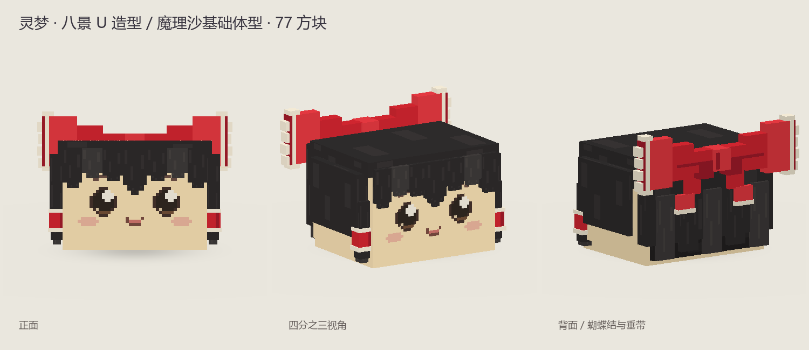

# 当前实体接入素材

已确认的[标准帕秋莉模型](../standards/yukkuri-library/assembled/patchouli/patchouli.bbmodel)及其共用组件位于项目内的 `standards/yukkuri-library/`。角色登记、造型基准和预览见[素材库说明](../standards/yukkuri-library/README.md)。

`art/source/` 保存当前 M1 灵梦、魔理沙使用的选定模型快照，不自动打入 Mod Jar。标准库中的同名角色可能属于另一制作版本，不覆盖这里的接入基准。M1 在 `src/main/resources/assets/mcyukkuri/geo/entity/` 和 `textures/entity/` 中保留几何与贴图的原样副本，并在 `animations/entity/` 中加入待机与移动动画。文件对应关系及指纹见 [runtime-sources.json](runtime-sources.json)。

| 种族 | 当前来源 | 文件 |
| --- | --- | --- |
| 魔理沙 | 用户选定的去底层版本；历史制作目录名为 `variants/marisa-body` | `source/marisa/marisa.bbmodel`、`.geo.json`、`.png` |
| 灵梦 | 与基础魔理沙同尺度的八景 U 参考版本；历史制作目录名为 `variants/reimu-hakkei` | `source/reimu/reimu.bbmodel`、`.geo.json`、`.png` |

`.bbmodel` 是可编辑源文件，贴图随项目文件保留；`.geo.json` 为此前导出的骨骼几何。运行资源沿用原始骨骼、UV 和坐标，Java 渲染缩放为 1.0。资源加载与动画观感仍待实机验收，见[开发记录](../docs/ENTITY_IMPLEMENTATION.md)。

造型参考本机《ゆっくり八景U》相关资源，几何与像素贴图为此前项目制作。原作品作者署名与授权尚未完整核实，不把这些文件标为已取得第三方开源授权。具体角色与设定来源见 [Wiki](../wiki/README.md)。

历史目录名用于说明来源，不是当前制作入口；本项目不包含八景 U 原始游戏资源。新素材在项目内的标准库制作，试用方案进入包内 `drafts/`；被替代的预览与输出核对引用后清理，仍有追溯用途的记录才进入 `archive/`。将新模型或动作接入游戏时，单独更新接入快照、运行资源、来源登记及实现说明。
