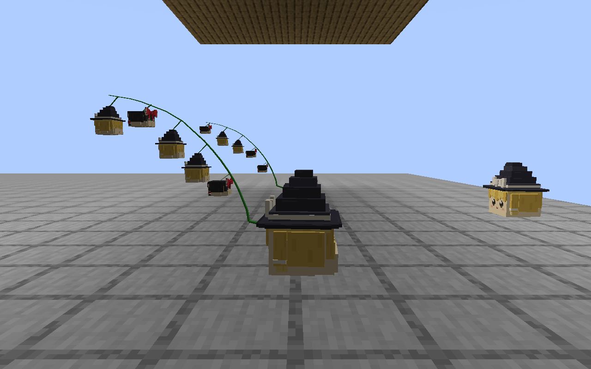
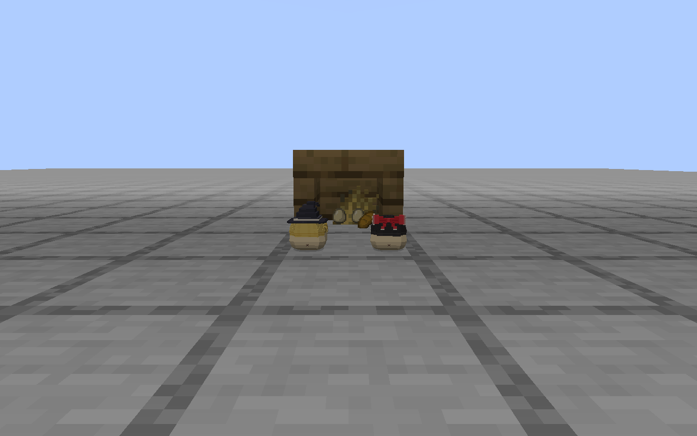
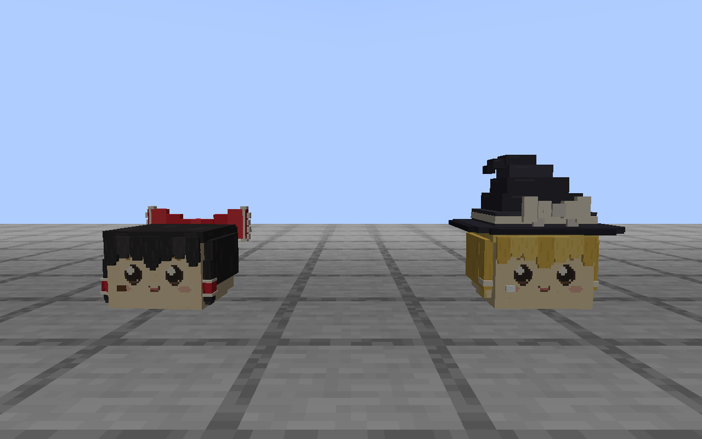

# 八景核心玩法版本

本页保留 2026-09-12 核心版本的玩法与验收基线。2026-09-13 起继续移植的现行治疗、馅料和周边资源规则见[剩余移植实施记录](PORT_REMAINDER.md)；下文旧绷带／草药和截图对应此前版本，不作为新资源的验收结果。

2026-09-12。Minecraft 1.21.1 / NeoForge 21.1.250 / Java 21。当前四种实体已接入发现、照料、互动、成长、家庭、家油巢卵与基础伤病处置。开发 Jar 为 `build/libs/mcyukkuri-0.1.0-dev.jar`，没有自动提交、推送或发布。用户已接受 Minecraft EULA，隔离专服仅绑定本机回环地址；此前文档的未启服状态属于当时记录。

## 实现范围

核心版本包含野外发现、搬运安置、持续照料、性格互动、成长、真实配对与茎生、亲子生活，以及家油搬料筑巢、产卵和孵化。基础伤病、治疗、寿终与遗留物处置已接入。额外种族、完整 41 卡和七类特殊遭遇仍属于后续内容扩充。

| 系统 | 已接入内容 |
| --- | --- |
| 网络基线 | 专服实际 tick、两个客户端、晚加入、竞争、区块卸载与正常磁盘重启 |
| 普通种家庭 | 年龄／体型／语言分开；父母和子代固定身份；孕育资源、容量预留、茎生与成长；亲代等待和照料 |
| 家油生态 | 真实碎食与材料、具体缝隙、巢与卵身份、孵化和局部清扫 |
| 身体与生活结果 | 伤病、可消耗治疗、寿终、遗留物和清理，不重复结算资源 |
| 综合验收 | 当前构建、受控引擎、专服同步与磁盘恢复、实机表现、生存路径和分档性能 |

本页说明现行规则和验证边界。已有 [P1–P2 玩法](P1_P2_IMPLEMENTATION.md)继续可用，完整规划范围见 [移植计划](HAKKEI_U_PORT_PLAN.md)。

## 已核对的规则和制作基线

- 原生 `yu_base.cs` 的醒来分支检查成长标记、先前睡眠状态和 `年龄 > 寿命 / 3`；`menu.cs` 的每日成长增加年龄。MC 使用实际加载的模拟时间，时钟跳转、离线和运输不补算。
- 年龄、体型与语言状态分别记录。项目成长范围为普通幼体 0.30–0.80、成体 0.80–1.20；原作年龄条件与 MC 时间参数分别标明。
- 茎生采用已有 [复合动作 v2](../standards/yukkuri-v1/LIFECYCLE.md)，子代在茎上闭眼，脱落后从子体 0.30 开始。母体大小影响 1–5 的胎数，胎数影响茎长和粗细，并保留个体差异；具体 MC 分布和速度会单独登记。
- 本轮沿用现有根部脱落和“油库里的茎”物品暂缓规则，不把茎回缩进额头当作替代结果。
- 亲缘由真实出生记录决定，未知父母保持未知；区块卸载与运输不当作死亡。家油是独立生态类别，使用巢卵流程。
- 原模型和标准确认记录保持原状。挂接、成长和新增设施通过独立制作配方接入，并用本轮实际导出审查。

## 生存玩法入口

需要先看实际效果时，可使用 [带按钮的可交互测试场景](SHOWCASE.md)。

1. 合成观察笔记，空中右键看七页指南，对个体右键看八页状态。普通种可在已配置的野外群系遇到；喂养与单体运输沿用 P1–P2 操作。
2. 提供有遮雨、可到达的住所、食物和清洁环境。观察笔记可选草窝，再潜行对个体分配。运输保存原身份，不复制个体。
3. 让成体互相熟悉。同伴绳用于介绍附近两只合格成体，不直接增加好感或立即产生子代。普通种在健康、饱食、互相认识且住所邻近时可自行配对孕育。
4. 孕育者在住所附近照料茎上子代，危险、饥饿、伤病、离家或空间不足会暂停。子代闭眼挂茎，逐只脱落成为真实幼体，落地后活动并寻找亲代；亲代等待和优先分食。
5. 两块橡木板和一根木棍可合成家油缝隙，入口固定朝北且需要遮雨。面包可合成碎屑，也可收集实际进食留下的碎屑。对缝隙放入碎屑，每处最多吸引两只初始家油，每只消耗四份藏食。
6. 在附近掉落纸、麦子或线，家油逐件叼回；六份材料形成垫料。熟悉的健康成体、有垫料且有藏食时可产下 2–4 枚卵。继续供食与清洁，缺食、过脏或缺少健康照料者会暂停孵化。
7. 湿布清理巢的脏污及剩余藏食，保留卵与垫料；潜行擦洗同时拆除该巢的卵和垫料。清扫后重新供食。破坏一处巢不会删除别处的卵或已孵化孩子。
8. 受伤后先清洁，再用绷带处理伤口，草药处理感染。伤口逐次损耗有限馅料，良好照料可恢复。死亡产生一次遗留物，手持遗留物对泥土上表面右键可埋成小土冢。

配方和解锁已注册，无需调试命令开启玩法。开发夹具会设置初始状态、缩短孕育时间；夹具不进入发行 Jar。

## 保存与参数

年龄、营养积累、体型和幼儿语分别保存，真实醒来时才检查成长；增大的碰撞体放不下则等待。亲缘由出生记录确定，未知父母保持未知，已知亲子与同胞不得配对。子代身份、种族和遗传参数在受孕时固定，出生只结算一次。母体死亡只取消尚未出生的茎上子代。

每个缝隙有独立身份、最多 24 份藏食和 8 级脏污。个体 NBT 保存年龄、尺寸、携带物和治疗；世界登记保存亲缘、未出生子代和运输凭证。个体卸载或运输不补算生长与治疗，巢卵仅随已加载巢点推进。

`config/mcyukkuri-family.toml` 保存以下 MC 适配参数，生活和社交继续使用原有配置。

| 参数 | 默认值 | 含义 |
| --- | --- | --- |
| `lifespanTicks` | 72,000 | 基础寿命，个体略有差异；新生成成体从约三分之一寿命开始 |
| `gestationTicks` | 6,000 | 条件满足时的茎生推进时间 |
| `reproductionRecoveryTicks` | 12,000 | 繁殖恢复时间 |
| `eggIncubationTicks` | 4,000 | 条件满足时的孵化推进时间 |
| `houseArrivalTicks` | 1,200 | 每只初始家油入住前的加载时间 |
| `localPopulationCap` | 16 | 32 格内已知活体与未出生预留上限，未加载个体仍计数 |
| `naturalPairing` / `aging` / `houseArrivals` | `true` | 自行配对、寿终、缝隙吸引初始家油 |

20 tick 约为一秒，实际速度受服务器负载影响。身体目前统一以 12 单位馅料开始，伤口和感染各最多 8；绷带持续 1,200 tick。这些是初版 MC 参数，不是体积模拟，仍需长期生存测试调整。

## 验证记录

最终断言数量、产物与源文件指纹见 [验收清单](validation/core/manifest.json)。

- 本机构建及实体、生活、家庭、核心生态四组 GameTest，覆盖旧规则、1–5 胎唯一出生、成长空间、自然配对、亲子跟随、运输及死亡、巢卵和真实搬料、藏身探头及离开巢顶、入住数量限制、治疗和生存埋葬。
- 原有专服基线 189 项断言；两个客户端晚加入、同步喂食竞争和资源重载。新增家庭的孕育元数据在两个客户端一致，实际出生得到 14 个家庭成员。
- 区块实际卸载到实体为零后重载；14 个体的身份、亲缘、成长、身体与携带记录一致。正常停服后的磁盘重启比较 57 项通过。
- 巢卵清扫断粮后暂停，重启后两个客户端的巢身份、卵数、垫料、食物及进度比较通过；重新投入真实碎屑后孵化出三只幼体。
- 实际客户端包扎消耗一件绷带，两客户端接收身体状态。八页观察内容和七页指南均通过原生书页高度检查，保留截图。
- 当前 1–5 胎的多角度实际预览；独立审查抽看 18 张茎生和 2 张设施图。450 组静态状态的非连接部位几何检查通过，连接茎另由截图确认；未声称完成所有动作的全参数几何审计。
- 三份配方导出与角色资源校验通过。已补齐 CI 检查入口，本轮未推送，因此没有本轮远端 CI 结果。

| 实体数 | 服务器平均 tick（ms） | 客户端平均帧间隔（ms） |
| --- | --- | --- |
| 20 | 0.83 | 17.05 |
| 50 | 1.14 | 17.87 |
| 100 | 2.06 | 29.49 |

性能数据来自本机平地专服、两个客户端、开启 AI 的短时采样，每档预运行约八秒再采样约六秒。50 ms 是 20 TPS 的单 tick 时间预算；该数据不覆盖大型模组包、复杂地形、长期家谱增长或大量同时孕育。100 只时客户端平均帧间隔明显增加。见 [采样摘要](validation/core/performance-summary.json)。

## 实际预览与剩余范围

当前已完成上述受控验证，尚未从自然发现开始按默认速度连续养到多代寿终；完整人工生存长测、不同地形、长期平衡与复杂模组兼容仍待验收。四、五胎茎长及新增道具是游戏适配版本，技术视觉通过不替代用户对标准造型的确认。

完整 41 卡、额外种族、外出事件、完整器具与特殊身体系统、图鉴和第三方集成属于后续扩展，未作为本版已完成功能。
