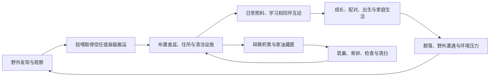

# 八景 U 内容梳理与 Minecraft 移植计划

> 2026-09-13 执行更新：本轮 P5–P7 移植功能和分领域实机记录已交付；共同版本通过 36 项 GameTest、2058 条报告检查及双客户端／区块／磁盘恢复等 2631 条检查。事件三个补验边界与联合发现的器具、剪茎和表情资源问题已修复复验。正式产物与证据见[联合验收](validation/port-integration/README.md)，逐项范围见[实施记录](PORT_REMAINDER.md)和[任务分工](PORT_TASKS.md)。默认速度多代生存、长期平衡、可选兼容及新造型确认仍待后续。下文差距表保留最初规划上下文，不代表现行功能状态。

编写日期：2026-09-12。状态：原始规划档案；实施状态以页首链接为准。

目标是在 MCyukkuri 中保留八景 U 的饲养、个体反应、成长家庭、物品互动和外出遭遇，并结合当前悠闲庭院 MOD 已形成的性格、社交、家油和资源规则，构成可以长期观察和参与的 Minecraft 生态。

建议按“基础可运行 → 生活与住所 → 性格和互动 → 成长家庭 → 家油巢卵 → 身体与工具 → 野外事件 → 扩展与平衡”推进。第一个可玩版本以灵梦、魔理沙为主，完成从发现、带回、喂养到安稳生活的闭环；随后完成真正可延续的家庭。每阶段都交付玩家看得见的动作与结果。

## 1. 梳理范围与证据口径

本次读取本机 `E:/yukkuri/Eight景U-ModLab` 的当前 Wiki、MOD 源码与已有原生反编译阅读文件，并对照 MCyukkuri 当前工作副本。基底固定为本机 **八景 U v9.8**，不判断网上最新版。

来源统一标为四类：

| 标记 | 含义 | 本计划怎样使用 |
| --- | --- | --- |
| U | 八景 U 原生内容，有本地源码或原生操作核读依据 | 重建规则和操作体验；特定调用链之外的细节仍需核实 |
| G | 悠闲庭院 MOD 的实现 | 借鉴规则和已知缺陷；重新实现为 Java 与 MC 世界逻辑 |
| L | MC 项目已采用的设定、标准素材或行为原型 | 沿用已确认定义；素材存在不算游戏功能完成 |
| P | 本文提出的 MC 适配方案 | 尚未实现的设计，阶段验收后才更新功能状态 |

U、G 均不表示本轮做过实机验收。本次核读了原生年龄推进、醒来成长、部分特殊事件入口，以及 G 的事件目录、关系记录和巢卵规则；没有逐行审计原游戏全部源码。工具与设施清单主要依据已有逐项审计。来源索引见第 12 节。

## 2. 八景 U 的内容结构

八景 U 的主要循环是：在外出场景遇见个体，通过捕捉或交易取得个体，把它们放入饲养环境，提供食物、住所、清洁和互动，观察性格、教育、身体与家庭关系带来的反应，再通过外出与设施增加新的遭遇。[S1、S2]

### 2.1 原生系统与移植目标

| 编号 | 内容域 | U 已有内容及边界 | MC 中的目标（P） | 首次落地 |
| --- | --- | --- | --- | --- |
| C01 | 个体与种族 | 种族、个体 ID、体型、年龄、寿命、饰品及状态；有目录不等于完整可玩种族 | 稳定身份、独立分类轴、个体资料与外观 | P0–P1 |
| C02 | 食物与生理 | 饱食、体力、进食、食物喜恶、睡眠、排泄和污渍 | 实际食物消耗、饥饿和休息，随后接清洁与排泄 | P1 |
| C03 | 情绪与养成 | 亲近、恐惧、悠闲、聪明、负面个性、教育和口令 | 对具体玩家的记忆、可观察反应、学习与习惯 | P2 |
| C04 | 家庭与生命 | 配偶、亲子、茎与实子、出生、成长、寿命；未证实通用三种生育方式选择器 | 配对和真实家谱、茎生、成长；其他生育方式按 L 单独接入 | P3 |
| C05 | 社会与冲突 | 相互好感、同伴互动、饰品相关反应、相扑及冲突 | 有向关系、分食和争抢、失饰识别、冲突与保护 | P2、P5 |
| C06 | 饲养空间 | 小屋、厕所、垫料、食盆、水池、游乐设施 | 可放置方块与实体设施、可达住所、照料工作区 | P1、P5 |
| C07 | 玩家操作 | 徒手、工具、器具、说话、管理、饰品共 40 个菜单入口 | 右键、手持物品、设施界面和少量情境操作 | P1–P5 |
| C08 | 身体后果 | 受伤、死亡、出馅、部件变化、清洗与治疗、遗体处置 | 统一伤害与身体资源，保留原因及角色反馈 | P1 最小伤病，P5 扩展 |
| C09 | 外出与事件 | 街道、小巷、森林、公园、河湖等；七类已核查连续特殊事件 | 群系、结构和附近真实个体共同触发 | P6 |
| C10 | 取得与经营 | 捕捉、收纳、冷冻、商店购买／交易 | 运输容器、收容设施、交易和生存合成路线 | P1 运输，P7 经营 |
| C11 | 信息与管理 | 状态、成就、存读档、设置、中文化 | 观察手册、进度、配置和正常世界存档 | P1 起逐步补齐 |

这些内容互相依赖。例如清扫会改变食物残渣与卫生，卫生影响生活条件；失去饰品影响亲友识别，但不应删除家谱；喂食会影响信任，但营养必须来自被实际消耗的物品。[S2、S5、S6]

### 2.2 角色、亚种与外观的范围

| 分类 | 现有证据 | 移植安排 |
| --- | --- | --- |
| 灵梦、魔理沙 | U 主种；MC 已有实体与动作代码 | 第一批完整生活、互动、家庭样板 |
| 爱丽丝 | U 主种，有原生路由依据 | P7 首批种族扩展；先补标准模型、口吻和差异行为 |
| 橙 | G 已启用原生编号 4，并有成长等专项记录 | P7 接入；寻找“蓝大人”只保留有依据的行为，不据称呼生成新人物 |
| 帕秋莉 | U 素材线索不等于完整可达；MC 静态标准造型已确认 | 可与前两种并列评估美术工作量，但玩法仍需单独完成 |
| 螺壳魔理沙 | U 编号及 G 分类核读；L 采用较强耐水 | P7 加入独立外观、移动和耐性；不得用帽船代替螺壳 |
| 多毛灵梦及一般不足油 | 原生部分路由、G 外观与行为扩展、L 定义 | P7 按具体外观制作，保留普通生活动作；不足不直接等同低智 |
| 两种家油 | G 有独立室内生态；MC 已有两种实体外观 | P4 完成碎食、藏匿、筑巢和卵生；普通宠物进屋不变成家油 |
| 帽船水生类型 | U 有漂流动作和事件，G 有捕获修复 | P6 作为依赖帽船的移动类型；与螺壳亚种分开 |
| 被炉、DOS | L 已分类；完整 U 生成与玩法未核实 | P7 后续候选；DOS 大体型不自动获得智慧、职位或超能力 |
| 妖梦、蕾米莉亚、芙兰等 | 资料保留，未确认完整 U 实装 | 扩展候选，不纳入“原生已实现内容”的完成率 |

种族、亚种、家油生态类别、先天不足、年龄、后天损伤和社会身份分开存储。当前四个实体注册 ID 保留；不要为了分类重构立即替换已有实体 ID。[S4、S9、S10]

### 2.3 玩家操作与道具清单

以下覆盖已有原生审计的六组 40 个入口；MC 中允许合并同类操作，但必须保留清楚的目标与结果，不能用一个通用“互动”按钮吞掉全部差异。[S2]

| 组别 | 原生内容 | MC 适配与次序（P） |
| --- | --- | --- |
| 徒手 10 项 | 观察、轻抱、用力抓、弹额头、拳击、拍打、蹭蹭、滚动、放倒、摇小屋 | P1 观察与搬运；P2 温和接触；P5 拘束、强力接触和姿态变化 |
| 工具 9 项 | 大头针、锤子、锥子、加热锥子、仰卧固定、包裹悬吊、鱼钩悬吊、理发器、裁剪刀 | P5 分为剪切、穿刺、固定、热损伤四类实现，逐项接具体作用点与后果 |
| 器具 5 项 | 振动器、去势剪、铁箱、剪茎剪刀、瓶装剪茎剪刀 | P5 专用设施包；依赖身体与繁殖状态，不能先做按钮后补结算 |
| 说话与口令 6 项 | 温柔说话、冷淡说话、特别优待、嫌弃对待、展示臀部、躺下 | P2 说话与习惯学习；特殊姿态随 P5 所需动作接入 |
| 管理 7 项 | 清扫、收拾、清洗、冷冻、丢弃、简单埋葬、隆重埋葬 | P1 清扫、清洗与放出；P5 遗体处置；P7 冷冻收容 |
| 饰品 3 项 | 拿起、没收、悬挂 | P2 实物取还与身份识别；P5 悬挂及追逐 |

其他设施、消耗品和系统按用途制作：

| 类别 | 内容梳理 | MC 适配（P） |
| --- | --- | --- |
| 食物 | 多档饲料、超辣饲料、饼干、手递食物、杂草、厨余、便便 | P1 食物标签和实际库存；P5 口味、污染、嫌恶及特殊食性 |
| 基础设施 | 食盆、三种厕所、三种小屋、四种垫料、水池 | 先交付一套基础款；后续差异体现在容量、清洁和庇护等可感知效果 |
| 游乐 | 纸筒、陶管、滑梯、蹦床、弹珠、橡胶球、玩偶、石子、骰子 | P2 一种可探看的玩具；P5 连续路线和物理互动 |
| 液体与治疗 | 清水、橙汁、酸奶饮品、生殖用馅、兴奋药、助眠喷雾、幼语药（シタタラン） | 不统一为回血药；饮水、清洗、治疗、繁殖辅助、睡眠和口吻变化分别结算 |
| 环境与管理 | 酒精灯、教育、冷冻库、商店、成就 | 火源复用 MC 环境；P2 学习；P7 收容、交易和进度 |

精确物品名称、配方、数值与材料消耗在各批实现前逐项登记。本表是内容范围，不宣称这些功能已在 MC 存在。

### 2.4 悠闲庭院可借鉴的扩展

| 扩展（G） | 有价值的内容 | 移植时的边界 |
| --- | --- | --- |
| 人格与经历 | 好奇、合群、大胆、体贴、守序、耐心；先天与后天分开 | 十六型是倾向组合的标签；不替代智力、情绪和品行 |
| 社交网络 | 有向好感、真实家系、配偶、朋友、群体与职位 | 同住不自动是亲属；高好感不自动是朋友；完整领袖／放逐仍有缺口 |
| 原生互动增强 | 靠近反应、拿走食物后的犹豫、同伴受惊与离返反应 | 迁为 MC 的距离、视线、实际投食和实体进出事件 |
| 身体与馅料 | 来源、成分、余量、甜度、营养、气味及来源认知；连续出馅和进食 | 一份物质只能有一个权威持有位置；表现副本不增加产量 |
| 环境伤害 | 接地摩擦、垫料、伤口、污染、承压 | 不能把已有摩擦模块称为完整温度或水体生态 |
| 家油与巢卵 | 室内碎屑、藏食、藏匿、材料建巢、双亲卵、孵化与清扫 | 四个家具角落和原秒数是 G 的场景参数，不能直接套 MC 房屋 |
| 不足油 | 特定外观、照料差异和部分姿态适配 | 已知细长动作覆盖缺口需重新解决；不能只缩放正常模型 |
| 野外事件 | 41 张有条件、参与者、阶段和结算的卡 | 逐批移植可达条件，不把旧场景编号当成 MC 群系 ID |
| 汉化与检验 | 种族及成长口吻、中文状态、动作检验目录 | 正常游玩自然触发；管理命令只辅助验收 |

G 已撤销捕捉后的初次见面选项演出、独立安抚按钮及实验食篮，本计划不将它们作为现成功能恢复。温柔说话、正常投喂和捕捉本身仍保留。[S5–S8]

## 3. MCyukkuri 当前基础与缺口

以本次读取的工作副本为准，包含已有未提交内容；不是仅按 Git 提交推断状态。[S9]

| 领域 | 当前实际状态 | 对计划的影响 |
| --- | --- | --- |
| 平台 | 配置为 MC 1.21.1、NeoForge 21.1.250、Java 21 | 沿用现有平台，不在移植同时更换加载器 |
| 实体 | 灵梦、魔理沙、两种家油及生成蛋；无自然生成 | P0 验证四种实体；P1 接最小野外发现方式 |
| 行为 | 漫游、持食吸引、喂食、捡食、随机短休息、受伤逃跑 | 可作为接线起点，但尚无完整生理与家庭系统 |
| 喂食 | 扣一份食物、恢复 2 点生命、600 tick 饱腹冷却 | 需改为持续饥饿与营养；明确何时扣物品、何时吞咽与生效 |
| 水域 | 有 `FloatGoal` 和避水漫游 | 不能视为完成“普通种不自主渡水”；诱食与逃跑路径也要检查 |
| 动作 | 四种模型各 19 动作、11 套表情；命令能请求动作 | 没有完整进食嘴部动作；多数社会行为尚无自然触发 |
| 存档与同步 | 保存饱腹冷却和休息间隔，同步动画名、开始 tick、表情 | 新生活、关系、巢卵与搬运状态需补存档与多人一致性 |
| 资料道具 | `field_notebook` 已注册普通物品 | 无阅读界面，不能写成图鉴已完成 |
| 标准素材 | 帕秋莉静态造型、成长与生育原型、道具等已有资料 | 分别核查确认状态与导出；不自动进入运行资源 |
| 验收 | P0 已通过构建、GameTest 和部分实际客户端检查；专服、多人仍待验收 | P0 尚未关闭，证据见 [验收记录](P0_VALIDATION.md) |

家油目前共用普通实体的基础属性和行为。体型变小尚不能说明具备藏匿、碎食、繁殖或缝隙导航能力；家油造型确认状态仍为待确认。

## 4. MC 中的玩法与规则选择

### 4.1 玩家主循环

一只油库里应当会因为有食物靠近，因为熟悉玩家而放松，因为家人落后而等待，也会在饥饿或危险时放弃玩耍。玩家通过这些反应理解状态，再用观察手册查看详细原因。

### 4.2 对二维场景和菜单的转译

- **饲养箱 → 玩家搭建的生活区域。** P1 使用可登记住所的窝或小屋方块，检查入口、落脚点和上方遮蔽；不要求先造完整家具系统。普通野生个体可使用天然遮蔽，之后再建设群落巢。
- **外出菜单 → 实际探索。** 森林、村落边缘、河岸、墓地或聚集地由环境与结构确定；用附近真实个体构成事件。只有需要保证亲缘配置的特殊遭遇才成组生成。
- **鼠标拎起 → 受距离约束的携带与运输容器。** P1 先实现单体容器，捕入和放出保持同一 UUID。多只装箱、冷冻另做批次。
- **操作列表 → 手持工具和情境菜单。** 空手观察、食物喂养、工具执行对应操作；可同时成立的操作用简短选择界面。多人服务器不暂停世界。
- **家庭认养 → 渐进的成员互动。** 先支持个体跟随及家人响应；一键收养全家属于新增事务，不冒称原生功能。
- **客厅四角 → 有效藏匿点。** P4 用可定位的缝隙／巢点方块和附近残渣起步；以后扩展家具标签。不按每户强制生成四个角落，也不每 tick 扫描整栋建筑。
- **金币商店 → MC 生存取得路线。** P7 用合成、发现和配置交易表提供物品与个体；不先引入独立金融系统。

### 4.3 需要遵守的现有设定

依据本项目[基本设定](../wiki/hakkei-reference/world/rules.md)和[生命周期原型](../standards/yukkuri-v1/LIFECYCLE.md)：

1. 沿用八景年龄逻辑并适配 MC 模拟时间。核心醒来成长条件有原生依据，但存在其他年龄分支；不能宣称 U 只有一个成长条件，也不直接把赤／子／成／实／老写成原生五状态。
2. 普通种成长倍率采用已有美术范围；年龄、体型和声线分别记录。原型演示的 28 秒、32 秒不是正式孕期。
3. 家油卵生；普通宠物不会因进入房屋改变生态类别。茎生与胎生按现有种族规则分别实现。
4. 茎生每胎 1–5 只；母体大小影响胎数、胎数影响茎长与粗细，并保留个体差异。具体分布与系数仍需设计；原型的均匀抽数不算完成。
5. 茎生出生进入子体、胎生出生为赤体；未出生实子闭眼。出生后的茎根脱落和“油库里的茎”物品维持已有“仅记录、暂不实现”状态，作为后续单列项。
6. 少量清水清洗、持续雨淋和浸水分开；普通种不能自主渡水。帽船提供浮力，耐水较强不等于游泳或无限浸泡。
7. 寒冷可造成死亡，但 U 的发抖表现不等于已有完整寒冷系统。MC 的暴露和庇护参数明确标为 P，不编造原作温度阈值。
8. 饰品识别取决于观察者，金章例外也属于观察者；失饰不删除血缘。先天不足与后天受伤分开。
9. 馅料成分、产出方式、气味和来源认知分开；不让远处个体自动知道一份馅的来源。

### 4.4 初始时间与种群政策（P）

首版只推进实际加载并模拟的生命时间，不在离线、收纳或区块卸载期间补算饥饿、伤害和出生；重载从保存的进度继续。睡过夜和 `/time set` 不直接跳过孕期或制造成批死亡。后续如加入简化的远处生态，另设明确的补算范围。

出生前同时检查住所容量、局部活体与待出生数量。P1 自然生成就引入局部数量上限；P3、P4 的繁殖占用同一套容量规则，避免用无限生产补足稀有度。饥饿、孕期、寿命与气候采用独立配置，先完成可验证的规则，再通过游玩确定速度。

## 5. 服务端状态与实现结构

以下类名与目录均为建议，不表示已经存在。沿用现有 `YukkuriEntity`、Goal 与项目渲染器，按领域拆出逻辑，不直接复制 Unity 的槽位数组、帧计数、场景编号或 ES3 接口。

| 模块建议 | 权威数据与责任 | 主要存放位置 |
| --- | --- | --- |
| 个体生活状态 | 年龄、生命阶段、饥饿、精力、清洁、伤病、暴露与家址 | 实体持久数据；家址含维度与位置 |
| 分类与能力配置 | 种族、亚种、生态类别、形态、食物适性、生育方式 | 注册信息与项目数据包配置；先保留现有四个实体类型 |
| 人格与玩家记忆 | 先天倾向、后天经历；对每位玩家分别记录信任和恐惧 | 个体数据；以玩家 UUID 为键 |
| 家谱与关系 | 双亲、配偶、有向好感、朋友、群体及死亡记录 | 世界级 `SavedData`；实体只持身份和必要引用 |
| 巢与设施 | 住户、容量、库存、卫生、建筑材料、卵及进度 | `BlockEntity`；卵按独立 UUID 记录，初版在巢内显示 |
| 搬运与出生事务 | 个体唯一持有者、容器转移、胎次／卵 ID、完成标记 | 服务端持久记录；普通 UI 和动画不能直接生成实体 |
| 行为协调 | 生存优先、目标占用、动作阶段、中止和资源结算 | `entity/ai/` 与相应领域模块 |
| 情景事件 | 条件、参与者、事件 ID、阶段、冷却、结算标记 | `ecology/`、`social/`、`event/`；规则可逐步数据化 |
| 表现 | 表情、关键帧、嘴部、附着物、字幕与效果 | `client/`；仅根据同步状态呈现 |
| 观察与诊断 | 正常观察手册、管理员受控触发、拒绝原因 | 玩家界面与 `command/`；不以命令代替自然 AI |

### 5.1 行为和连续动作

统一优先级建议为：死亡／不可行动 → 环境避险和严重伤病 → 被搬运／固定 → 紧迫生理 → 生育与育幼 → 觅食回巢 → 社交和学习 → 休闲。每类有明确中止规则；危急情况可以打断普通事件。

每次复杂行为至少定义“资格检查 → 占用对象或资源 → 靠近 → 接触／动作 → 实际结算 → 收尾”。持续过程中检查距离、可达性、存活、维度和玩家干预。不能在开播时一次结算整段行为，也不能依赖客户端关键帧回调决定出生、伤害或食物消耗。

例如拿走食物：尚未入口时归还预留；已经装入口中时，食物改由个体持有，保存这份余量；吞咽才增加营养。中止、死亡和搬运分别转移或掉落剩余物，不能让食盆、掉落物和嘴里同时各有一份。

### 5.2 身份、存档与多人

- 个体、巢、卵、胎次和可追踪身体资源使用稳定身份；短期网络实体编号只用于当前连接定位。
- 捕入、放出、出生与死亡处理都只能结算一次。两人同时喂食、抓取或打开同一容器时，由服务端重新检查目标和实际库存。
- 出生先确定子代身份，再创建实体并记录结果；失败保留待产状态。正常保存／重载需识别同一子代，避免“已出生但父体未记账”造成复制。
- 不强制加载远处亲属或巢的区块。暂时未加载不是死亡，也不删除配偶或亲缘。
- 客户端接收动作 ID、开始 tick、阶段、参与者和必要参数；晚加入可以恢复当前表现。完整家谱和内部记忆不逐 tick 广播，只按查看需要读取。
- 模组配置、实体数据和数据包字段采用稳定命名；首版记录格式版本并给缺失可选字段合理默认，不在本计划建设八景 ES3 → MC 世界的导档器。

### 5.3 三维美术接入

八景 U 原图用于核读轮廓、表情层次和动作因果。新模型与动作从 `standards/yukkuri-library/` 制作；选定后形成 `art/source/` 快照，再导出到运行资源并更新 [runtime-sources.json](../art/runtime-sources.json)。不把原生 Sprite、反编译文件或 Unity 程序打入模组。

优先补进食、嘴内食物、睡眠进入／醒来、回头等待、擦洗、排泄、幼体和出生，而不是先扩充种族数量。复杂动作复用现有骨架采样，另加嘴部／表情及附着物控制；不要为每种种族重写一套 AI。

成长同时调整显示和碰撞范围；模型变小不自动获得穿过实体方块的能力。家油窄路、帽船载具、茎上实子与脱落轨迹需在当前导出的多角度预览以及 Minecraft 实机中检查。造型改变后保留原批准基线，新版继续登记待确认。

## 6. 分阶段交付

P0–P7 是本专题实施批次，与现有 M0–M4 对应，避免重写总路线。每批都有玩法、数据、表现和验收；前一批依赖验收通过后再接后一批。P0 已完成构建、引擎断言和部分客户端验证，专服及多人门槛仍待通过；P1–P7 为计划。当前证据见 [P0 验收记录](P0_VALIDATION.md)。

| 批次 | 对应路线 | 内容与玩家可见结果 | 完成门槛 | 依赖 |
| --- | --- | --- | --- | --- |
| P0：确认基础 | M1 | 四实体可生成、标准动作可播放、现有基础行为可运行 | 资源检查、构建、专服与客户端加载、晚加入和重载验证通过 | 当前工作副本 |
| P1：生活与住所 | M2 | 发现普通种、单体运输、观察、实际进食、休息、回巢躲雨、清洗与基础厕所 | 一只实体能持续生活；食物不复制、住所失效可重寻、卸载重载状态正确 | P0 |
| P2：性格与互动 | M2 延伸 | 温和／冷淡说话、信任与恐惧、玩具探看、分食争抢、饰品取还与学习 | 同条件下能看到个体差异；对两位玩家记忆分开；危险能打断休闲 | P1 |
| P3：成长与家庭 | M3 | 生命周期、真实亲缘、配对、茎生、亲代等待和照顾、寿命处理 | 一胎从孕育到独立生活并正确成长；保存／重载不重复出生，满员不超生 | P1、P2 |
| P4：家油与巢卵 | M3 | 缝隙探头、拾碎食、带回、材料筑巢、产卵、孵化、检查和清扫 | 无材料不造巢、无有效巢不孵化；拆一巢不伤及其他巢和已出生个体 | P3 的身份与出生机制 |
| P5：身体、工具与设施 | M3 扩展 | 伤口与漏馅、身体资源、治疗、冲突／保护、工具、游乐、遗体和埋葬 | 伤害与产物只结算一次；整段动作可中断；原版危险与新后果无重复扣除 | P1–P3；巢相关操作需 P4 |
| P6：野外群落与事件 | M4 | 环境生成、家庭与群落、七类特殊事件、41 卡分批接入 | 正常探索可触发；全部已接事件有实际对象、可退出、有限资源与冷却 | P2–P5 的相关机制 |
| P7：内容扩充与生存平衡 | M4 | 爱丽丝／橙／帕秋莉等、螺壳与不足油、额外生育方式、收容交易、图鉴与兼容 | 每个新增内容都有完整操作路线、动作、存档和自然行为；性能与生存取得合理 | 对应基础系统通过 |

### P0：先确定已有代码可以作为移植基础

按 [实体开发记录](ENTITY_IMPLEMENTATION.md)执行四种实体与 19 动作检查。核对食物标签、模型与语言打包，运行 Gradle 构建、客户端和专用服务器，验证存档、资源重载、多人观察和晚加入。发现错误先修正，不能用美术离线预览替代运行验收。

P0 同时形成可复用的小型测试区域：平地、台阶、窄道、屋顶、水边、食物堆。所有后续阶段使用项目独立测试世界，记录本轮环境和文件版本。

### P1：第一个可玩饲养版本

交付灵梦、魔理沙的最小自然生成或可发现巢点、单体运输容器、食盆、窝、基础厕所和观察手册。生存玩家不依赖管理员命令取得首只个体。

把饱腹冷却改为持续生活状态；进食必须经过接近、取食、咀嚼、吞咽和收尾。先实现有限库存与基本适口性，再细分食物质量。睡眠有进入和醒来表现，住所被破坏时会寻找替代地点。接入短洗、雨淋、浸水和火伤的最小区别；普通种避免主动走入水域，已经落水时尝试逃生。

**验收情景：** 玩家发现一只，带回安置，投食、看其吃完、清洗、休息；下雨后能到可达遮蔽。食盆见底后重新觅食，玩家移走住所后不永久卡住。保存退出再进入，个体身份、饥饿、家址和容器状态一致。

### P2：从“会动”变成“会回应”

先做四类稳定反应：玩家靠近、实际投喂、温和／冷淡说话、同伴接近。每类至少有行为、表情和一句合适口吻，不先堆大量形容人格的文字。

六种倾向参与选择概率与等待时长；需要和危险仍优先。对不同玩家分别积累信任与恐惧。引入有向同伴关系、饰品实物所有权和识别，再接分食、争抢、玩具探看及一次简单学习。实际操作才更新经历，不因重复打开观察页增加好感。

**验收情景：** 两只同种表现出不同靠近意愿；同一只对长期照料者和陌生人反应不同。给甲的食物只能被一只实际吃到；失饰后亲友暂不认出，归还后恢复识别，原关系记录仍在。

### P3：普通种家庭循环

先接当前茎生原型，使用同一套生命周期与服务端出生事务。孕期保存胎数、个体差异、双亲和子代 ID，不在重载时重抽。生育资格同时看生理、配对关系、冷却和容量，不沿用普通动物喂两次立刻生子的简化流程。

把已有成长尺寸映射到模型和碰撞箱；醒来成长与语音阶段按已采用规则接线。出生后有亲代等待、呼唤、分食和失散反应，未知父母不以最近成体代替。非暴力的寿终与基础遗留处置先闭合，复杂遗体交互到 P5。

**验收情景：** 1–5 胎数均可正确挂接和出生；中途保存、搬运或中断不丢子、不复制。达到容量时不给另一亲本重复计胎；家人暂时卸载不被记成死亡。出生后继续完成成长与亲子行为。

胎生原型保持独立来源，到 P7 按物种规则接入；不会因茎生先完成就让所有非家油永久采用茎生。

### P4：家油是另一套生活方式

复用两种家油的已接入资源，补小体型路线和藏匿状态。残渣来自真实进食／厨余，筑巢材料来自独立材料来源；清洁可抑制新进入机会，但不能凭一个卫生数值删除全部活体。

用一类缝隙／家油巢方块完成最小生态，卵各有身份和双亲。巢内卵先作为巢的持久对象显示，不给每枚卵单独运行完整生物 AI。检查、清扫、破坏和孵化都指向具体巢及卵。活体离巢后仍保持身份；隐藏展示与实体模拟不能各保留一份相同个体。

**验收情景：** 两只成年家油从捡食、搬料到建巢、育卵、孵化；缺食缺料会阻止相应阶段。清扫一处不清除另一处藏食，拆巢不会抹掉已经出生的家谱。

### P5：身体后果与全部操作的分包实现

按三个可独立验收的内容包推进：

1. **身体与资源：** 伤口、吐馅／漏馅、口中余量、气味、来源知识、治疗和遗体；基础清扫与埋葬闭环。
2. **接触与工具：** 抱持、压迫、滚动、剪切、固定、专用器具；接地摩擦由实际接触和位移决定，动作播放本身不凭空制造伤害。
3. **设施与群体后果：** 垫料差异、玩具路线、厕所升级、相扑、霸凌／保护及相关情绪反应。

“请吃了我”等已有 G 扩展作为依赖亲缘、饥饿、身体资源和连续动作的后段内容。每种结果分别说明物质转移、目击者反应与中止处理，不用相同动画证明所有后果完成。

**验收情景：** 同一段受伤只产生相应的实际资源；清扫、拾取和吞咽竞争同一份物品时只能成功一次。危险中断后无冻结实体；家人目击与后来者反应有区别。按第 2.3 节逐项关闭操作缺口。

### P6：让野外事件真正发生在世界里

以森林、村落边缘和河岸三类环境起步，再补聚集地、墓地与特殊结构。先有实际栖息点、可用食物和个体，再抽取符合条件的故事。禁止每次靠近或重进区块就重新补满食物和重刷同一家庭。

七类特殊事件按第 7 节完成；41 张 G 情景按第 8 节分批接入。每张卡都检查正常触发、拒绝条件、参与者失效、中断、资源与存档。事件数量统计与实际完整验收数量分开。

### P7：扩充与兼容

先扩展已具备明确资料或标准造型的种族，逐种补齐出生、成长、饮食、动作、口吻和自然出现方式。螺壳、帽船、DOS、不足油不能只靠颜色或缩放替代核心特征。

补普通小屋／厕所升级、冷冻收容、交易、进度与完整图鉴；观察手册继续使用已有物品入口。Jade、农夫乐事、Patchouli 图鉴模组和季节模组都属于可选兼容，届时检查具体版本与接口；本计划不新增依赖。角色帕秋莉与 Patchouli 图鉴模组分开表述。

本阶段以后才评估完整季节、远处群落迁移、自动领袖／放逐、稀有种复杂生态。它们不作为 U 已有功能的直接复制任务。

## 7. 七类原生特殊事件移植表

这里的七类来自本机原生连续事件核查，不声称涵盖 U 全部特殊内容。代码中的“圣诞”命名不证明固定季节触发；相扑原生存在伤亡风险，不能写成天然无伤小游戏。[S3]

| ID | U 内容 | MC 触发与表现（P） | 依赖与验收重点 |
| --- | --- | --- | --- |
| N01 | 森林偶像与观众 | 森林聚集地出现表演者和绑定观众；靠近、捕入或受惊触发群体回应 | 观众身份明确；表演者离场后观众有反应，不能把路过者全算粉丝 |
| N02 | 相扑挑战 | 有空间、体力且愿意互动的两只发起准备、交锋、胜负 | P5 身体与连续动作；伤害模式配置明确，不必先造锦标赛或奖品系统 |
| N03 | 姐妹乞食与恳求 | 村落边缘庇护点成组生成真实姐妹，等待投食与回应 | 同胞来源真实；只有吃到食物才结算，不因气泡播放增加营养 |
| N04 | 单亲家庭求食 | 生成母亲和幼体，以靠近、投喂、离开等行为产生不同结果 | 不能随机抓邻居作孩子；玩家没有投食时不预发正向结局 |
| N05 | 帽船漂流与岸边追赶 | 合适河段出现帽船和已绑定岸上同伴，沿岸跟随与呼喊 | 帽船实体、水边寻路和持续危险；救援／获救后寻亲是新增延伸 |
| N06 | 家庭求饲养与分离 | 家庭靠近合适玩家，成员被带走后其亲属请求或寻找 | 个体跟随、搬运、亲缘识别；一键全家收养不算原生已有 |
| N07 | 弃养后的反应 | 已有饲养关系的个体被放出并结束收养关系，按记忆产生反应 | 需明确定义玩家的放生操作；普通运输放出不误判弃养，跨世界寻主另议 |

原生魔理沙探险队另有路线及落水代码线索，G 有队员报到卡。作为 P6 后续扩展单列核读，不为了凑数并入七项，也不提前宣称完整跨群系探险已还原。

## 8. 41 张 G 情景卡的移植批次

本轮直接统计 `src/Mod/WildEvents.cs` 的 `new Card(...)`，共 **41 张：20 张通用、3 张实际操作后续、18 张地点专属**。以下完整列出卡名；P2、P3、P4 可先接满足依赖的卡，P6 收齐适用范围。[S7]

| 批次 | 卡数 | 完整内容 | MC 实现前提 |
| --- | ---: | --- | --- |
| A：食物与日常社交 | 10 | 闻嗅觅食、把一口分给同伴、抢走发现的食物、停下来陪弱者、大个子让出空隙、相看两厌、三只挤在一起、这块地方归谁、饿着肚子的请求、同伴轮流张望 | P1 食物与体力，P2 关系和动作 |
| B：家庭、学习与经历 | 10 | 亲代回头等孩子、同胞模仿游戏、伴侣相互确认、跟着做一次、异种互学口癖、陪着寻找饰物、等慢慢跟上的它、孩子叫住亲代、争执后的试探、同群成员商量先后 | P2 学习／识别；P3 家谱；不足油卡待相应形态接入 |
| C：玩家操作后续 | 3 | 玩家投食后的回望、玩家劝说后的缓和、被喝斥后停止争抢 | 仅实际喂食／说话完成后触发，不能随机生成操作结果 |
| D：居住、村落与森林 | 12 | 小屋门口让位、一起试探人偶、墓地里放轻动作、街边短小表演、街边争一口碎食、巷口嫌弃与饥饿、墙角能挤几只、林中找食物与误判、林间清点家人、公园里商量跟随、公园动作比试、热得停下来的同伴 | 对应设施／结构、资源与家庭；“公园”可映射公共草地，不复制原编号 |
| E：特殊场景联动 | 6 | 观众接上一声、探险队互相报到、岸边追赶者与漂流者、雨里挨近一点、湖上别乱动、姐妹互相让一口 | 七类事件中的对应角色或探险队、水面状态已接通 |

卡 A 的地面食物必须来自 MC 实物库存或有实际储量的采集点；不照搬“切场景取得零星食物”的实现。没有吞咽前取消可退回预留，已经吞咽不能退款。族群和学习条件未完成的卡明确标“依赖未就绪”，不放宽条件让任意两只都能触发。

G 原来的全局单事件适合小场景；MC 改为附近参与者互斥与区域预算，允许远离的玩家各自遇见事件。对白仅发送给附近观察者，限制同卡和单个角色发言频率。

## 9. 首轮可以直接拆出的任务

下面是顺序清楚的本地任务清单，尚未创建 GitHub Issues。美术可提前准备，但功能合入按依赖推进。

| 任务 | 范围 | 完成定义 |
| --- | --- | --- |
| T01 | P0 现有实体验收 | 构建、四实体、专服、动作、重载及双人同步有本轮结果 |
| T02 | P1 生活数据 | 饥饿、精力、清洁、模拟年龄及家址能保存，收纳／卸载不偷跑 |
| T03 | P1 进食行为与美术 | 取食、口中持有、咀嚼、吞咽；手喂与地面食物共用一次结算 |
| T04 | P1 食盆 | 库存可查看，玩家与多只实体竞争无复制，耗尽后停止取食 |
| T05 | P1 住所与避险 | 可达家址、回巢睡眠、屋顶判断、雨水区分、住所被拆后恢复 |
| T06 | P1 发现与运输 | 生存可找到首只普通种；容器捕入／放出保留身份，双人操作不复制 |
| T07 | P1 清洁与观察 | 基础排泄、清扫、清洗有动作与实际结果；手册能查看状态 |
| T08 | P2 玩家记忆 | 两位玩家独立的信任／恐惧，投喂和说话完成后才更新 |
| T09 | P2 同伴关系与两张卡 | 有向关系、分食与争抢自然触发，中断和库存正确 |
| T10 | P3 家谱与第一胎 | 真实双亲、胎次身份和茎生流程，出生前后重载不重复生成 |

原计划要求 T02 在 T01 通过后开始；本轮按用户指示，在专服验收暂缓的前提下已实现 T02–T09，未执行项见实现记录。原依赖安排为：T03–T07 依赖 T02，T04 依赖 T03 的资源结算，T06 复用同一身份与持有规则。T08–T10 再展开。先用 T01–T07 的实际工时校准排期，再估算全量工具、种族与事件；当前缺少运行基线，不给无依据的固定总工期。

## 10. 验收与性能标准

### 10.1 每个功能的完成定义

每项移植在交付时分别填写：规则和来源、服务端实现、自然触发、三维表现、资源结算、存档、多人与专服、人工观察。源码、资源和原型分别计数；管理员命令播放成功不能代替自然玩法完成。

| 检查 | 应覆盖的情况 |
| --- | --- |
| 规则测试 | 真实资源扣除、资格边界、容量、方向关系、出生去重和中止退款；优先验证这些高影响规则 |
| 受控游戏测试 | 不同状态下的正常路径与拒绝路径，目标不可达、死亡、被搬运或切换维度 |
| 正常存档 | 吃到一半、孕育中、卵到期、容器持有、关系变化和巢被拆后的重载 |
| 多人 | 两人竞争同一对象，旁观者晚加入，操作距离和权限校验；服务端与客户端结果一致 |
| 视觉 | 当前导出正侧背面、动作连续性、地面接触、饰品遮挡、嘴部与物品连接、幼体与家油尺度 |
| 自然游玩 | 生存取得首只、持续照料、一胎成长、一轮家油筑巢孵化、至少一次正常野外遭遇 |

连续动作至少观察完整一轮，不只检查起止两张截图。标准造型确认仍以登记和文件指纹为准，不能用本计划替代用户确认。

### 10.2 性能与规模

建议以 **20／50／100 只活跃个体**做分档测试，另测多巢、多卵、两处相隔较远的玩家区域。这是规划中的测试规模，不是已达到的容量承诺。

记录服务器每 tick 耗时、寻路次数、邻近查询、事件候选数、网络量和客户端帧时间，并与同一世界的空载基线对照。目标是常用规模下不出现持续超过 50 ms 的服务器 tick；模组独占预算待 P0、P1 实测后分配。

生活数值分时更新，社交只查询附近候选，远处不建立全体两两关系扫描；卵和藏匿点采用轻量状态；静态网格与关键帧缓存按当前渲染器能力优化。只对已加载区域运行事件，不靠强制加载全家族区块维持故事。

## 11. 范围边界与待细化事项

本计划覆盖 U 的主要系统和已列操作、七项特殊事件，以及 G 的主要扩展和 41 卡目录。它不声称已穷举全部原生对白、物品数值、隐藏分支或所有种族组合。

以下事项进入相应阶段的设计任务，不妨碍现在从 P0 开始：

- 正式的饥饿速度、寿命与孕期、MC 时间换算、生态容量和稀有度；不得直接拿预览秒数或 G 四角场景参数充当定值。
- 母体大小与胎数分布、茎尺寸的函数；已确认的是关系，具体系数尚未确认。
- 帕秋莉等原生可达性、被炉与 DOS 的完整来源，以及细长不足油尚缺动作。
- 原生工具的精确目标部位、消耗和物品配方；逐项核读后接入 P5。
- 模组间兼容版本及远处生态策略；在核心玩法稳定后决定。

不在此次计划执行中修改模型、运行代码或确认状态；不导入八景存档，不建设 Unity 运行桥，不更换 MC 平台，不创建额外素材项目。公开打包沿用项目第三方来源管理，原始游戏程序与原生素材继续只作本地参考。

## 12. 来源与本轮核对记录

### 12.1 来源索引

下列 `S1–S8` 位于外部只读参考工程 `E:/yukkuri/Eight景U-ModLab`，路径为本机核读入口，不是 MC 打包依赖；`S9–S10` 位于本项目。未把旧 Wiki 页面中的历史“待合并”当成当前部署状态，也未将其旧实机结果写成本轮测试。

| 编号 | 来源入口 | 支持的内容 |
| --- | --- | --- |
| S1 | [游戏地图](E:/yukkuri/Eight景U-ModLab/wiki/game/README.md)、[历史原生基底地图](E:/yukkuri/Eight景U-ModLab/wiki/game/history/game-map-v0.3.md) | 固定基底、原生玩法和索引边界；历史页仅用于基底线索 |
| S2 | [原生操作审计](E:/yukkuri/Eight景U-ModLab/wiki/game/native-operation-audit.md) | 六组 40 操作、设施和物品范围 |
| S3 | [原生特殊事件核查](E:/yukkuri/Eight景U-ModLab/wiki/events/native-special-events.md)、[生态可行性](E:/yukkuri/Eight景U-ModLab/wiki/game/ecology-feasibility.md) | 七事件、年龄、生育、水与寒冷的已知边界 |
| S4 | [种族目录](E:/yukkuri/Eight景U-ModLab/wiki/lore/species/README.md) | 主种、亚种、生态类别和未确认实装范围 |
| S5 | [当前状态](E:/yukkuri/Eight景U-ModLab/wiki/STATUS.md)、[运行模型](E:/yukkuri/Eight景U-ModLab/wiki/world/runtime.md)、[接入契约](E:/yukkuri/Eight景U-ModLab/wiki/game/architecture.md) | G 模块、撤销项、身份、时钟与结算 |
| S6 | [社会关系源码](E:/yukkuri/Eight景U-ModLab/src/Mod/SocialNetwork.cs)、[数值机制](E:/yukkuri/Eight景U-ModLab/wiki/game/numeric-mechanisms.md) | 有向关系、真实亲缘、有限结算与经历 |
| S7 | [41 卡源码](E:/yukkuri/Eight景U-ModLab/src/Mod/WildEvents.cs)、[野外情景说明](E:/yukkuri/Eight景U-ModLab/wiki/game/wild-ecology.md) | 完整卡目录、地点、条件和实际操作后续 |
| S8 | [家油](E:/yukkuri/Eight景U-ModLab/wiki/game/house-yukkuri.md)、[巢卵](E:/yukkuri/Eight景U-ModLab/wiki/game/house-nests.md)、[巢卵规则源码](E:/yukkuri/Eight景U-ModLab/src/Mod/HouseNestEntities.cs) | 家油资源、巢卵身份、容量和出生顺序 |
| S9 | [实体开发记录](ENTITY_IMPLEMENTATION.md)、[实体代码](../src/main/java/io/github/longshou/mcyukkuri/entity/YukkuriEntity.java)、[物品注册](../src/main/java/io/github/longshou/mcyukkuri/registry/ModItems.java)、[美术入口](../art/README.md) | MC 已有与未实现功能、当前运行素材 |
| S10 | [本项目基本设定](../wiki/hakkei-reference/world/rules.md)、[生命周期](../standards/yukkuri-v1/LIFECYCLE.md)、[社会关系](../wiki/hakkei-reference/world/personality-social.md)、[资源生态](../wiki/hakkei-reference/world/resources-ecology.md) | 已采用设定及美术原型与运行功能的区别 |

本轮原生直接检索定位：`menu.cs:7146` 日成长、`:12268` 姐妹事件生成、`:12427` 偶像生成、`:12566` 单亲生成、`:12714` 出生初始化；`yu_base.cs:3095` 醒来成长条件、`:31422` 起相扑阶段、`:46874` 水面动作、`:47470` 姐妹事件、`:48387` 弃养、`:48507` 雨中待机。上述行号仅适用于下表文件指纹。

### 12.2 核读版本

- MCyukkuri：HEAD `1c549a6`，本次以含未提交修改的工作副本为准；已有修改保留。
- 参考工程：HEAD `47eb39c`，`Directory.Build.props` 版本值 `0.8.12`；核读时已跟踪文件无未提交改动。安装版本以其状态页另行记录，不由源码版本推断。
- 下面是本轮实际计算的文件 SHA-256，不是原始 DLL 哈希。

| 参考工程内路径 | SHA-256 |
| --- | --- |
| `analysis/decompiled/menu.cs` | `D22A8E629EC62FF1DF3A3E8008D4B983524469247636FF6CDEEFB031056FE3FA` |
| `analysis/decompiled/yu_base.cs` | `BFF7E83DCEB58417C908E79EE4D4AAB01BFD272F96441E93B0E06054D9623002` |
| `src/Mod/WildEvents.cs` | `AEECFC8BB2AF3DF84D7E811C6FF515A4F04DE49950AA32F67DDC6946C3200E56` |
| `src/Mod/HouseNestEntities.cs` | `9C1A610B46D40B3D99997FF2A39F2CC6E8097FF676BC6BEDAA1B225136289BDF` |
| `src/Mod/SocialNetwork.cs` | `364ECCE6300792A5F935BA7053C2A11F4A959B823844FE991160299B2B5B5334` |

### 12.3 本次交付检查

计划编写阶段只做计划与入口文档：核对本地来源、41 卡数量、MC 实际代码与未验收说明，并检查新增文档链接和补丁差异。当时未编译、未启动 Unity 或 Minecraft、未执行玩法测试、未修改或导出模型。其后执行的 P0 检查单独见 [验收记录](P0_VALIDATION.md)。中文技术文风作人工审校；当前未找到 `tech-doc-style-chinese`、`tech-doc-lint`，没有声称运行这两项工具。
