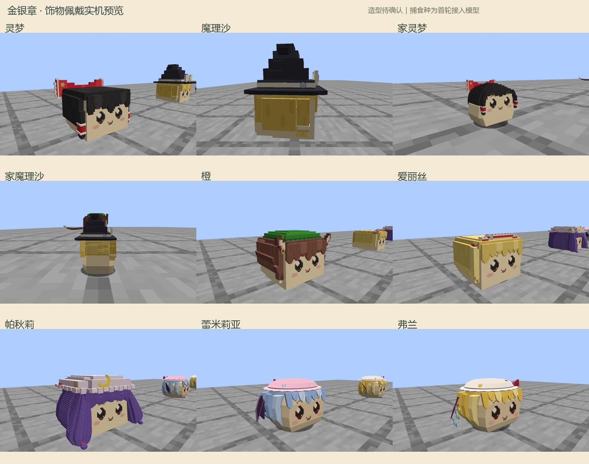

# 金银章专项验收

2026-09-13。本次完成金银章训练、店员考核、资格档案、身份绑定的摘章与补发，以及基于性格和关系的等级反应。漫画和小说依据见[核读记录](../../../wiki/badges.md)，使用方式见[玩法说明](../../BADGES.md)。造型保持待用户确认。

## 当前预览

打开[多角度实机预览](index.html)可以切换正面、斜侧、侧面、背面，并查看七种离身饰物、伸展帧、幼体和实际档案菜单。下图使用本轮实际客户端截图；九种角色的底模不是本任务重新制作的标准。

九种实体挂点已目视核查。灵梦与家灵梦位于蝴蝶结，魔理沙、家魔理沙、橙及帕秋莉位于帽侧，爱丽丝位于头带，两种捕食种位于帽冠侧面。爱丽丝的旧点位被头发遮挡，已移至可见头带表面；捕食种首轮帽带点位只能露出部分牌面，已改选帽冠外表面并重新截图。

灵梦、魔理沙、爱丽丝和两种捕食种均保留伸展动作的真实帧与状态。幼体缩放为 0.4，徽章跟随整体缩放；饰物离身后身体不再画牌。七种饰物物品均已从牌面所在侧核对；新增两种使用捕食种任务最新完整客户端的补采图，本任务已逐张打开确认。只有正面不显示帽侧徽章属于真实遮挡关系，不能据此把徽章改贴在脸部。

**范围限制：** 两种捕食种模型仍由捕食种任务继续迭代；其离身帽饰和客户端物品渲染注册晚于首次冻结。两种新帽饰现已由该任务最新完整客户端补验通过，圆牌完整显示；[补验图片指纹与帧状态](predator-detached-supplement.json)单独登记，正式来源为[捕食种验收目录](../predators/)，未冒用首次冻结构建的指纹。多人专服操作与用户标准造型确认未执行；本页不代表整个共享工作副本全部功能验收通过。

## 检查

冻结初版完整构建成功，金银章 47 项断言全部通过且游戏测试进程正常结束；[初版断言](checks-initial.json)。其后独立构建再次验证了相同 47 项，并核对实际 source set 编译输出与 classpath。最新结果见[断言报告](checks.json)和[测试文件指纹](test-runtime-manifest.json)。

覆盖训练时长、冷却与读档中断、实际银章和金章考试及寻路、真实食盆吞咽／如厕转移／睡醒记录、晋级失败保留银章、重复报名收费、同店员单场考试、错误主人、空白章与他人章、旧编号失效、饰物丢失补发、旧饰物返回、旧存档来源、店内评级来源、装箱保存、性格羡慕与嫉妒、关系冷却和隐藏徽章不宣告等级。

运行方法见[玩法说明末尾](../../BADGES.md)。`badge_checks.init.gradle` 把各 source set 实际 class 目录放入任务目录，并配合独立 Gradle 项目缓存。检查脚本拒绝过时的本模块 class；启动后必须产生非空报告、全部断言通过且进程返回 0。路径冻结同时处理 Windows 参数文件中的反斜线转义，不通过忽略退出码掩盖其他失败。

一轮复测曾被自动注册的野外事件测试混入，虽然徽章 47 条均为真，进程仍按失败记录；事件任务已修正其自动注册，本任务没有删除其失败断言。首次成功与后续复测的证据分别保留，不把未通过的一轮改写为通过。

## 文件关系与证据

- `art/props/badges/mounts.json` 为挂点制作源，`scripts/export_badges.py` 根据实际饰物三角面生成运行 `yukkuri/badge_mounts.json`。
- 圆牌像素源由 `art/structures/human-world/author_products.py` 维护；手册封面由本模块导出脚本维护。标准角色组件、骨架、动画和既有用户确认指纹未改写。
- [首次预览构建指纹](preview-base-manifest.json)、[最终预览构建与视觉修正指纹](preview-final-manifest.json)、[截图所用挂点](preview-badge-mounts.json)、[实际帧与实体状态](capture-states.json)。最终视觉修正只更新徽章挂点和独立预览镜头；新捕食帽饰初次数据探针未列为通过截图，后续正式实机补验另见 `predator-detached-supplement.json`。
- `images/` 保存精选的 61 张原尺寸截图；完整临时帧和启动日志保留在 `.local/badges/preview/`。本次创建的两个最终客户端均已通过 P0 stop 关闭。

中文说明已人工核对事实与措辞；本会话未提供 `tech-doc-style-chinese` 或 `tech-doc-lint`，未声称运行这两项工具。
