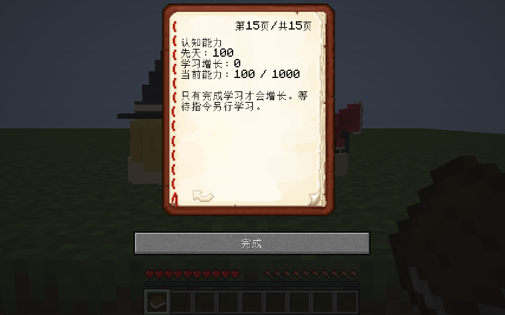

# 认知模块验收

2026-09-13，Minecraft 1.21.1、NeoForge 21.1.250、现有 JDK 21。实现及原生／Mod／MC 规则分界见[专题说明](../../COGNITION_IMPLEMENTATION.md)。本页只证明所列固定副本，不宣称整个持续修改中的共享检出目录或全部领域通过。

## 独立引擎检查

认知专项 **51／51 通过，进程退出 0**。固定产物为 `.local/cognition/gametest/20260912-214016-298219/runtime/`，完整报告为[检查结果](cognition-checks.json)，源码、编译类、语言、发行 Jar 和实际输出路径指纹见[验收清单](manifest.json)。

| 范围 | 已执行检查 |
| --- | --- |
| 独立属性与迁移 | 固定默认 100、形态／ORDER／好奇／饰品不改能力、旧等待技能不补发增长、异常值按 0–1000 限制、真实自然生成事件一次初始化 |
| 同伴课堂提交 | 能力差 50 与 49 边界、真实幼体、无课堂／只对白／教师单独跳起／失败概率／危险拒绝、成功仅增后天 1、永久课堂去重 |
| 概率 | 教学和森林原公式的严格阈值、无效随机样本拒绝 |
| 玩家教学 | 真实 `YukkuriSocial` AI tick 完成后原等待课与能力一起结算，发起不结算，离开距离中断不结算，重复完成回调无收益 |
| 存储与维度 | 完整实体 NBT 回读、真实压缩 NBT 磁盘往返、较旧或虚高镜像不能覆盖世界权威、真实捕入／冷冻／取回／同 UUID 放出、实际 `changeDimension` 去下界再返回后能力及课堂凭据不变 |
| 实际出生 | 原家庭资格和带顶巢穴、两亲受孕及真实出生、只使用亲代先天值、未知父方 LIVE 出生保留空值、同一出生不重抽、伪父方拒绝 |
| 观察 | 原 14 页保留，第 15 页使用独立认知观察字段；观察不增加能力 |

课堂事务的拒绝矩阵使用受控事件字段夹具，不将这些字段写入等同于真实动作。实际教师示范和幼体模仿跳跃来自事件任务的引擎验收：其 `runtime-9` 共 89 项通过，教师 500、幼体 400，实际双跳后能力 401，同课堂再次提交为 `DUPLICATE`；森林辨识成功后继续由原生活逻辑扣物和吞咽。家庭任务另在其固定副本中验证了真实出生认知接线。相关报告路径、哈希及选定断言见[接线证据](integration-checks.json)。

首轮认知夹具未为父母巢穴加顶，实际家庭资格正确拒绝受孕；随后只补齐夹具居住条件，未放宽生产规则。第二轮 48 项通过后，针对跨维度和自然生成入口补充真实引擎检查，得到本页 51 项结果。

## 构建与边界

执行命令：

```powershell
./gradlew.bat --offline build createP0GameTestLaunchScript createP0PreviewLaunchScript --project-cache-dir .local/cognition/gradle-cache --no-configuration-cache -I scripts/cognition_checks.init.gradle
python scripts/run_cognition_checks.py gametest
```

`main`、`p0Test`、`test` 的实际类和资源输出都位于 `.local/cognition/build/`，运行 classpath 没有引用根 `build/`。随后立即复制类与资源，运行器记录逐文件 SHA-256。发行 Jar 含认知生产类，不含 P0 夹具。测试使用真实 `mcyukkuri_p0:empty` 模板，独立与默认 suite 各显式注册一次。

## 图鉴实际排版

复用事件任务的 `runtime-14` 固定客户端，真实客户端交互打开观察书并切到第 15 页。`Font.split` 按实际 114 宽度测得各页高度为 `[81,54,9,81,81,81,90,90,90,90,45,99,72,72,63]`：认知页 **63**，全书最高 **99**，都小于 128 的限制。截图显示真实默认个体的先天 100、学习增长 0、当前 100／1000；已目视确认无截字。



认知全部生产类（含记录与枚举）、NotebookItem 和 YukkuriSocial 的编译指纹与本页 51 项规则快照一致；三语认知文本与当前资源一致。见[客户端核心指纹](client-core-checks.json)、[字体检查](client-font-check.json)和[实际采集状态](client-capture.json)。这张图验证认知页及观察书排版，不代表其他事件场景完成视觉验收，也不以默认值截图证明教学增长。

未执行多人专服、长期能力分布平衡、断电坏档恢复或英日客户端排版。没有新增模型或改动标准造型，未额外启动本任务客户端，也未停止事件任务继续使用的客户端；本任务启动的独立 GameTest 进程均已正常退出。

原始参考文件只读，其指纹见[来源清单](source-reference-hashes.json)。中文事实和文风人工审校，没有声称运行不可用的中文文档技能。
