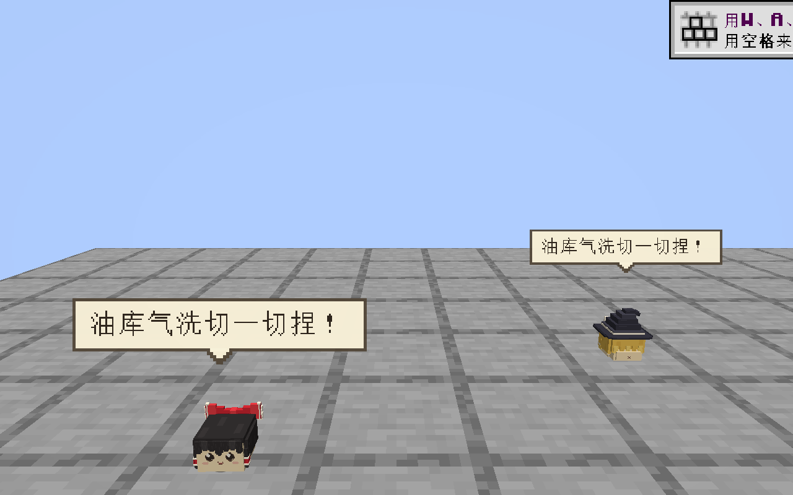
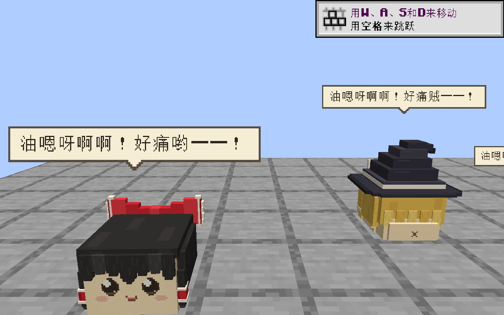

# 本轮对白证据

本目录对应 2026-09-12 的原版台词与 AquesTalk1 接入。代码和输出指纹、打包检查、回归失败项见 [report.json](report.json)，解释见[验收说明](../../../DIALOGUE_IMPLEMENTATION.md)。

[成体时序](adult-timeline.json)、[幼体时序](young-timeline.json)、[打断时序](interrupt-timeline.json)来自实际 Minecraft 客户端。成体欢迎语尚未播放结束时，受伤事件将四个实体的台词序号各增加 1；同时播放实例保持每实体一个。幼体与打断记录末尾均已清空文字和声音实例。

