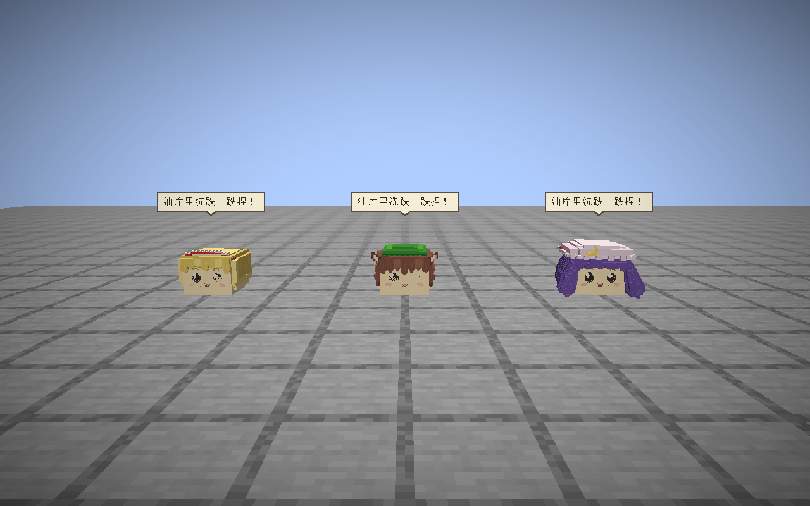
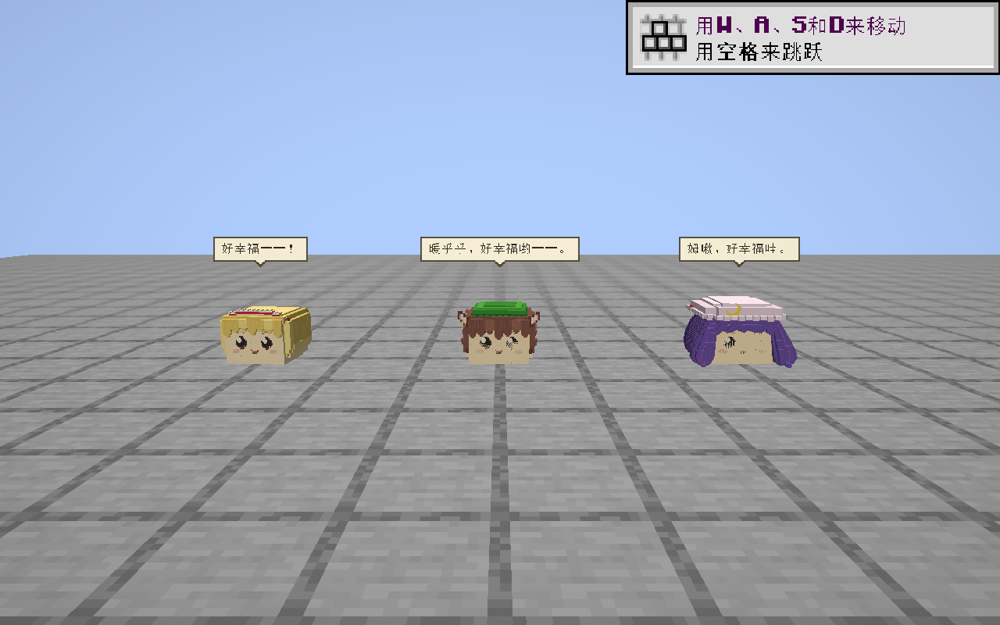
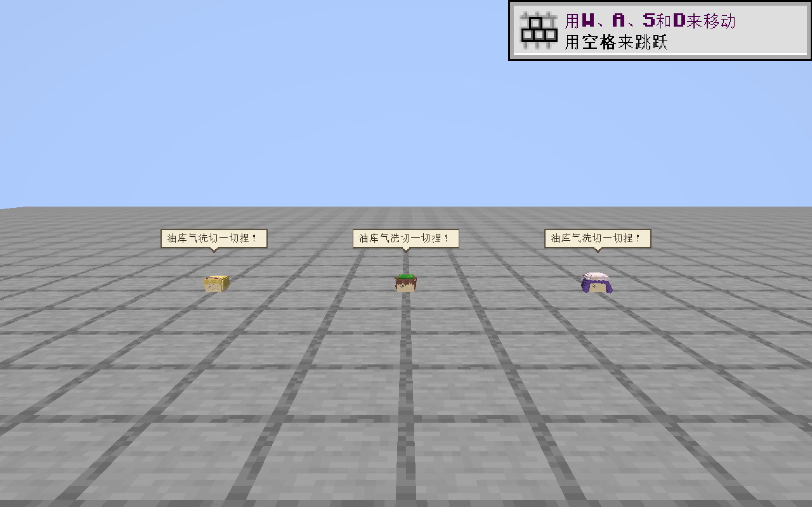

# 三种角色对白实机验收

2026-09-13。验收对象为 [对白扩展](../../../DIALOGUE_SPECIES_IMPLEMENTATION.md)的 288 条配音与既有气泡／播放系统。声音参数与原创口吻仍待用户听审。

## 结果

| 检查 | 结果与证据 |
| --- | --- |
| 音频源与导出 | 288 对 WAV／OGG 解码及指纹检查通过，十组各覆盖 56 类事件；[覆盖与检查](../../../../art/dialogue/reports/species-extension/checks.json) |
| 浏览器试听 | 288 条元数据、实际播放、切换互斥、搜索、84 条原创标签通过；[browser.json](browser.json) |
| GameTest | 2／2 通过；新增六组事件选句及来源、打断、到期清除见 [game-test.json](game-test.json) |
| 客户端 | 成体／幼体各采集问候、受伤打断、进食三段，共六段；[report.json](report.json) |
| 画面审查 | 三种角色均显示中文气泡，未见文字截断或同屏气泡相互覆盖；幼体仍可读。部分截图包含游戏自身教程提示，未遮挡气泡 |
| 人工听审 | 未完成，不能以技术检查代替用户对声线、节奏和口吻的确认 |

每段首帧均有三个角色对应的活动声音实例。受伤段的同步序号由 1 增为 2，替换刚开始的问候；全过程实例数不超过 3。受伤与进食段末帧均为零活动实例、空对白键。爱丽丝进食显示 `native` 来源键，橙与帕秋莉显示 `original`；成体和幼语分别核对。

采集通过夹具直接请求 `hello`、`wounded`、`fed`，验证游戏实际同步、渲染及声音管理器；没有把这项采集写成自然受伤或自主进食的 AI 验收。本轮也未重做专服多人、距离裁剪及墙后遮挡回归，首轮相关记录适用于其各自固定版本。

## 实机画面

从左到右为爱丽丝、橙、帕秋莉。图片均来自本轮实际客户端，无示意图替代。

成体原版问候：

成体进食反应；橙与帕秋莉这两句为项目原创：

幼语原版问候：

其余：[成体受伤](adult-interrupt.png)、[幼语受伤](young-interrupt.png)、[幼语进食](young-fed.png)。对应 JSON 保存每十 tick 一次的对白键、年龄、序号、起止时间与声音状态；完整帧序列位于本任务 `.local/dialogue-species/preview/dialogue-control/`。

## 固定产物与复核范围

生产产物来自徽章任务 2026-09-12 20:46:29 UTC 的构建快照，复制到本任务 `.local/dialogue-species/runtime/`。原始指纹见 [base-runtime-manifest.json](base-runtime-manifest.json)。复制时逐文件核对，288 个 OGG 与本轮运行资源一致；启动参数和依赖也复制到独立目录，没有在别人活动中的构建输出上启动客户端。

仅两份本任务夹具在此后使用 JDK 21 `javac -proc:none`、固定运行 classpath 重新编译：

- [DialogueGameTests 指纹](fixture-revision.json)：补齐空模板的区块强加载、悬空与存活／实际 tick 断言。首次到期断言失败的日志保留在 `.local/dialogue-species/gametest/first-run.log`，复跑通过日志为同目录 `run.log`。
- [DialogueSpeciesPreview 指纹](preview-fixture-revision.json)：清理独立复制世界中场景范围内的旧展示实体，避免截图混入前次展示；只在显式启用的临时预览中执行。

GameTest 使用 `mcyukkuri.p0.suite=dialogue`，客户端另启用 `mcyukkuri.dialogueSpeciesPreview=true`；实际 Java 参数保存在各自 `command.json`，控制目录、世界、日志均位于 `.local/dialogue-species/`。本轮两次客户端已通过各自的停止指令退出。上述结果仅证明记录的固定生产产物与夹具，不代表其他任务后续改动或整个共享工作副本已通过。
