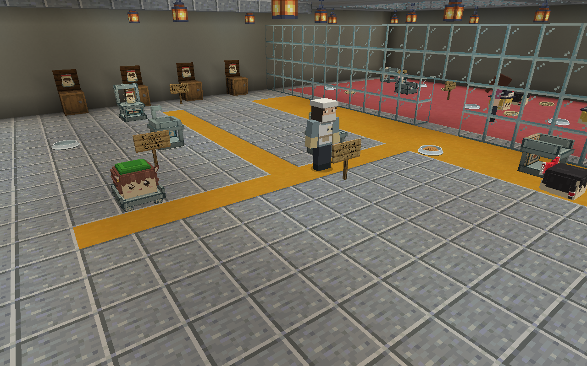
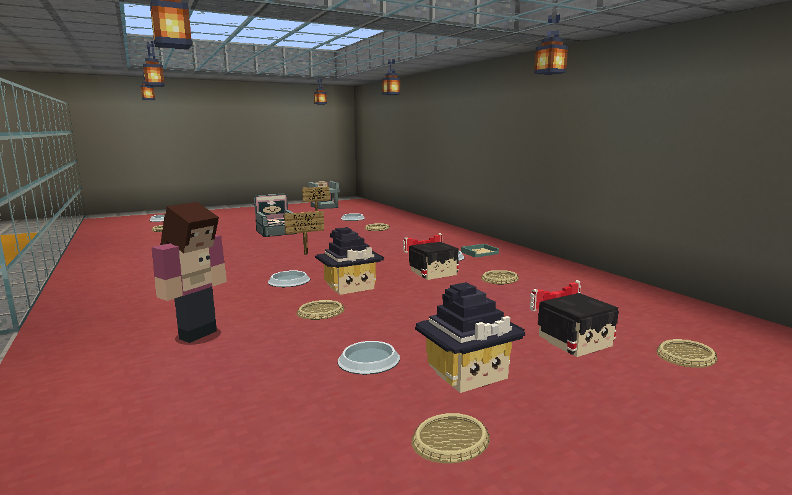
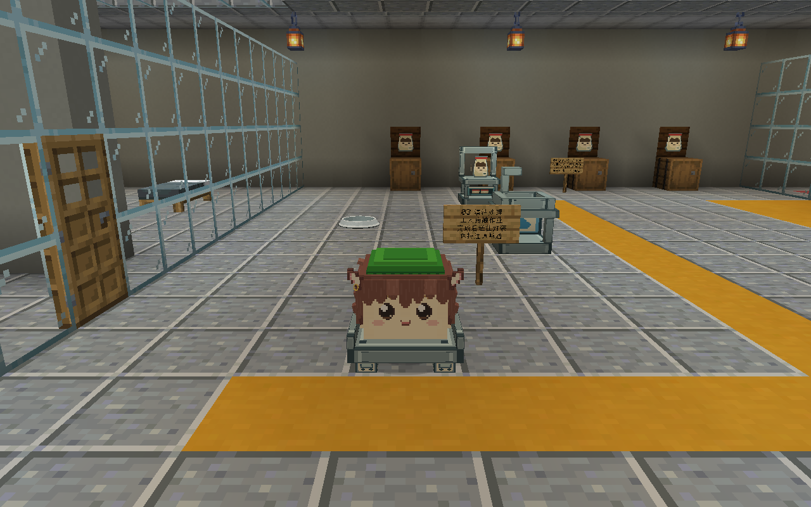
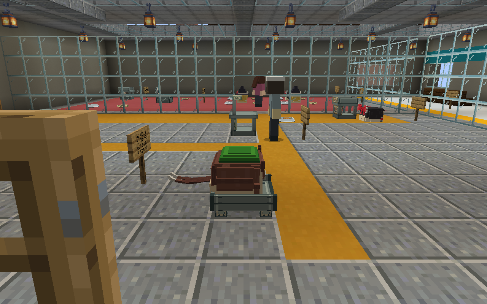
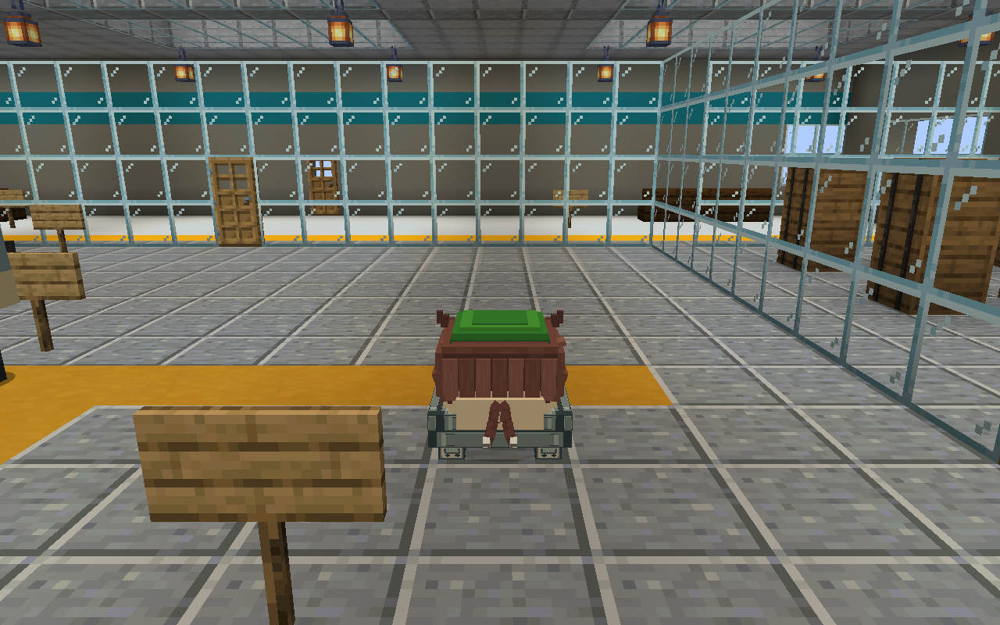
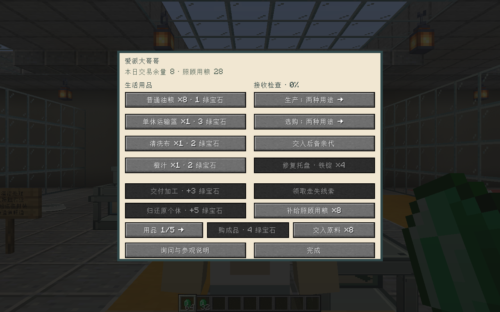

# 工厂子油流水线

2026-09-13。用户要求将[作品核读后的建议](../../../wiki/factory-production-review.md)落实到游戏。本次继续使用现有茎生与单体运输令牌，扩展馒头厂、活体袋装厂的生产过程。设备为项目原创，当前造型待用户确认。

## 玩家可见流程

两组亲代在各自巢位繁殖 → 茎上发育、落地 → 接收检查 → 托盘送往育成栏 → 年龄和营养达标 → 出货分选 → 清洁 → 封装／馅料处理 → 有限库存销售。

- 每厂一辆持久化周转托盘，一次承载一只真实个体；不通过传送或生成替代品完成搬运。托盘会寻路绕过设备，到达相应朝向的停靠位后，工人近距离、有视线地完成操作。
- 接收、分选、清洁和封装各需累计 100 个接触作业刻，每次最多推进 20 刻，同一世界刻重复调用无效。运输、育成、观察所需时间另计；这不是每五秒必出一袋的固定产量。
- 接收检查生命、感染、霉菌与伤口；未达标送观察位。分选另要求营养至少 45，封装至少 35。观察区允许护理员喂食与治疗，健康和营养恢复后重新分选，不能靠等待计时直接判合格。
- 茎生仍遵守每胎 1–5 只、落地进入子体的既有规则。育成要求有效年龄至少 `max(200, lifespan/24)`，营养成长至少 `max(150, lifespan/32)`，且已经落地、营养至少 45、生命至少 80%。没有用快育药改写既有生命周期。
- 同胎沿用出生记录的 UUID 作为批次，分配车间批号；外部输入另行登记。两种活体用途可切换为“油虐用”“饲料用”或按批次交替。已经分选的同胎批次保留用途。
- 活体袋保持单只、唯一令牌，标明批号、种类、大小、生命、营养、馅料份量、精力、足部灼伤记录和幼语状态。拆袋仍释放同一个体，保留家庭、身体和教育数据；成功拆袋后旧令牌失效。
- 菜单可选择生产用途和选购用途，购买只取匹配的实际库存。售价维持纸／馒头／活体袋各 1／2／4 绿宝石；单体袋每份消耗一张纸，馒头每份消耗一份小麦及实际馅料。

## 亲代与停工条件

初始四只亲代分为 A、B 两组，各两只。一次成功受胎后，两只亲代的服务次数均加一、额外休养 1200 刻，并轮到另一组；家庭系统自身的恢复期仍生效。任一亲代达到六次服务或进入老年，完成当前胎次后退役。另一只原配在该组不能成对工作时一同退出，避免与后备个体无条件重配。

工厂接收玩家运输篮中的成年普通种作为后备亲代。补位检查成年、未绝育、非老年、健康、无近亲关系及既有配偶关系；托盘先把配对后的真实个体送至空工位，再认领实际巢位。退役亲代进入饲料用输入，释放原巢位。出生所有权由 `HumanCommerce.inheritFactoryChild` 继承，避免末胎出生与退役交错时成为无主个体。

育成／输入、后备及未出生预留共同参与容量判断，工厂繁殖准入上限为八只（工作亲代另计）。已登记个体卸载不自动释放名额。车间周围区块未完全参与实体更新时暂停生产与受胎；原料耗尽、16 格成品库存满、必要工序设备缺失也暂停。运输受阻时不跳过工序，并禁止新受胎；道路恢复后托盘可重新尝试。休息或交易中的工人不推进工序。

托盘 UUID 写入工人存档；已卸载托盘不会生成副本。托盘被毁后，玩家须手持四个铁锭修复，随后生成替代托盘。设备、停靠朝向和通路必须实际存在。旧存档中的老布局不会自动改建，需要补上新设备和通路。

## 制作源与接入

| 内容 | 制作与运行路径 |
| --- | --- |
| 工厂布局、实体和工位 | `art/structures/human-world/build.py` → `src/main/resources/data/mcyukkuri/structure/yukkuri_{manju,bag}_factory.nbt` |
| 五类新设备 | `art/structures/human-world/author_pipeline.py`；原创贴图在同目录 `products/factory_*.png`，记录在 `products/pipeline-manifest.json` |
| 原生方块几何与贴图 | `src/main/resources/assets/mcyukkuri/models/block/factory_*.json`、`textures/block/factory_*.png`；模型由六面方块元素组成，无外部漫画素材 |
| 托盘实体 | `human/FactoryTray.java` + `client/FactoryTrayRenderer.java`；复用 `factory_transfer_tray` 方块模型，载物面高 4/16 格，实体碰撞宽 0.95、高 0.25 格 |
| 状态与亲代轮换 | `human/FactoryPipeline.java`、`FactoryBreeding.java`、`FactoryProduction.java`；个体保存工序／工作量，工人保存批次、用途、托盘与有限库存 |
| 界面 | `HumanMenu`／`HumanScreen`；流水线使用数据槽 39–50 中的相应字段。商店分页由捕食种任务另行扩展到 54 槽，本次保留其按钮与字段 |
| 导出 | `scripts/export_human_world.py`；语言由 `pipeline_language.py` 合并，源与目标指纹由 `exports.json` 管理 |

## 运行与视觉验证

当前共享源码构建成功；工厂专项 63 条全部通过，包括出生时立即继承工厂归属。商店旧断言有五项与新增库存数量及排序不符，已交捕食种任务修正。全量 `runP0GameTest` 在消耗品与生活检查出现失败，随后因缺少 `ecologygametests.empty` 模板中断，已交对应负责人；本轮不据此宣称全回归通过。

后续生态任务已修复玩具接触、教学距离及生态测试模板前缀。本任务核读其独立生活报告，确认 83/83 通过；生态负责人另报告 30+4 项专项通过。原始全回归失败记录保留为当时证据，本任务未因此重跑全量回归，也不将这些专项结果等同于全项目通过。

专项报告、运行依赖与文件指纹见 [checks.json](checks.json)。完整临时输出在项目 `.local/factory-pipeline/`。本轮主工作副本同时有捕食种、亚种、徽章、胎生与收容任务，冻结依赖的专项通过不能代表整个共享工作副本通过。

游戏测试分两部分：最终工序夹具核对真实库存、原料扣除、销售、重载和令牌唯一性；独立 AI 流程则先经 `FamilyData.conceive/birth` 创建孩子，设置成熟年龄和营养以缩短育成等待，再由真实托盘寻路、工人作业完成所有工序。测试没有用逐工序传送来替代该 AI 路径，也没有验证从零开始等待一个完整自然寿命周期。

视觉采集使用隐藏的隔离客户端，1280 × 800；菜单图使用 GUI 比例 2。已自查车间布局、育成区及托盘前／侧／后视角：载物面与身体接触、护栏和车轮可见，橙的尾部自然伸出托盘边缘。没有启动用户存档；已停止本轮客户端。护理与后备转运的长期产量、多人联机和自然地形生成未在本轮重测。

## 实现边界

当前是落地接收与单体周转，不包括整茎采收、皮带网络、多体包装、厂店间运输或复杂处理等级。饲料用是已实现的商品规格；捕食种任务当前使用实体化猎物，不直接消费袋中令牌，拆袋后才进入其取食范围。没有用食品加工漫画的全部处理步骤套用活体袋装。

中文事实、路径和措辞由人工核对；本会话未提供 `tech-doc-style-chinese`、`tech-doc-lint`，未宣称运行这两项工具。标准造型仍由用户确认，技术检查不代替确认。
