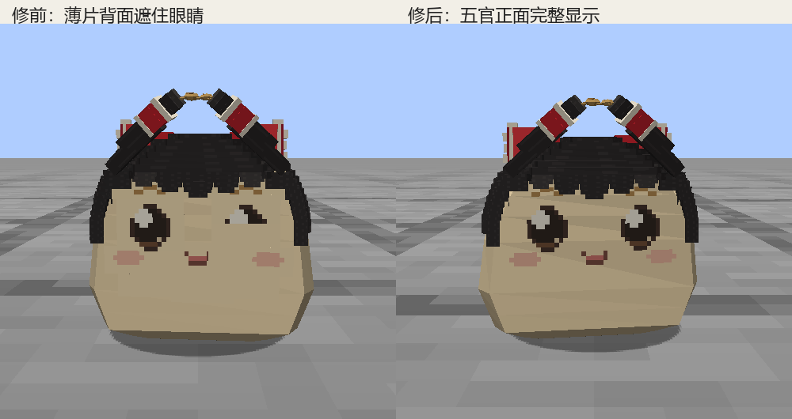

# 家油行走五官与携物验收

2026-09-13。两种家油普通行走、慢走和携物行走的五官遮挡已修复。源模型的静态形状和表情贴图保持原样，造型确认状态不变。

- 五官挂接按薄片实际高度采样身体分段；普通走动仍使用原有 waddle 时钟。
- 短辫把物品举到额前上方，避开眼睛；辫子只旋转，长度、地面接触与夹取/放下时序不变。
- 实机另发现无背面剔除材质会绘制五官薄片的背面，遮盖相邻眼睛。YukkuriModel 仅对两种家油的五官过滤原始法线 nz >= -0.15 的背/侧面；伤口替换网格采用同一规则。

## 本轮证据

[实机汇总](index.html) · [768帧采集与144样本](visual.json) · [模组与模型指纹](release.json) · [资源检查](assets.json) · [交互检查](interaction-checks.json)

两种家油 × neutral/happy/cry × 普通/慢速/携物 × 正面/35°斜侧，共36组、768实际采集帧；144个按步态相位选出的原始画面已逐组核看。速度分别为每tick 0.02、0.004格，服务器轨迹确认实体实际移动，并由普通AI更新选择waddle，没有用指令动作冒充慢走。持物画面包含真实food_scrap。

资源、源快照及附件指纹28条检查通过。两种家油的夹取前中断、单份拆取、携物保存恢复、巢口入库及总量守恒各10条，共20条实际引擎检查通过。

旧网页背面剔除规则漏检了实机遮眼，旧检查不能证明游戏通过。修正后的NoCull检查在11表情、25相位与两视角共6600样本通过；保留旧背面绘制的72个复现样本中有16个失败、3360遮挡像素，见[修前复现](legacy-face-backs.json)与[新规则](verification.json)。

## 固定产物与执行范围

主验证副本为 `.local/personality-deibu/preview-tdzmjt8l`。固定模组见 [mcyukkuri-0.1.0-dev.jar](../../../../.local/house-carry/release/mcyukkuri-0.1.0-dev.jar)，SHA256 `d49be96b237d1dddbcc6ac3b7d0eb0b4e71595cb3a1be2fa9f9b3249006cbf48`。其1474份运行资源与252份生产类均逐字节匹配副本；四只豆油/捕食种模型指纹保持前次交付值。

隔离构建及全部source set输出检查通过，采用Java 21。命令见 release.json。生产代码只补家油五官背面过滤；此前生育规则、人格、灵胖和生长修改保留。本轮没有重跑全套41项GameTest、多人或长期游戏。

扩展检查时，旧全种族waddle-assets夹具先受此前携物标记影响，清理后又对捕食种静态waddle作了错误断言。本轮给夹具增加家油限定并显式重置携物标记，相关限定复验单独记录。旧全九种伤口演示在2GB堆下触发内存不足，不能视为全种族伤口通过；已保留失败日志，后续仅核对本次两家油的替换表面。

家油限定补验已完成：两种模型的步态、携物夹点与返回待机检查通过，见 [client-motion-checks.json](client-motion-checks.json)。伤口替换表面补采正面39帧、背面35帧，核看8个正面相位及两张背面原图，五官与局部伤口均保持可见，见 [伤口表情图](wound-front.png)与 [wound-capture.json](wound-capture.json)。补验副本 `.local/personality-deibu/preview-gpez6nle` 的全部生产类与资源逐字节匹配同一固定Jar，只有开发夹具增加家油范围参数。两轮采集与失败复现进程均已结束。

完整临时逐帧序列与控制响应留在各隔离运行目录；正式报告保存144个精选原始画面、来源指纹和修前证据。生产Jar不包含开发夹具。中文说明人工核对，未运行缺失的文风工具。
