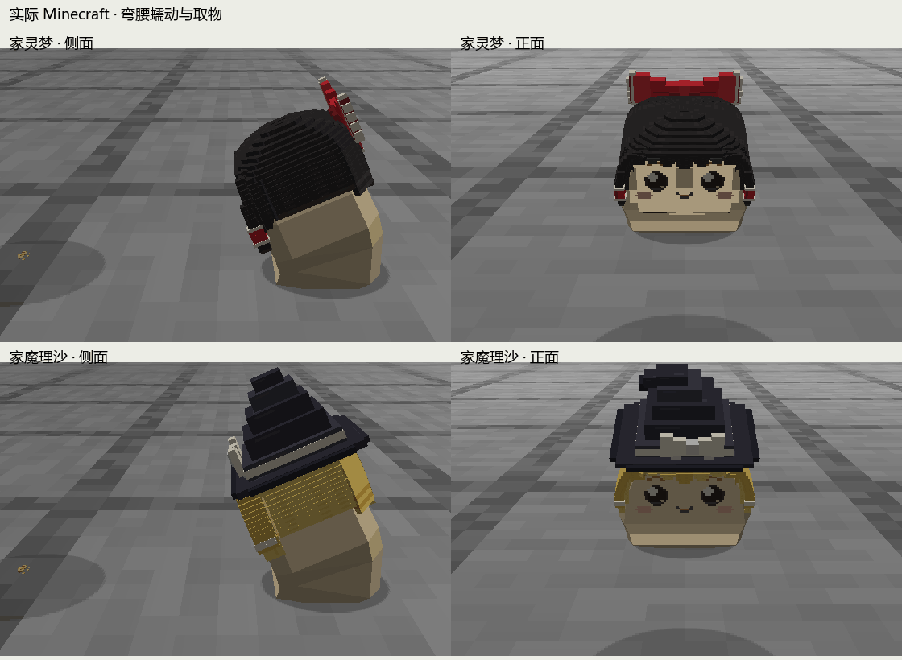
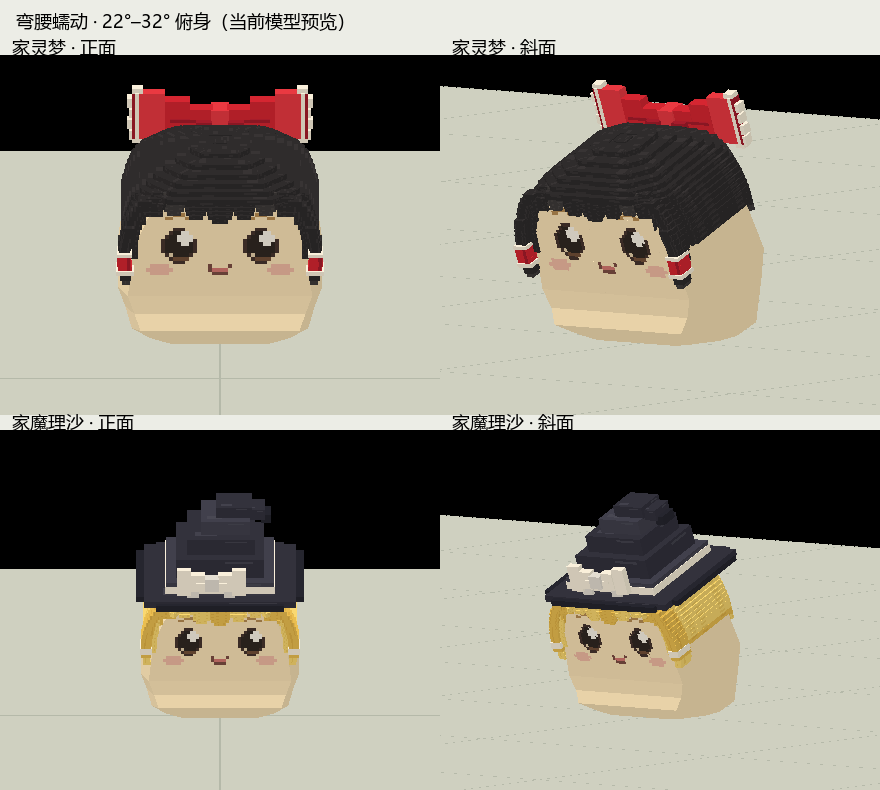
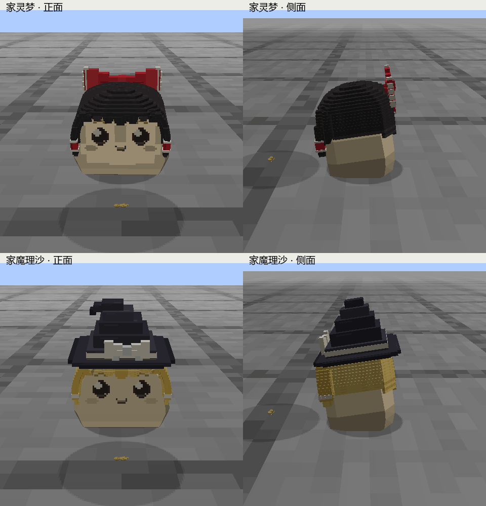

# 家油短辫交互与蠕动检查

## 当前弯腰与速度修订（2026-09-13）

腰部持续俯下 22°–32°，腹底仍只小幅伸缩；服务器行程与皮肤伸展分开，每 0.6 秒前进 0.12 格，平均速度为旧小幅版的 9.6 倍。源配方、两种家油的适配骨架、运行 JSON 和当前预览均已同步。标准静态造型、原 19 个动作和另外三段交互曲线保持不变。

当前指纹与检查见 [`crawl-bowed-report.json`](crawl-bowed-report.json)。原地采集正面、侧面、斜面共 144 帧；192 次 neutral 嘴部像素对照完整可见。蠕动连续采样最低 Y 约 -0.00000005 模型单位，属于舍入范围。独立视觉审查认为侧面弯腰可读，未见遮嘴或挂件脱离；腹底前缘仍略方，造型自然程度待用户判断。

实际 Minecraft 录制两种家油各正面／侧面，共 717 帧，包含蠕动、夹取、搬运和放下。四组轨迹有 21–30 个连续蠕动 tick，平面单步位移与新曲线误差低于 0.000000000000005 格。当前为连续拖行，不再将旧版接触边固定检查作为通过条件。最新 [实机动图](../../../../art/source/standard-runtime/previews/current/house-crawl-game.gif) 保留侧面视角。

资源校验通过。开始录制时，工作区因其他代码缺少 `FamilyLife` 方法而构建失败；实机录制采用上轮可运行的隔离快照，仅替换本轮单独编译的 `HouseCrawlMotion` 及两份当前模型，模型与当前运行 JSON 逐字节一致。随后相关文件发生更新，完整 `build compileP0TestJava` 已通过，并使用该次构建产物重新执行家油专项检查。早期失败日志与最新构建日志分别保存在项目内 `.local/bowed-crawl/build.log`、`build-current.log`；客户端录制范围和专项结果分别登记在本轮 JSON。

最新完整构建产物的 `house_motion` 专项 24 项全部通过，包括收集、入巢／探出、实际位移、墙体碰撞和 NoAI／死亡中断。尚未检查幼体、不平地面及专服画面；标准造型仍待用户确认。录制和检查的临时进程已关闭。

## 上一版小幅挪动记录（2026-09-13）

以下保留旧参数和旧指纹；通用预览链接已更新到本页顶部的弯腰版本。

用户否定上一版的拉伸幅度。当前大幅收回头身前移和下压，腹底伸展降为约 12%，步幅降为 0.20 模型单位，周期缩为 12 tick。既有标准静态形状与原动作保持不变。

当前指纹、轨迹、接触、脸部可见性及专项测试见 [`crawl-compact-report.json`](crawl-compact-report.json)。[侧面对照](../../../../art/source/standard-runtime/previews/current/house-crawl-compact-comparison.png) 使用相同相机和各版最大动作阶段；[最新实机动图](../../../../art/source/standard-runtime/previews/current/house-crawl-game.gif) 已更新。美术比例仍由用户判断，测试不证明这种运动符合用户心中的身体质感。

本轮实际客户端录制两种家油各正面／侧面，共 1145 帧；轨迹包含小幅挪动、夹取、搬运和放下。四组连续蠕动记录各 231–233 tick，休止段平面位移为 0，收拢段符合新步幅；沿前进方向的接触边滑移低于 0.000000006 格。原地查看正面、侧面和斜面，并用 192 次嘴部像素对照复核遮挡；本轮模型接地最低值约为 -0.00000005 模型单位，属于数字舍入范围。

源配方、接入快照、运行模型及预览均已同步，运行模型与本轮录制副本逐字节一致；静态顶点、绑定、原 19 个动作和另外三段交互曲线不变。构建与资源校验通过。较短步幅需要更长的巢口期限和收集观察时间，专项夹具相应延长，并在随后的繁殖检查前清理长时间积累的巢穴污垢。全量测试未在本轮重跑，上轮失败情况保留在下方。

本轮 `house_motion` 专项 24 项检查全部通过，涵盖巢材收集、入巢与探出、位移、墙体碰撞、NoAI／死亡中断；结果保存在本轮 JSON。录制和检查进程已关闭。

## 上一版大幅拉伸的位移检查

下方为已被用户否定的旧幅度与旧指纹。它记录位移同步的验证过程，不作为当前造型合格的依据；引用的通用预览路径现已更新到顶部的小幅版本。

当前来源和检查结果见 [`crawl-locomotion-report.json`](crawl-locomotion-report.json)。两种家油已经在 Minecraft 中向真实碎食前进，四组正面／侧面共录制 807 帧，行为经过蠕动接近、夹取、搬运和放下。

| 检查 | 当前结果 |
| --- | --- |
| 位移节奏 | 四组轨迹各有 136 个连续蠕动 tick；前伸与休止段平面位移为 0，收拢位移符合 24 tick、0.04 格／周期的曲线 |
| 接触边 | 将实际服务器位置与本轮导出的皮肤矩阵组合，每种模型检查 48 次后缘撑地、56 次前缘撑地；沿前进方向的最大滑移低于 0.000000006 格，仅证明平直地面的目标接触点 |
| 遮脸与地面 | 原地预览的正面、左右斜面共 192 次嘴部像素对照保持完整；新蠕动连续采样最低 Y 为 0。实机正面复核眼睛、嘴和腮红 |
| 编译与资源 | `build compileP0TestJava` 成功；七种模型以及生活、家庭、家油资源检查通过 |
| 家油专项引擎检查 | `house_motion` 套件 24 项全部通过，包括六份真实巢材收集、入巢、探出、根位移、两格高墙碰撞、NoAI 与死亡时立即取消旧蠕动 |

使用独立同步的蠕动时钟，休止不重启姿态；远处正常走动，近处才使用慢蠕动。新曲线与服务器阶段、行程由资源校验核对。原有 19 个动作和另外三段短辫交互曲线保持不变。

本轮全量 `runP0GameTest` 在其他巢穴测试 `ShelterGameTests.householdResources` 中因放置结果为空而中断。随后 `core` 单独检查暴露了慢速收集需要更长时间的问题，已增加该测试的观测预算；其中旧伤口检查也与当前伤口实现不符。本轮不修改无关伤口或巢穴放置功能，家油移动验收另行记录。

实际录制使用本轮编译的冻结运行目录，最终两种家油模型与录制目录逐字节一致。专项测试使用随后编译的检查夹具；结果已纳入上方 JSON。浏览器、录制客户端和专项测试进程均已结束；未提交或推送。

尚未验证幼体、不平地面、多人与专服画面。运动继续经过原版方块碰撞与重力；贴地速度控制会抑制无伤害的水平推挤，不能据此声称全部外力已适配。独立代码审查发现并修正了入巢期限过短、NoAI／死亡后旧蠕动多走一帧的问题。

## 前一轮蠕动参考及遮脸修订

以下 `crawl-report.json` 保留旧周期和原地动作检查的指纹，不作为上方新版位移的证明。

按小说所述的受伤拖行姿态修订既有蠕动：压低上部、前伸与下腹伸展错开、收拢后暂停，循环由 1.2 秒改为 1.6 秒。来源及转译边界见 [交互适配](../../../../art/source/standard-runtime/HOUSE_INTERACTIONS.md)。

上一轮审查漏掉了前伸时嘴和腮红被身体遮住的问题。用户指出后，通过临时移除身体表面的对照确认原因：下腹形变延伸到脸部高度，但五官采用上部刚性变换，两者错位。已把混合区域限制在脸下方，0.85 模型单位以上的支撑表面与五官同步。

本轮模型指纹、与遮脸版本的逐项比较、连续接地采样见 [`crawl-report.json`](crawl-report.json)。两种模型各采集正面、侧面和斜面 32 帧，共 192 帧，并检查关键阶段。另在正面、左右斜面每种模型各采样 32 帧，把完整模型的嘴部着色像素与单独嘴部渲染比较：192 次采样全部显示完整嘴部着色像素；该检查只证明当前 neutral 表情与指定视角，不代表所有表情和任意视角。眼睛与腮红在当前正面及斜面图中复核。

新版已同步运行资源；本轮未启动 Minecraft，尚未验收导航速度下的拖行效果、动作切换及不平地面。

## 前一轮取物交互记录

以下报告及实机图保留各自登记的旧模型指纹。此次仅修订 `house_crawl`；下列实机事务和夹取画面不能证明新版蠕动的游戏表现。

检查日期：2026-09-13。适用模型指纹、接地采样、游戏状态转换及事务断言见 [`report.json`](report.json)。制作与参考说明见 [交互适配](../../../../art/source/standard-runtime/HOUSE_INTERACTIONS.md)。

| 检查 | 本轮证据与结论 |
| --- | --- |
| 来源与数据 | 七种运行模型校验通过；原 19 段动作保持完整，两种家油各增加 4 段行为动作。选定模型、贴图、静态顶点、绑定及原动作未因这四段行为而改形 |
| 连续接地 | 每种家油、每段新增行为采样 131 次，共 1048 次；最低点约 -0.000456 模型单位，位于身体接地混合处。头发、辫子与脸未穿地；这不等同于全部表面互穿检查 |
| 短辫 | 新动作只驱动主辫根旋转，不缩放或增加辫长；物品挂点取实际变换后两辫梢的中点 |
| 真实物品事务 | 两种家油各 10 项断言通过：选取来源、接触前保留、接触前中断、恢复、只拆一份、中断与携带存读档、返回窝、延迟入库、只入库一次、总量守恒 |
| 自动行为与实机画面 | 真实集成服务器目标运行，实际客户端录制两种家油各正面／侧面，共 434 帧；状态序列包含夹取、搬运、放下及携带数量变化。最后场景三份碎食全部进入窝中 |
| 构建 | 最终 `gradlew build compileP0TestJava` 成功；没有普通 JUnit 测试源。资源检查单独运行并通过 |
| 独立代码审查 | 修正放下时未复核距离、满仓后重复尝试、中断后物品跳回嘴边三处问题。距离中断与满仓竞争分支经代码审查，未另做自动场景断言 |

实机录制使用项目内的隔离存档和本轮编译的目标类。为避开同一工作区其他任务修改中的依赖，录制环境冻结了此前已构建的运行依赖；最后一轮录制未带入并行开发中的奖章显示块。随后当前工作区全量构建已成功。没有用这份录制证明其他任务的功能。

本轮没有录制幼体、不平地形、全部原指令动作下的持物、多人同步或专服表现。蠕动完成浏览器连续与多角度查看，并接入觅食、靠近物品和进出缝隙的移动状态；本轮精选实机动图集中展示取物与搬运。原版材料的地面悬浮表现保留，碎食专用掉落物改为低处同尺寸显示。食盆取食与短辫喂食不在本轮新增流程中。

素材仍为待用户判断的动作版本。代码审查、数据检查和实机录制不代替用户确认。预览进程完成后已关闭；未提交或推送。

