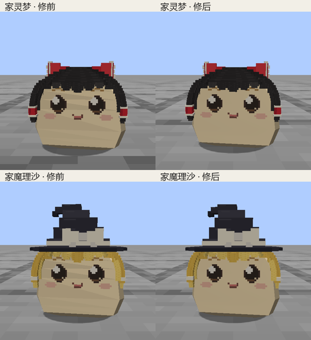

# 家油脸部浮动明暗修正

2026-09-13。用户指出上一版行走时脸上仍有褶皱浮动。此前遮眼检查只证明眼口完整，未覆盖身体光照。本轮复现为家油前壁各三角面在变形后独立计算平面法线，导致横条与对角明暗随步态浮动。

当前仅修改 `YukkuriModel` 的 `house_body_surface` 光照法线。静态位置相同（量化至1e-5模型单位）、原始法线相同（量化至1e-3）的顶点归组；每帧用蒙皮后、未归一化的三角面叉积作面积加权，再归一化组法线，逐顶点交给Minecraft光照。不同原始法线的硬边分组保留，头发、饰物、五官与其他角色不使用此改动。

顶点位置、UV、表情贴图、骨架、权重、所有动作JSON和碰撞尺寸均未变。伤口渲染原有共点平滑法线与凹陷明暗保留。上一轮五官背面过滤及额前携物修复仍在。

## 当前证据

[实机修前后动图](index.html) · [321帧与56样本](visual.json) · [两家油客户端检查](client-checks.json) · [固定产物对比](release.json)

两种家油各7组，共14组、321实际帧：普通和携物行走的正面/35°斜侧、开心和哭泣表情正面、实际慢走正面。56个代表相位已逐组核看，浮动的横条和三角面明暗消失；眼口完整，碎食仍夹在辫梢之间。服务器轨迹验证每tick 0.02/0.004格真实移动，使用普通AI更新选择waddle。相位对比按两轮录制的实际步态相位就近配对，没有重绘画面。

客户端有限顶点、步态变化、携物夹点和返回待机检查通过。源码和源资源侧的独立对照见[素材侧法线检查](../../../../art/source/standard-runtime/face-motion/reports/current/surface-lighting.json)，具体范围以该报告为准。



## 固定产物与边界

[本轮模组](../../../../.local/house-surface/release/mcyukkuri-0.1.0-dev.jar)，SHA256 `30102b8cc134988fa3d74bfe64a007f8e3e5e9a642c76688014ce3e2abe03304`。

隔离客户端 `.local/personality-deibu/preview-jdmy7u9t` 的全部生产类与运行资源逐字节匹配此Jar。与上一轮 `d49be96b…` 逐条对比，仅 `YukkuriModel` 及其内部类发生变化（包含新增法线缓存类与内部类元数据）；其余所有Jar条目完全一致。因此两家油主模型与全部贴图仍是上一轮原指纹。

构建使用Java 21，命令：

```text
gradlew.bat -I scripts/personality_deibu_checks.init.gradle --project-cache-dir .local/personality-deibu/gradle-cache --no-configuration-cache build createP0PreviewLaunchScript verifyPersonalityOutputs
python scripts/capture_house_surface.py
python scripts/archive_house_surface.py
```

构建和source set隔离检查通过。完整临时序列与控制数据保留在上述隔离目录，正式报告保存56张精选原帧、接触表、实际对照和文件指纹。只运行家油专项；未重跑全套41项GameTest、多人或全种族伤口压力场景。上一轮记录的2GB全种族伤口演示内存问题不属于本次修正。没有改动或重新确认标准造型。中文说明人工核对，未运行缺失的文风工具。
