# 人类世界扩展验收

2026-09-13。本轮对应莫西干头、三类独立工厂、育成车间、金银章宠物与商店用品扩展。玩法与限制见 [HUMAN_WORLD.md](../../HUMAN_WORLD.md)，制作与导出见[建筑包](../../../art/structures/human-world/README.md)。造型为待用户确认版本。

## 执行结果

| 检查 | 当前结果与范围 |
| --- | --- |
| 构建 | JDK 21.0.12.1、NeoForge 21.1.250，`gradlew.bat build --console=plain` 成功 |
| 导出 | `python scripts/export_human_world.py --check` 通过，83 个制作源与导出文件指纹一致；同时核对本模块中英文语言条目 |
| 人类交互 GameTest | [37 项断言](human-world-checks.json)通过，覆盖旋转模板归属、普通／银章／金章库存、交易、令牌、交货与委托 |
| 工厂扩展 GameTest | [43 项断言](human-expansion-checks.json)通过，覆盖三种模板、有限原料／成品、真实馅料、活体袋、同一 UUID 拆包、育成准入与自主寻路 |
| 完整项目回归 | 18 个用例中 11 个通过、7 个失败；人类与工厂两组仍通过，其他失败见[回归明细](regression-summary.json) |
| 自然生成 | [四种建筑检查](human-natural-checks.json)通过；使用隔离测试维度的原版噪声地形与实际结构放置规则，在新坐标寻找结构，没有用 `/place` 代替自然生成 |
| 实机视觉 | 当前客户端截图覆盖四种自然建筑、莫西干头正侧背、商店与三类生产内饰、育成间、徽章及交易界面；没有缺失材质或发脊脱离头部的问题 |
| 中文文档 | 人工核对来源、实现边界与相对链接；未找到可用的中文文档 lint 技能，未声称运行该工具 |

接手收尾后，使用 `python scripts/run_human_checks.py` 在 `.local/human-world/gametest-clean/` 重新运行两组 GameTest，日志确认 `All 2 required tests passed`。该入口冻结编译产物，每次创建新世界，保留报告后清理临时目录。测试源位于 `src/p0Test/`，不打入发行 Jar。源、导出、断言和截图的 SHA-256 见 [manifest.json](manifest.json)。

原任务中断时，本页所引用的报告、截图和清单尚未归档。本次补齐 15 张实际客户端截图、四种自然建筑报告及重新执行的 80 项断言，并重新通过构建、人类资源导出一致性和实体／生活／家庭／家油资源检查。截图沿用原任务扩展版本的实际采集，本次逐张查看，没有重新生成图片，也没有改动建筑和人类造型；原任务临时客户端已正常保存世界并退出。

育成检查调用实际 `FamilyData.conceive()` 与 `birth()`，验证亲子身份和原料／名额准入，再推进测试个体年龄、营养成长以缩短等待；随后启用正常 AI，验证它能通过常开出口走向封装台并以同一 UUID 进入包装。该检查证明衔接与寻路，不等于完整寿命周期的长期平衡验收。

本轮审查修正了单个饥饿劳力阻断整条线、自主繁育绕过工厂限制、活体袋买卖差价、育成门槛及输送台压力板支撑。复跑测试清除了旧巢位居民记录，避免重复放置夹具继承历史个体；自然预览在实体加入时仅冻结 AI，避免在区块尚未加载完成时触发碰撞查询。

接手时重用旧测试世界，亲代繁育断言曾失败；亲代准备状态、配对与工厂名额检查均为正常。旧世界还保留已移除测试实体的亲缘人口记录，仅重置巢位不足以隔离这类状态。改用上述全新世界入口后 80 项断言通过，未放宽运行中的人口上限或繁育规则。

实机截图还发现菜单先于 NPC 同步时，固定用品被显示为空气；当前目录显示已解除对客户端 NPC 到达时序的依赖，服务器仍核对实际交易对象与距离。

接手后已在新的隔离世界补跑完整项目回归，冻结当时的编译产物和资源，18 个用例中 11 个通过、7 个失败。失败用例为 `settlementacceptance`、`livingacceptance`、`entityacceptance`、`householdresources`、`coreacceptance`、`instrumentacceptance`、`settlementreturn`；涉及群落人数与返家、人口限制、远处进食、搬运及剪茎器具等，尚未在本任务中修复或完成归因。完整回归内的人类与工厂两组共 80 项断言仍全部通过。详细失败文本及日志指纹见[回归明细](regression-summary.json)，原日志位于 `.local/human-world/regression-clean/acceptance.log`。此前回归保留在[历史记录](../human-world/README.md)，不能用本轮人类范围通过表述为全项目通过。

多人并发、长期经济平衡、多种世界种子、极端地形与全部人物动作的逐帧验收仍未执行。自然外观截图只覆盖有限视距，建筑周围远处区块及洞穴支撑不据此认定通过。用户造型确认尚未完成。

## 当前实机画面

以下建筑自然生成图来自同一个隔离噪声地形世界；内饰和人物近景来自当前模板与实体渲染的固定预览区。

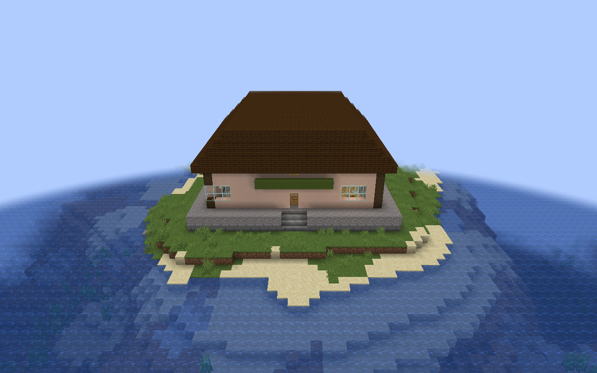

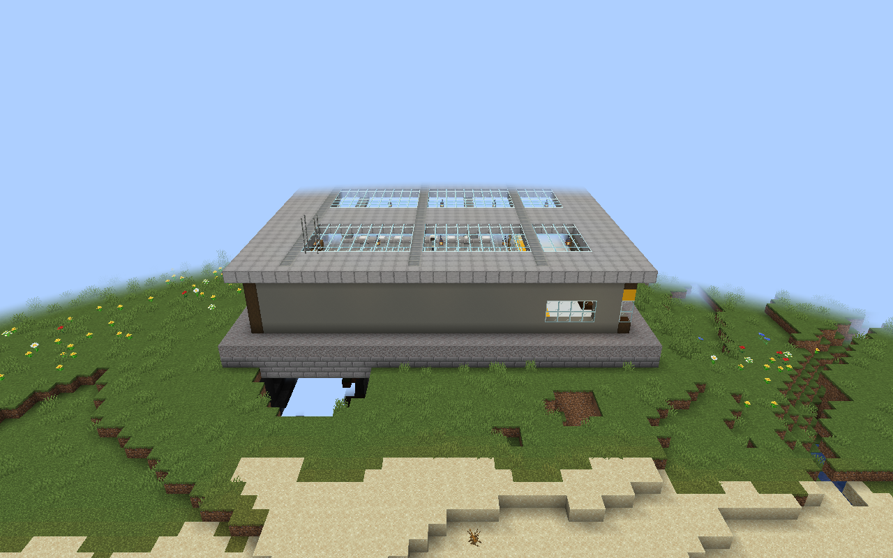

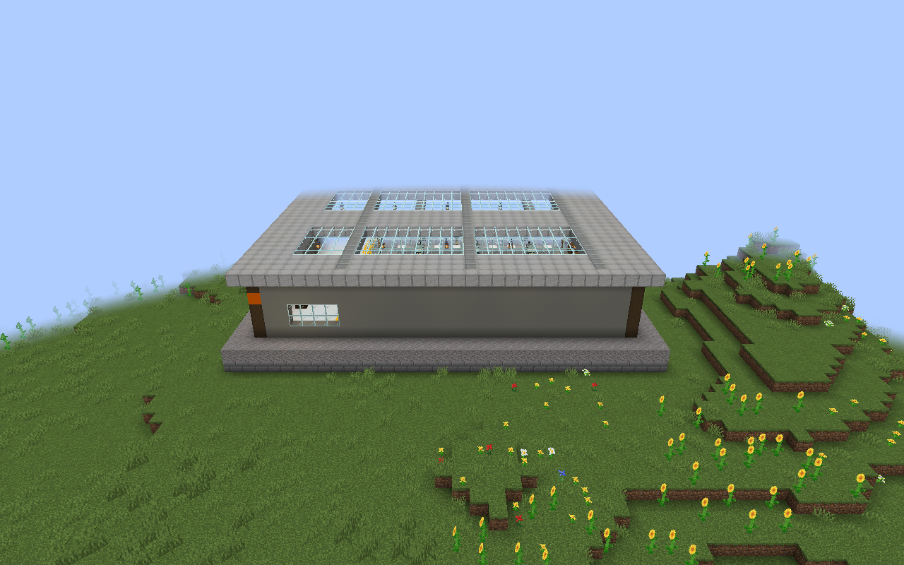

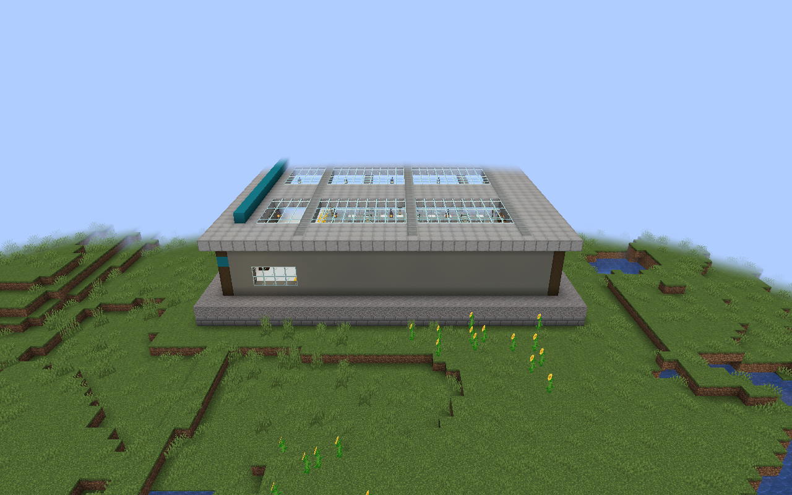

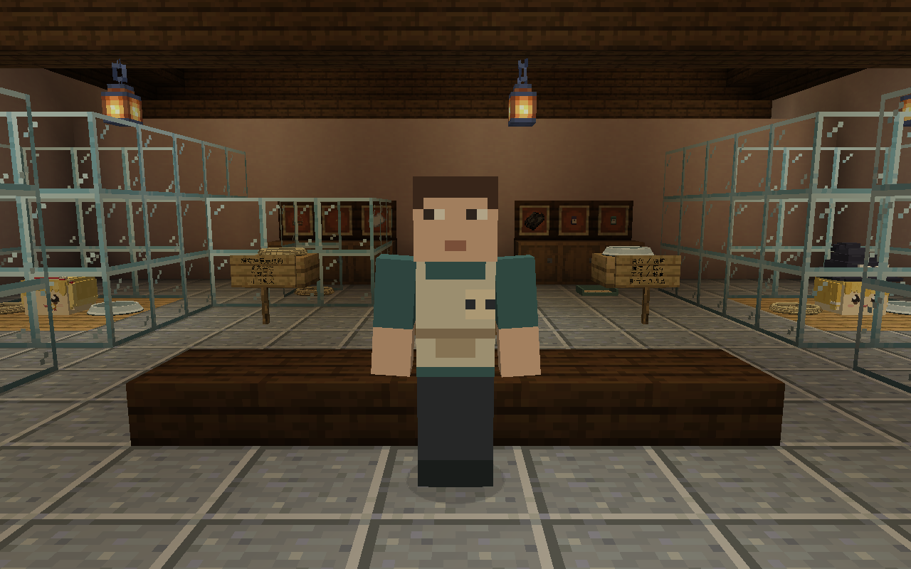

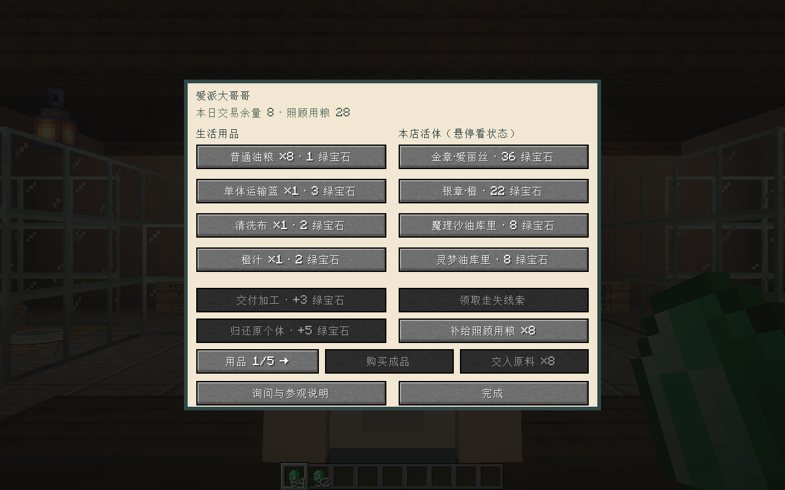

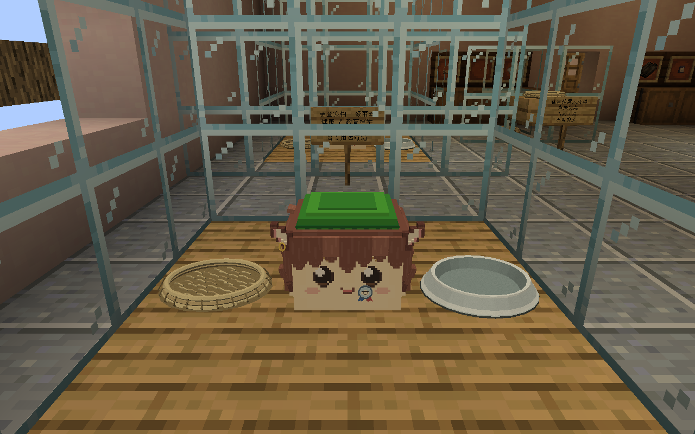

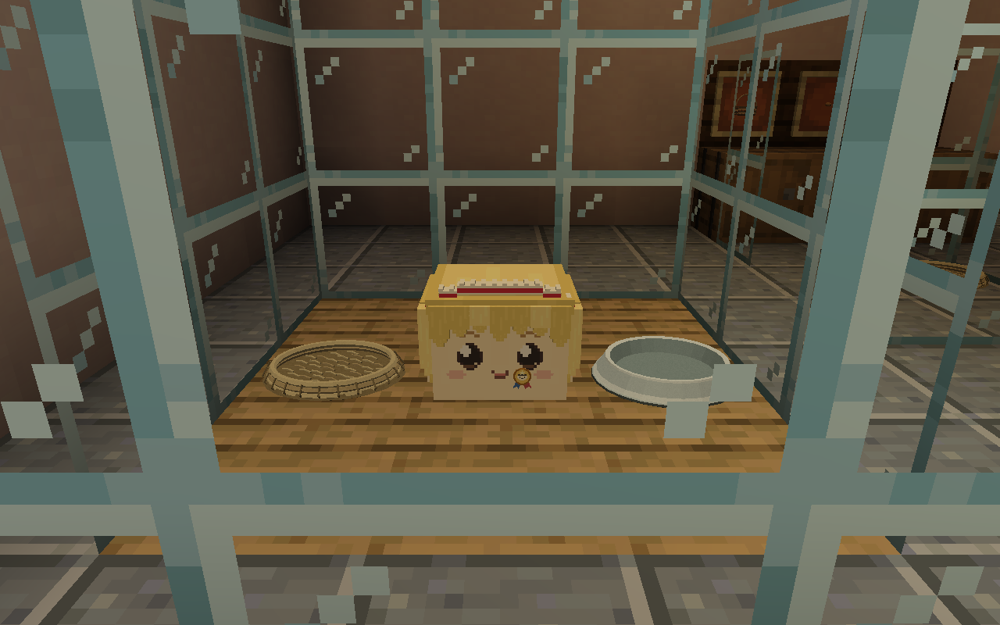

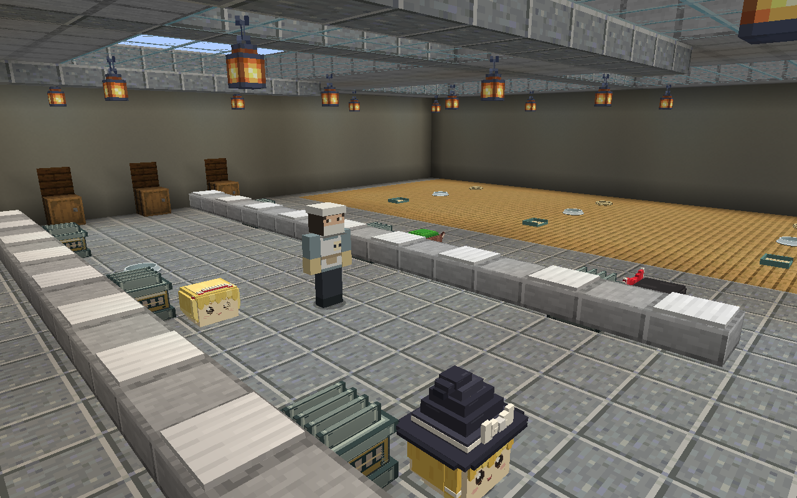

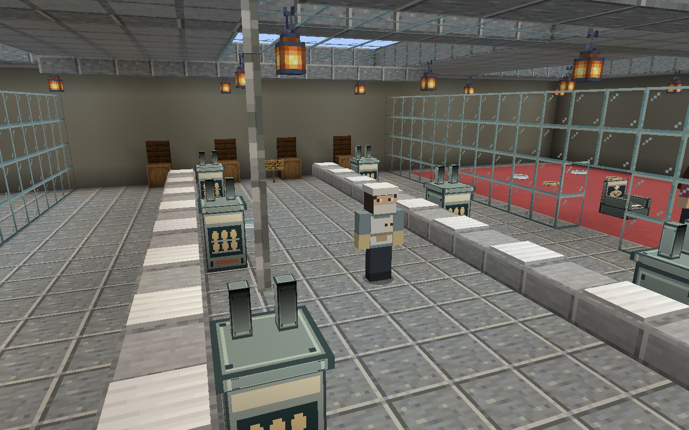

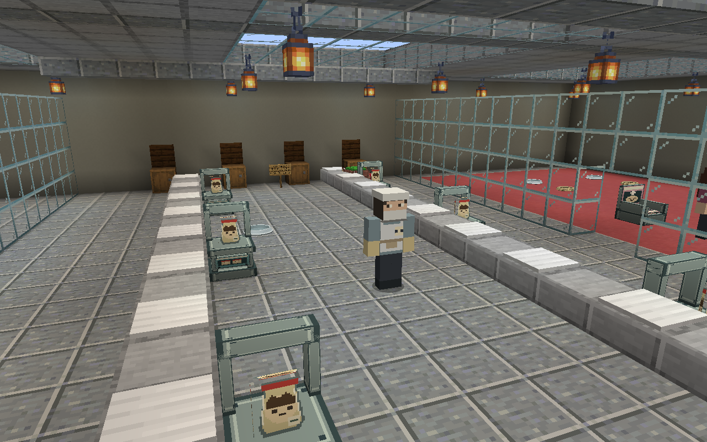

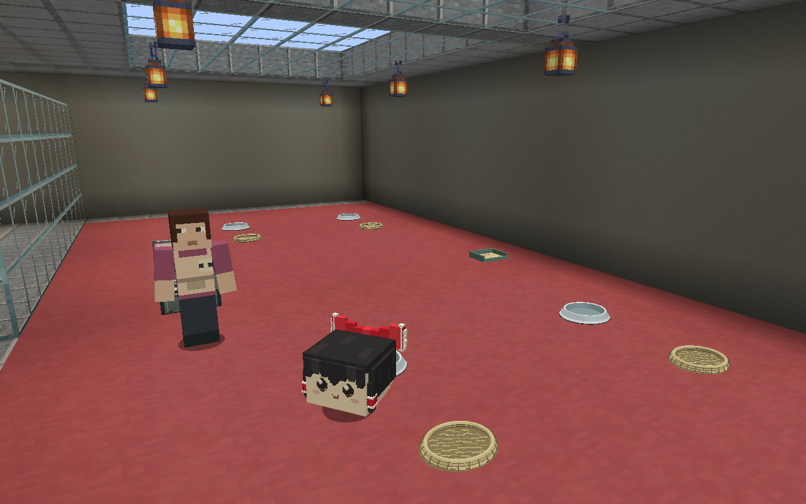

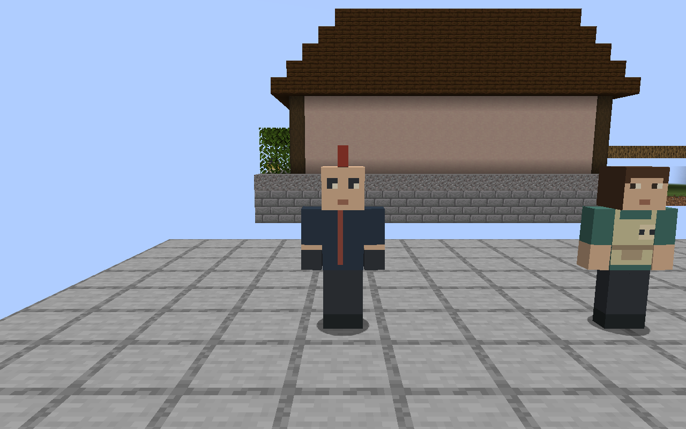

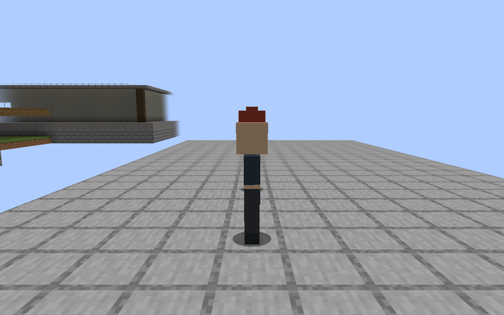

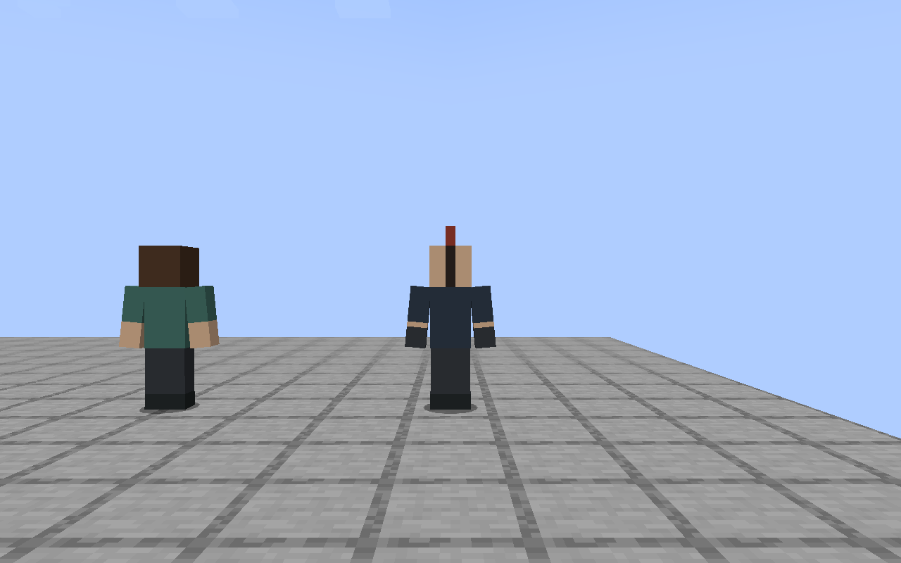
