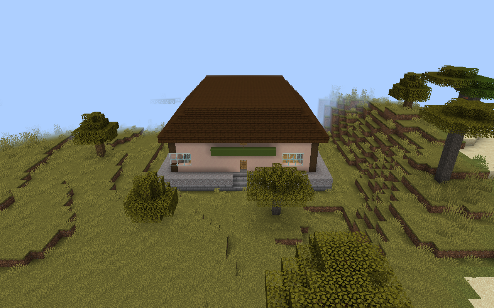
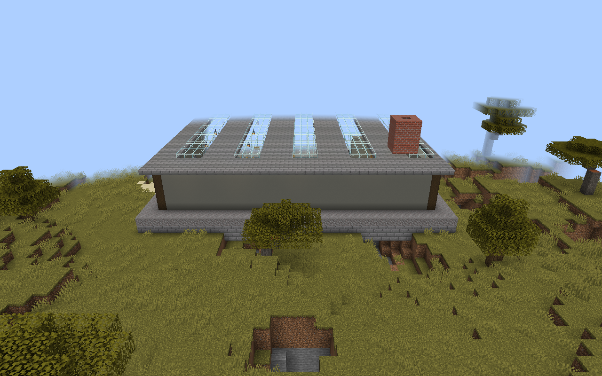
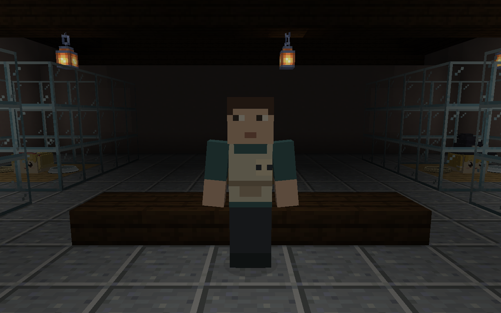
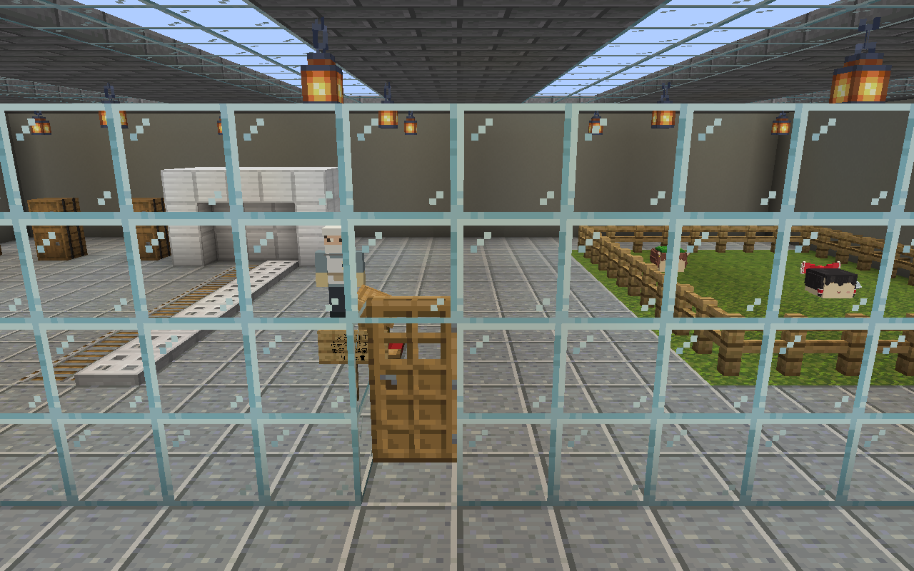
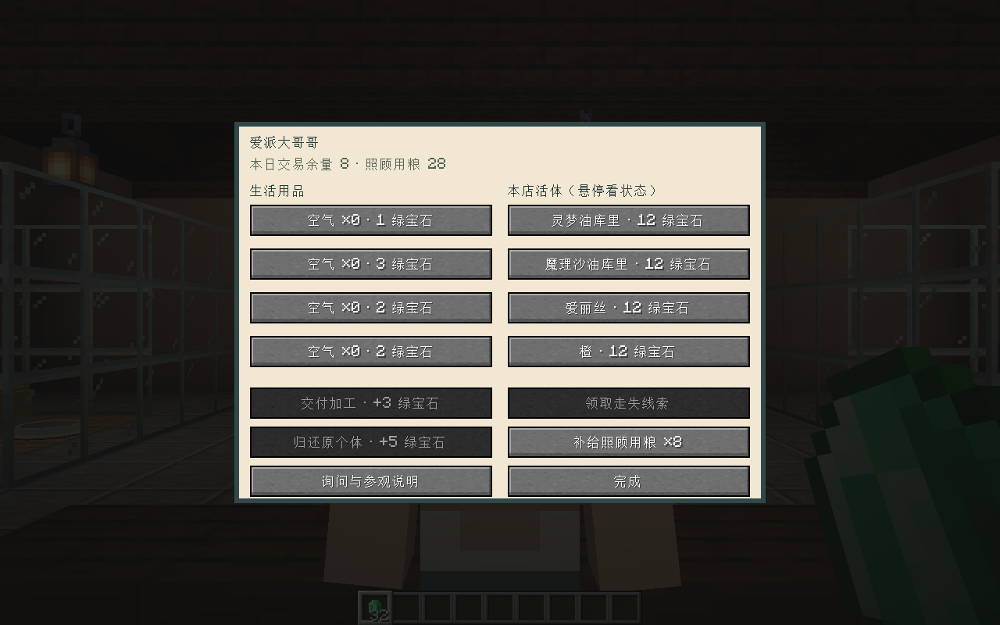
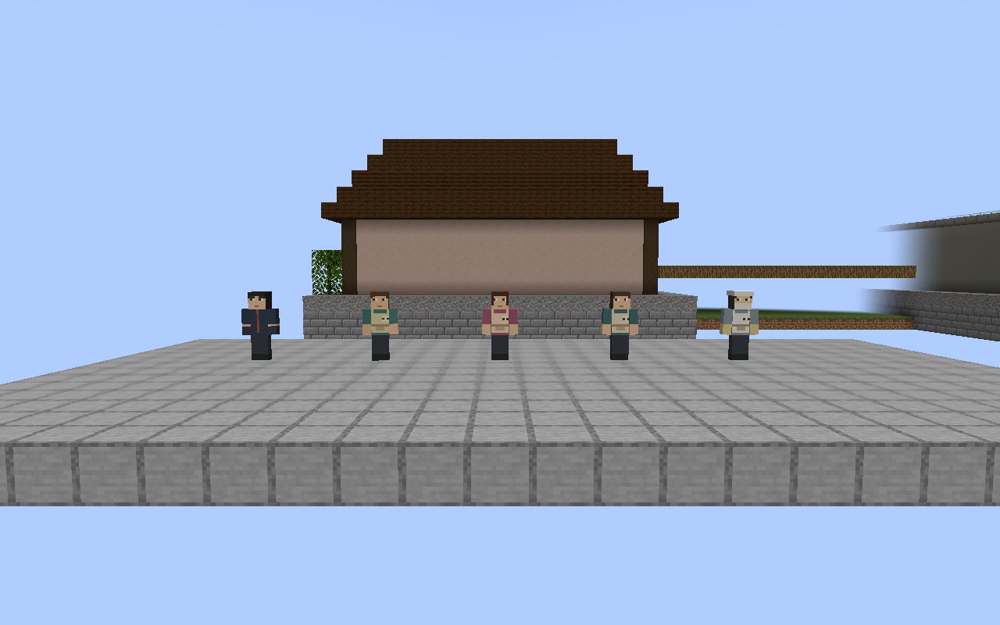
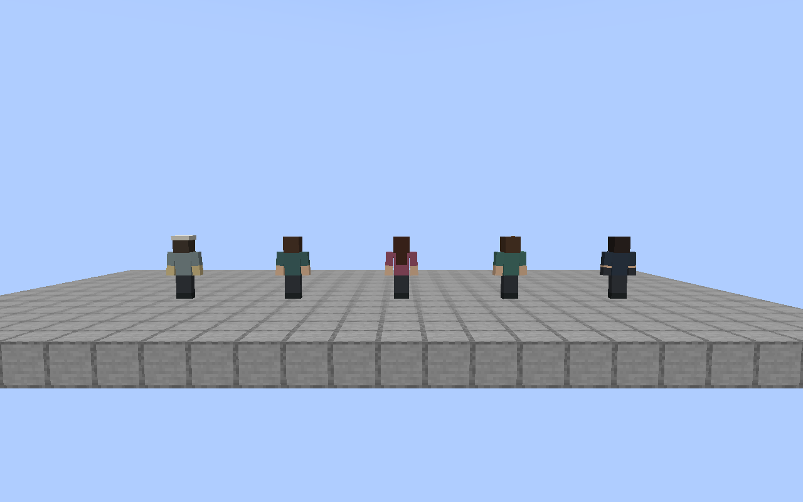
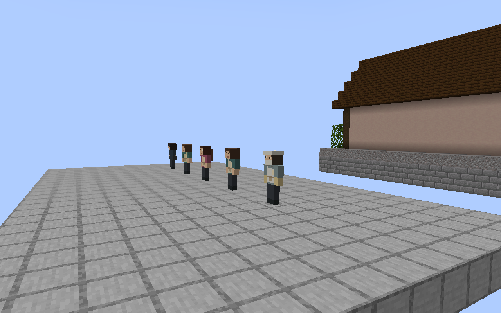

# 人类世界验收

本目录保留首批商店与旧加工所的历史证据。莫西干头、三类独立工厂、金银章和扩展商品的当前证据见[扩展验收](../human-world-expansion/README.md)，本目录的旧指纹不证明扩展版本通过。

本轮环境：Windows、Java 21、Minecraft 1.21.1、当前项目 NeoForge 开发运行环境。检查日期 2026-09-13，实际源与资源指纹见 `manifest.json`。测试存档位于项目 `.local/human-world/preview/`，未操作用户生存存档，也未提交或推送。

| 检查 | 证据与边界 |
| --- | --- |
| 编译与回归 | `build` 通过；最终在本任务独立 GameTest 目录执行 11 个用例，9 个通过、2 个失败，详情见 `regression-summary.json`。人类用例 36 项断言全部通过，见 `human-world-checks.json` |
| 普通地形生成 | `human-natural-checks.json` 记录原版噪声地形中的两类实际结构边界、居民及动物数量；使用定位和区块生成，不调用模板放置冒充自然生成 |
| 保存重载 | `reload-check.json` 比较独立客户端正常保存、退出、重新加载后的十名人类和十只动物；人类身份、职业、库存及动物身份、归属一致。包括五名额外服装展示人物；活动中的鬼威惨位置会继续变化，不要求坐标不动 |
| 静态画面 | 实际客户端采集商店、工厂、内部、交易界面及人类正侧背面；修正入口高差和商店吊灯支撑后刷新截图 |
| 资源一致性 | 七种原有油库里模型检查，以及生活、家庭、家油、人类导出 `--check` 均通过 |

GameTest 检查旋转商店和工厂模板、岗位与态度、四只真实待售库存、运输篮所有权、原个体 UUID／家庭／教育保留、重复报价不扣款不复制、交货令牌退役、实际馅料消耗、走失身份与领奖一次、交易配额保存以及远程／夜间拒绝。

自然生成夹具为 `src/p0Test/resources/data/mcyukkuri_p0/dimension/human_world.json` 的普通主世界噪声维度，逻辑在 `HumanNaturalChecks.java`。隔离预览存档须启用生成结构；从 GameTest 存档复制时默认可能关闭。依次执行 P0 预览命令 `human-natural-start`、等待区块加载、`human-natural-check`，`human-natural-view` 可查看已定位建筑。夹具不打入发行 Jar。

本轮查出并修正：jigsaw 深度 0 未加入起始建筑，改为 1；模板没有连接出口，因此只生成单栋。商店空心屋顶下的吊灯缺少支撑，增加横梁。入口改用连续台阶。浅水选址问题增加了结构地基采样，跳过积水及高差过大位置。

尚未执行本模块多人并发交易、长期生存平衡、多种种子和极端地形覆盖；人物动作沿用原版人形动画，尚未逐帧验收全部动作。静态技术检查不能替代用户确认造型。

最终完整回归的失败为 `coreacceptance`（伤口相关四项断言，首项为首次伤口消耗有限馅料）和 `nativespeech`（对白独立计时到期）。共享工作区同期正在修改伤口功能，本任务保留其改动；没有把早先十项通过的结果替换成当前全绿。一次共享 GameTest 启动也发生启动错误，Gradle 仍返回成功，因此最终以独立运行的测试日志和断言为准。当前人类范围已通过，以上完整回归问题仍待对应模块处理。

## 当前实机画面

人物从左至右为鬼威惨、爱派大哥哥、爱派大姐姐、店员和工厂职员。

