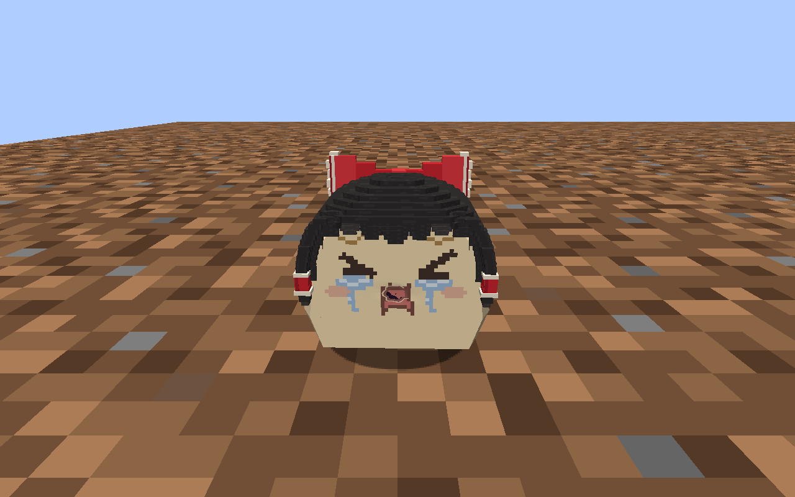
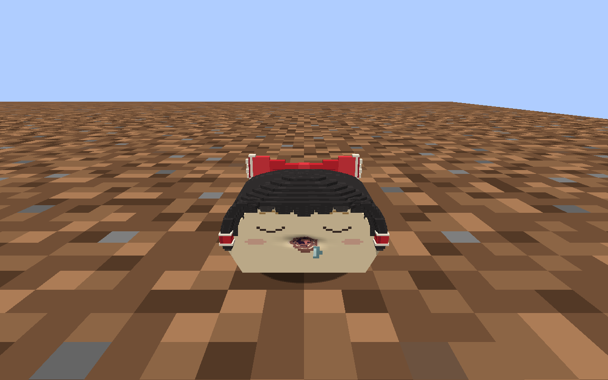
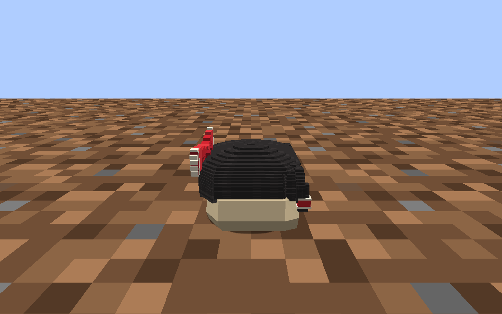

# 受伤与遗体验收

2026-09-13。本次修正轻伤与致命伤记录、遗体实体、主动搬运、铲子安葬和物品显示。玩法见[受伤与遗体](../../../INJURIES_AND_REMAINS.md)。

## 固定产物与范围

固定目录：`.local/injury-remains/runtime-20260913-131423/`。Jar 为该目录 `libs/mcyukkuri-0.1.0-dev.jar`，SHA256：`2a56121ef1173db399dae55aee93f3e3e5fb0782ffbe58724cb4f4d44481b494`。Minecraft 1.21.1、NeoForge 21.1.250、Java 21。

Java 从本轮共享源码隔离编译。美术使用测试地图此前已验证的 `.local/play-readiness/runtime-20260913-115036/resources/main/` 基线，仅覆盖三份语言 JSON 和遗体物品模型 JSON。语言覆盖同时保留此前另一任务已完成的“宠物油”用语修正，具体键见[runtime.json](runtime.json)。其他运行资源逐字节一致，见[资源基线核对](resource-baseline.json)。

这份固定包不包含另一任务仍在返工的稀毛／歪脸魔理沙候选模型，也不代表共享工作目录此后的修改已通过。没有覆盖制作源或候选资源，没有重新生成玩家存档。

## 已执行检查

| 检查 | 结果与证据 |
| --- | --- |
| 构建与隔离 | `build` 成功；主程序、开发夹具、资源与运行 classpath 均位于独立目录；[构建日志](build.log)、[输出检查](isolation.json) |
| 遗体专项 | 139 条通过：九种基础实体半点实际伤害、致命伤、身份／死因／尺度／原伤口保存、主动搬运、放下、错误土壤拒绝、铲子耐久、墓中身份、重复结算、旧掉落转换、溺亡／饿死无外伤及灼伤表情；[报告](remains-checks.json) |
| 伤口专项 | 348 条通过：表面命中、动作与接触变换、保存同步、有限出馅、治疗、旧数据迁移及出口碰撞；[报告](wound-checks.json) |
| 既有核心玩法 | 40 条通过，旧“拿遗留物放坟头”的断言改为实际放下遗体后用铲子安葬；[报告](core-checks.json) |
| 测试进程 | 3 组 GameTest，527 条检查，零失败、报告完整、退出码 0；[汇总](gametest-summary.json) |
| 客户端显示 | 使用同一固定类与资源启动独立集成服务器，检查两种家油及普通灵梦／魔理沙的遗体、侧面接地、真实伤口、痛苦表情、物品栏和手持模型；七张实际帧如下，SHA256 见 [runtime.json](runtime.json) |

测试使用 Minecraft 引擎中的真实 `hurt` 和 `Player.interactOn` 路径；伤害来源由夹具控制，搬运与安葬由 FakePlayer 执行。落地接触部分使用受控物理 tick。客户端截图的伤势由实际伤害调用生成，没有直接往预览实体写入伤口。

本次没有重新跑全部 43 组联合测试，没有进行双客户端专服交互、长期遗体累积或用户手动游玩验收。遗体的静态姿态为运行适配，死因专用美术仍待制作，不能登记为用户已确认标准。

## 当前实机帧

家油受伤：



家油灵梦遗体与侧面接地：





其他遗体和物品显示：

- [家油魔理沙遗体](house-marisa-remains.png)
- [灵梦遗体](reimu-remains.png)
- [魔理沙遗体](marisa-remains.png)
- [遗体物品栏与手持模型](remains-carried.png)

## 执行入口

本轮 Gradle 命令：

```powershell
$env:JAVA_HOME='E:/yukkuri/.devtools/mcyukkuri/java/jdk-21.0.12.1+1'
./gradlew.bat build createP0GameTestLaunchScript createP0PreviewLaunchScript createClientLaunchScript integrationIsolation -I .local/injury-remains/checks.init.gradle -I .local/injury-remains/art-baseline.init.gradle --project-cache-dir .local/injury-remains/gradle-cache --no-configuration-cache
```

冻结和 GameTest 复用 `scripts/run_port_integration.py`，将 `WORK/BUILD` 指向 `.local/injury-remains/`，专项报告指定 `remains-checks`、`wound-checks`、`core-checks`，期望三组测试。运行参数中的 `mcyukkuri.p0.suite=remains` 选择专项。完整进程参数保存在固定目录 `gametest-process.json` 与 `preview-process.json`；临时请求、连续帧和完整客户端日志位于该目录 `runs/`。

客户端已通过本任务专用 P0 控制正常停止。既有其他任务的进程未清理。地图任务已将 `.local/experimental-map/release/runtime.json` 切换到本页固定目录，Jar 指纹一致；存档仍使用 `run/saves/MCyukkuri-Lab/`。下次通过根目录 `启动实验地图.cmd` 启动即加载本次修复。
