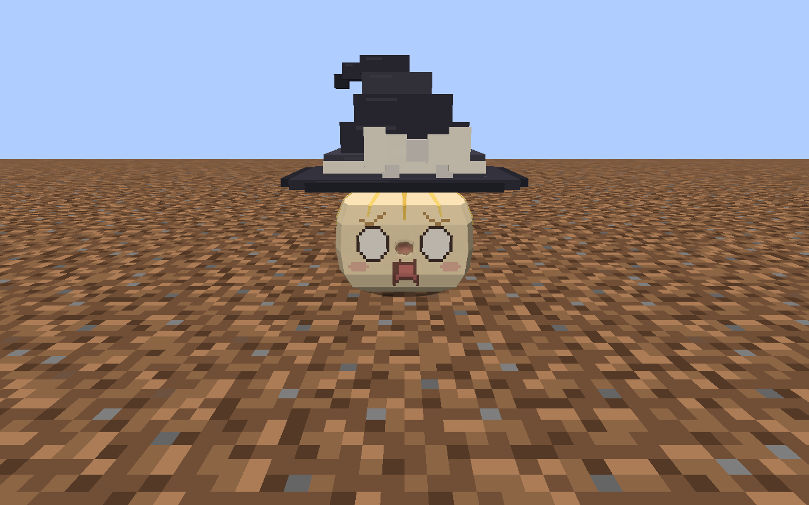
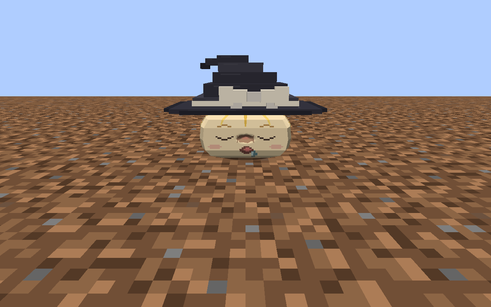

# 亚种伤势与遗体搬运复验

2026-09-13。稀毛魔理沙试玩反馈后的修正；操作规则见[受伤与遗体](../../../INJURIES_AND_REMAINS.md)。

## 修正与复现证据

- 拳击原本只有浅凹陷和两条细线，正常距离下难以辨认。现在在同一命中三角面上增加淤伤颜色，保留凹陷与随动作变形；没有把背部伤势搬到脸部。
- 遗体改为空手右键拾取，不要求潜行；收集直接转移原快照。地面、物品栏和手持共同读取 `Model`，手持尺寸也使用死者的 `RenderScale`。
- 真实客户端复现了创造模式放下遗体后手里仍留一份的问题：`ServerPlayerGameMode.useItemOn` 会恢复原堆叠数量。现在成功放置后替换手持格内容，生存和创造模式均只转移一份；空间受阻时不消耗。
- 只读检查用户实验存档时，稀毛魔理沙遗体已保存 `Model=marisa_sparse` 和八处凹伤。带完整快照的遗体物品在本轮没有重现变成灵梦的现象，不能据此断言此前那份物品的来源。最新实测覆盖实际右键拾取、物品栏、手持及放下，逐字段确认同一份身份、模型、饰物和伤口。

参考 [Corpse 渲染器](https://github.com/henkelmax/corpse/blob/master/src/main/java/de/maxhenkel/corpse/entities/CorpseRenderer.java)保留死者外观、复用对应角色渲染的做法；本轮没有复制其实现或新增依赖。

## 固定产物

交付目录：`.local/sparse-injury-remains/runtime-20260913-150058/`。Jar：`libs/mcyukkuri-0.1.0-dev.jar`，SHA256 为 `8bf26c0ad3b14e92f020d77456bc2f057b193114a20b0b65bb65ce62411be944`。

GameTest 在交付目录运行。客户端截图来自 `.local/sparse-injury-remains/runtime-20260913-145846/`；之后只修正了核心测试对旧手持对象的断言。两个目录的主模组类、运行资源和 Jar 逐文件相同，见[runtime.json](runtime.json)。Minecraft 1.21.1、NeoForge 21.1.250、JDK 21。

角色网格、骨架、贴图和动画未重新制作。稀毛魔理沙继续使用 `art/source/subspecies-runtime/marisa_sparse/` 所选快照及运行 `yukkuri/marisa_sparse.json`、`textures/entity/marisa_sparse/`、`yukkuri_wounds/marisa_sparse.json.gz`；正式来源以 [art/runtime-sources.json](../../../../art/runtime-sources.json) 和[稀毛／歪脸圆润选用](../../../../standards/yukkuri-library/subspecies/deficient/rounded-marisa/README.md)为准。伤势改动只发生在运行渲染代码，不改变标准造型确认记录。

## 已执行检查

| 检查 | 结果 |
| --- | --- |
| 隔离构建 | `build` 成功；各 source set 类、资源和运行 classpath 均位于任务目录，见[isolation.json](isolation.json) |
| 遗体与亚种 | [327 条通过](remains-checks.json)：19 种形态的偏离中心命中、半点伤害、致命伤、快照、保存、右键拾取、生存／创造放置、阻挡拒绝及铲子安葬 |
| 原伤口逻辑 | [348 条通过](wound-checks.json)：表面定位、动作变换、保存同步、治疗、迁移和有限出馅 |
| 核心关联流程 | [40 条通过](core-checks.json)，遗体放下检查改为读取实际手持格并经过游戏模式入口 |
| GameTest 汇总 | 3 组、715 条、零失败、退出码 0，见[汇总](gametest-summary.json) |
| 客户端真实交互 | [完整闭环通过](client-acceptance.json)：空手普通右键包收集、原快照逐字段相等、放置包移除手持物并生成唯一同快照遗体 |
| 物品渲染 | [四种场景通过](remains-render-checks.json)：实际 `ItemRenderer` 的 GUI、第一人称、第三人称和掉落显示均读取 `marisa_sparse/sleep.png` 并输出几何 |

客户端同时检查了两种家油及两种稀毛的受伤资源指纹和嘴部运动。19 种形态的完整玩法由引擎断言覆盖，本页实机图片重点为稀毛魔理沙；没有声称已逐只完成 19 种人工视觉确认。未运行全部联合测试、双客户端专服或长时间游玩。

过程中的创造模式重复保留已在实际包路径复现并修正；早一轮核心测试曾出现家油巢卵场景未完成，后续基线与最终运行通过。过程日志保留在 `.local/sparse-injury-remains/`，不使用中途失败或旧包截图作为最终通过证据。

## 实机图

击打处淤伤：



地面遗体：



- [真实右键拾取后的手持与快捷栏](sparse-carried.png)
- [物品栏中的稀毛魔理沙遗体](sparse-inventory.png)
- [同一快照重新放到地面](sparse-replaced-front.png)

## 运行与交付

```powershell
$env:JAVA_HOME='E:/yukkuri/.devtools/mcyukkuri/java/jdk-21.0.12.1+1'
./gradlew.bat build createP0GameTestLaunchScript createP0PreviewLaunchScript createClientLaunchScript integrationIsolation -I .local/sparse-injury-remains/checks.init.gradle --project-cache-dir .local/sparse-injury-remains/gradle-cache --no-configuration-cache
python .local/sparse-injury-remains/run.py freeze
python .local/sparse-injury-remains/run.py gametest
```

冻结与运行器复用 `scripts/run_port_integration.py`，选择 `remains` 专项；控制脚本及连续响应均在任务目录。测试客户端通过自身 `stop` 请求正常退出。实验地图启动清单已指向交付目录；切换前后用户世界逐文件指纹一致，见[切换记录](release-update.json)。没有自动提交、推送或合并。
