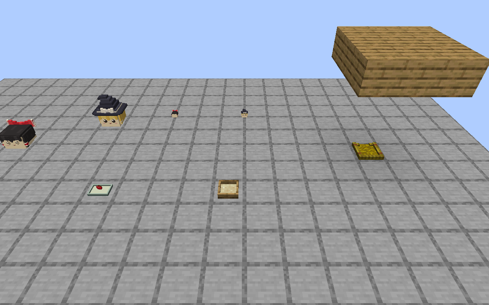
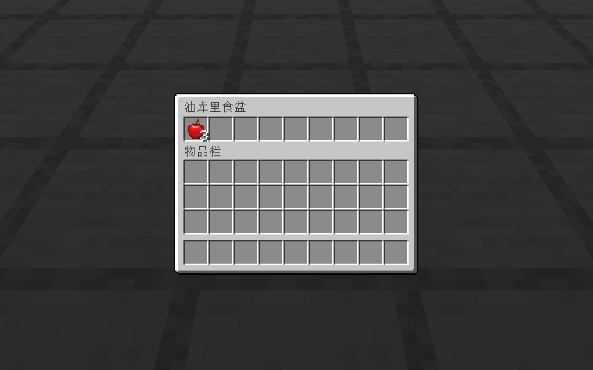
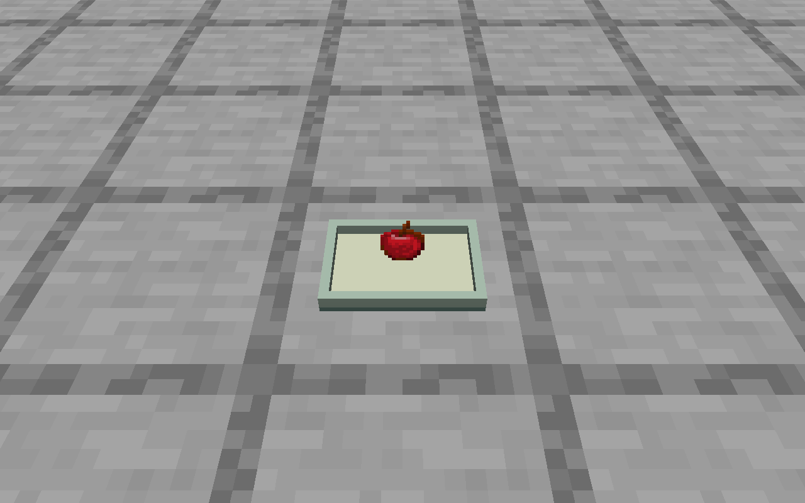
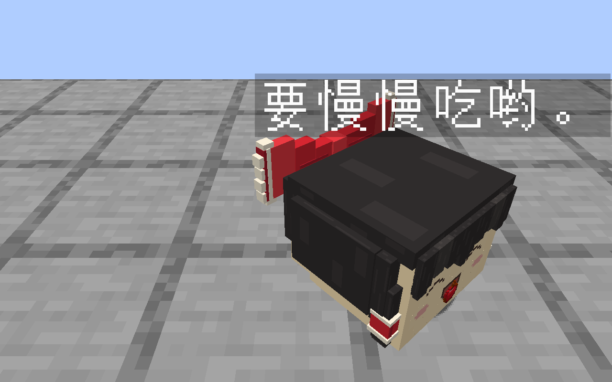
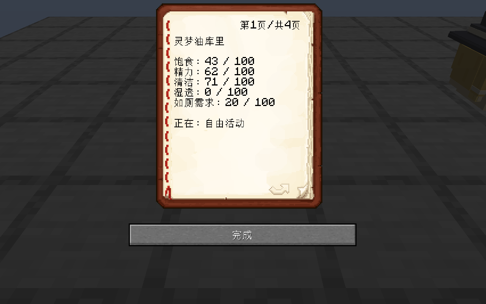

# P1–P2 本轮证据

日期：2026-09-12。Minecraft 1.21.1、NeoForge 21.1.250、Java 21，Windows 本机含既有未提交修改的工作副本。功能和验收边界见 [实现说明](../../P1_P2_IMPLEMENTATION.md)。

| 文件 | 内容 |
| --- | --- |
| [summary.json](summary.json) | 结果摘要、执行边界与发行 Jar 指纹 |
| [workspace-sha256.json](workspace-sha256.json) | 本轮适用的生产源码、资源、夹具和制作源指纹；不表示这些文件均由本轮新增 |
| [build-gametest.log](build-gametest.log) | 最后一轮构建和引擎测试日志 |
| [server-checks.json](server-checks.json) | 当前基础实体 189 项断言 |
| [living-checks.json](living-checks.json) | 当前 P1–P2 79 项断言 |
| [client-qa.json](client-qa.json) | 正常客户端交互请求及服务端状态，包括进食、观察、洗净、饰物取还与收纳 |
| [before-reload.json](before-reload.json)、[reload-qa.json](reload-qa.json) | 实际保存退出前状态、重启后的状态、原 UUID 放出、资源重载、八页笔记高度检查 |
| [care-packet-qa.json](care-packet-qa.json) | 食盆空／有食物更新包检查及实际库存界面 |
| [meal-timeline.json](meal-timeline.json) | 进食整轮客户端采集时间线；完整帧序列仍在项目 `.local/p0/`，下方保留精选帧 |

这些是受控 GameTest 和隔离单人世界的实际引擎／帧缓冲输出。未启动专服，未执行双客户端、普通玩家完整生存流程、长期性能和远程 CI。没有把受控数据设置当作自然游玩，也没有改变任何用户已确认造型的指纹。

## 四种实体与设施

正、侧、背和家油近景沿用本轮运行模型。前期全景中食盆显示曾为空；该问题已修复，下方设施图是修复后的实际结果。

[正面](living-front-0000.png) · [背面](living-back-0000.png) · [侧面](living-side-0000.png) · [家油近景](living-house-0000.png)

## 进食与饰物

[吞咽后帧](living-meal-0033.png)保留收尾状态。进食期间持续采集，没有只用首尾截图推断整轮。

## 观察手册

观察页：[住所](living-notebook-2-0000.png) · [个性](living-notebook-3-0000.png) · [玩家记忆](living-notebook-4-0000.png)

使用指南：[发现与运输](living-guide-1-0000.png) · [安置照料](living-guide-2-0000.png) · [交流学习](living-guide-3-0000.png) · [饰物](living-guide-4-0000.png)

中文八页逐页采集，并使用实际客户端字体检查 114 像素宽、128 像素高的原版书页正文区域。没有对英文页面声称完成逐页实机验收。
