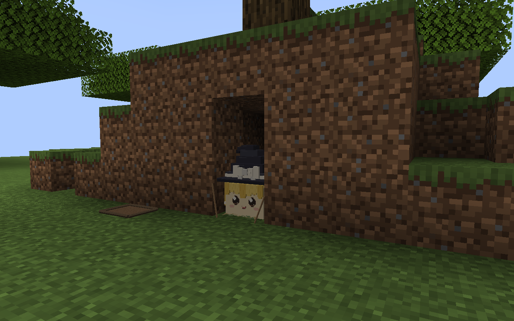
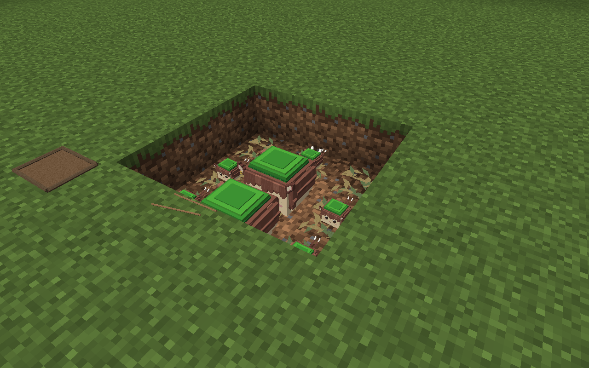

# 天然洞穴与土坑验收

2026-09-13 按用户对野外油库里能力与尺度的纠正完成：撤去整座覆土工事，认领现成洞穴、岩土凹处与浅坑，只搬运垫料和少量细枝。这里是当前证据入口；[此前覆土工事报告](../wild-shelters/README.md)仅保留为已否定方案的历史记录。

## 实际游戏预览

以下两图来自本轮重新编译后启动的 Minecraft 客户端，运行快照为 `.local/settlements/runtime/20260913-041033/`。预览夹具先布置地形，再调用正式家庭生成逻辑；角色为关闭自主 AI 的展示状态，不能用截图证明自主找洞或搬运。展示地形由测试夹具提供，正式认领逻辑不挖土、不造洞壁或洞顶。

洞穴为一只成年魔理沙与五只幼体的家庭。洞口细枝靠向现有侧壁，叶床在洞内；洞口截图有遮挡，六只成员的身份与住址以[家庭记录](cave-family.json)及[捕获状态](capture-natural-cave-front.json)核对。

浅坑为两只成年橙与五只幼体，坑底低于地面一格，叶床按实际睡位分布，细枝横放在坑沿。对应[家庭记录](pit-family.json)与[捕获状态](capture-natural-pit.json)。露天土坑不因叶床或结界获得挡雨能力。

本轮由主 agent 和独立审查 agent 查看最终两图，未发现完整工事、明显悬空或比例异常。洞口没有拱框或绑绳，横枝贴近坑沿；已修正上一轮横枝端点偏高的问题。模型多角度图来自[本轮实际导出网格](../../../../standards/yukkuri-library/ecology/wild-shelters/previews/current/shelters-sheet.png)。视觉复核之后，用户于 2026-09-13 回复“确认”，将以上两图所示的叶床、细枝结界与浅坑布置确认为标准。确认记录及适用文件指纹见素材包 `manifest.json` 的 `approvals`。本次只更新登记和重建时的状态保留逻辑，模型、贴图及游戏行为未变。

## 已执行检查

- Java 21 下完成 `build`、`compileP0TestJava` 及两种验收启动脚本的生成。使用项目内独立构建目录，避免其他并行任务覆盖运行中的类文件；未自动提交、推送或合并。
- 四组必需 GameTest 全部通过，共 206 项断言，完成时间为本机 04:10:59；[引擎结果摘录](gametest-summary.txt)。
- 五个模型的制作导出、选用快照与游戏资源一致；[模型检查](model-consistency.json)。记录时另核对了这些模型及贴图与实际预览快照的一致性。
- 人工核对中文说明、有效入口与源／导出关系。未运行当前环境中不可用的 `tech-doc-style-chinese` 或 `tech-doc-lint`。

| 检查文件 | 通过断言数 | 范围 |
| --- | ---: | --- |
| [聚落与家庭](settlement-checks.json) | 142 | 家庭、聚落、亲缘、住所及存档约束 |
| [移动与回家](settlement-movement-checks.json) | 2 | 引擎中的自主移动与回家 |
| [天然住所](shelter-checks.json) | 58 | 四向洞口、认领及拆除保留地形、实际床位与存档、重复认领拒绝、浅坑、积水、露天睡眠与雨天醒来、纸箱 |
| [实际资源行为](shelter-resource-checks.json) | 4 | 浅坑内住户翻越一格坑沿，拾取细枝、采短草、更换垫料和搬出污物 |

测试中的家庭组成含随机选择，因此断言总数可能随下一次运行变化。本页计数只对应随附报告。截图使用受控展示，资源与移动行为的结论来自启用 AI 的 GameTest。

[文件指纹清单](manifest.json)记录本轮源码、模型、证据、预览实际类文件及独立构建 Jar 的 SHA-256。源码指纹代表记录时工作区文件；编译类指纹代表本轮预览快照，不把未记录的后续工作区修改视为已验收。

## 待游玩验收

尚未验证自然世界中合适洞穴的密度、长期森林聚落遭遇率、多人生态平衡和季节性资源循环。勘测目前限同层床位、近处岸壁与低洞顶，浅坑支持一格高差出口，尚未覆盖完整地下洞系。聚落整体迁址与自然落叶再生尚未实现。

具体行为与限制见[野外住所说明](../../../WILD_SHELTERS.md)，模型制作入口见[天然住所素材包](../../../../standards/yukkuri-library/ecology/wild-shelters/README.md)。
