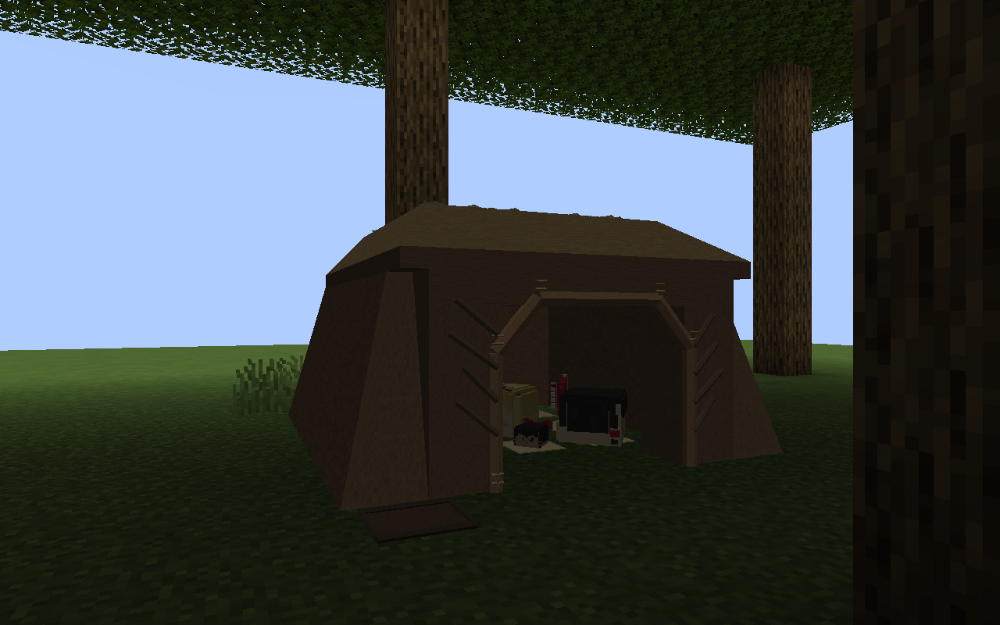
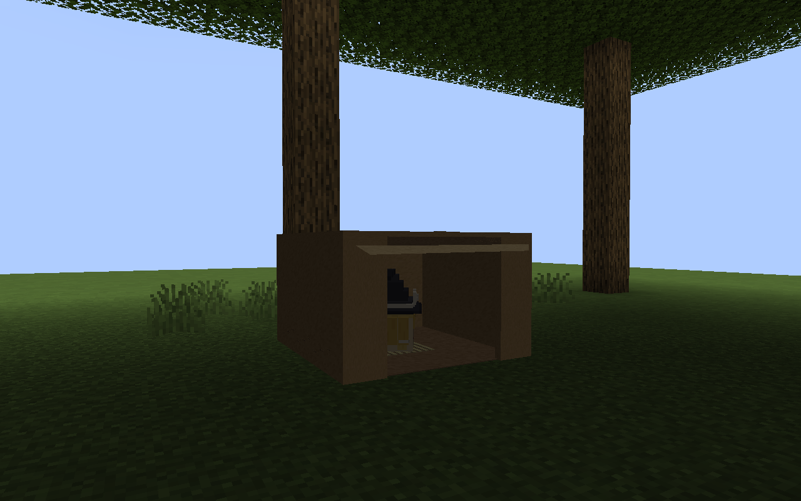
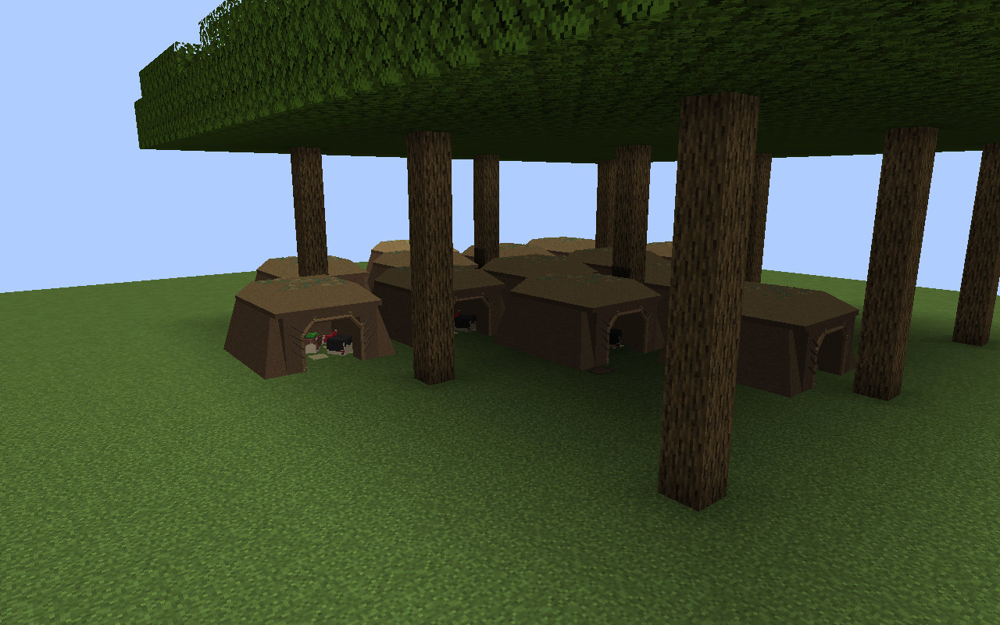

# 被替代的覆土工事验收

本页记录用户已否定的覆土工事版本，仅供追溯。此处通过结果与截图不适用于当前天然住所，最新入口见[天然住所验收](../natural-habitats/README.md)。

2026-09-13，Windows / JDK 21.0.12 / Minecraft 1.21.1 / NeoForge 21.1.250。完整构建成功；隔离 GameTest 世界执行四组检查，227 条登记结果全部通过。与此前仅变更人口的验收分开保存。

| 报告 | 通过 | 覆盖 |
| --- | --- | --- |
| [群落](settlement-checks.json) | 148 | 可变家庭、成组生成、亲缘、族长识别、预算与住所预留 |
| [返家](settlement-movement-checks.json) | 2 | 真实服务端 AI 步行超过十四格返回 |
| [住所](shelter-checks.json) | 73 | 两种住所四向碰撞、睡位、入口寻路、有限库存、NBT、雨淋与遮雨、干燥、墙体拆除、场地与生物碰撞拒绝 |
| [生活维护](shelter-resource-checks.json) | 4 | 真正走出门拾木修补、采草铺床、消耗新草换脏垫料、把一份实际排泄物运出巢穴 |

检查中发现并修复了住所时钟未推进、实心墙误标可通行、外出母体漏算预留床位及失败生成残留记录。测试运行物与 classpath 复制到本轮快照，使用一次性世界，避免并行构建和旧掉落物影响检查。

以下画面来自最后一次隔离客户端，使用本轮打包网格。场地为人工平地与树冠，居民固定站位以检查造型，不作为自然森林遭遇率或动态行为证据。动态行为由上述服务端检查覆盖。最新一次森林样本为十二户家庭、一个族长住所，共六十只；小家庭样本为四只。

角色、人数与住址分别见 `family.json`、`wanderer.json`、`forest-led.json`；截图状态保存于 `capture-*.json`，文件指纹及运行快照见 [manifest.json](manifest.json)。[素材静态核对](../../../../standards/yukkuri-library/ecology/wild-shelters/reports/current/static-consistency.json)验证制作、选用与运行文件一致，造型仍待用户确认。

未执行独立的跨区块卸载拆屋、实体加入事件取消、野厕满载专项检查，也未完成自然地形长期生存、季节迁徙或多人平衡验收。不得用本轮结果证明这些项目已经通过。
