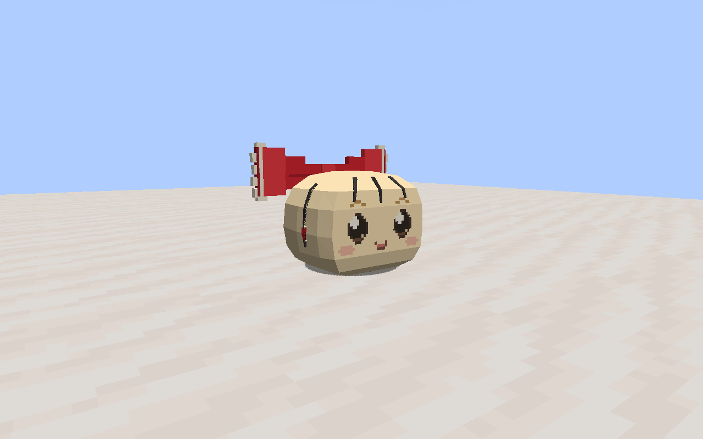
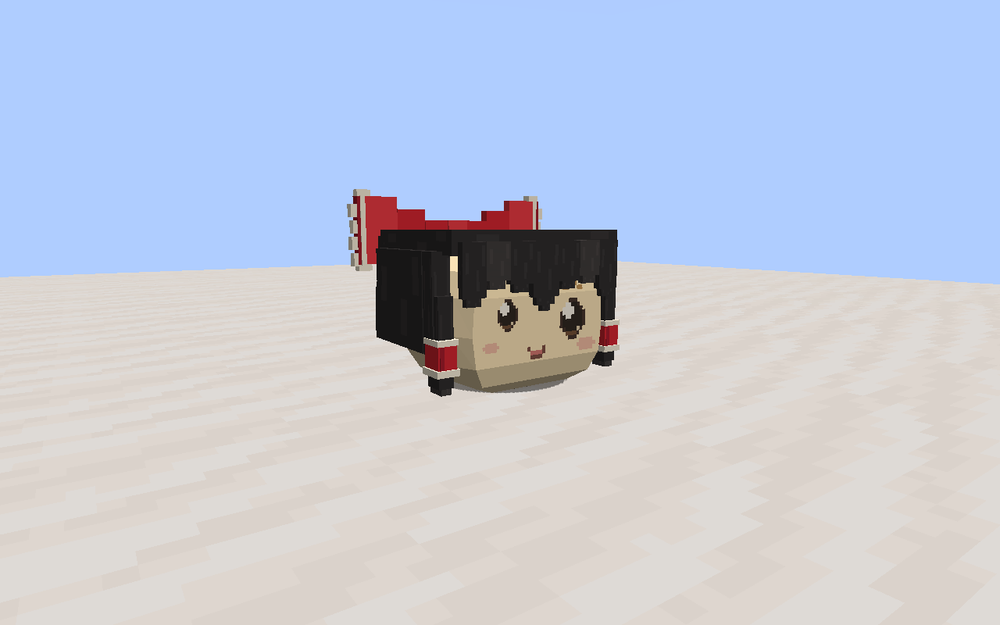
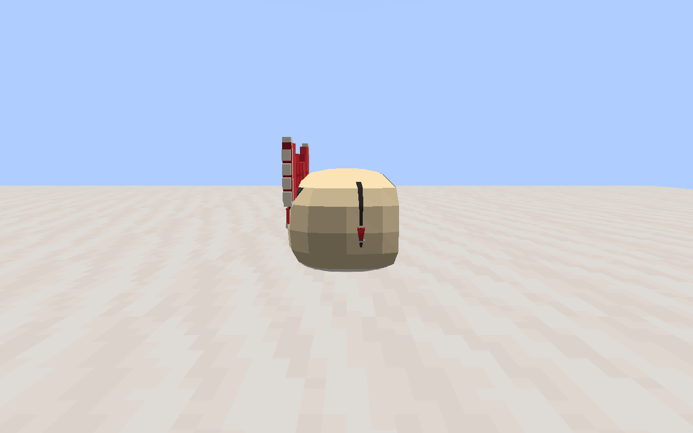
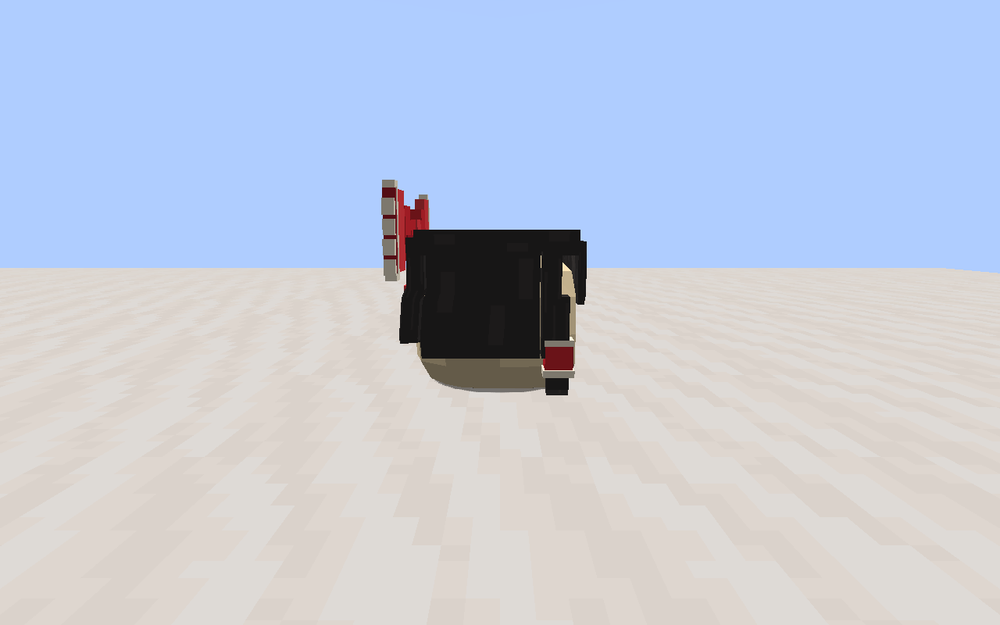
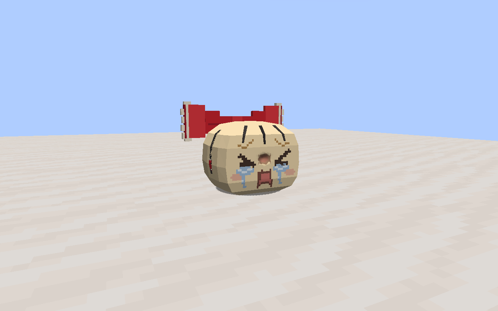
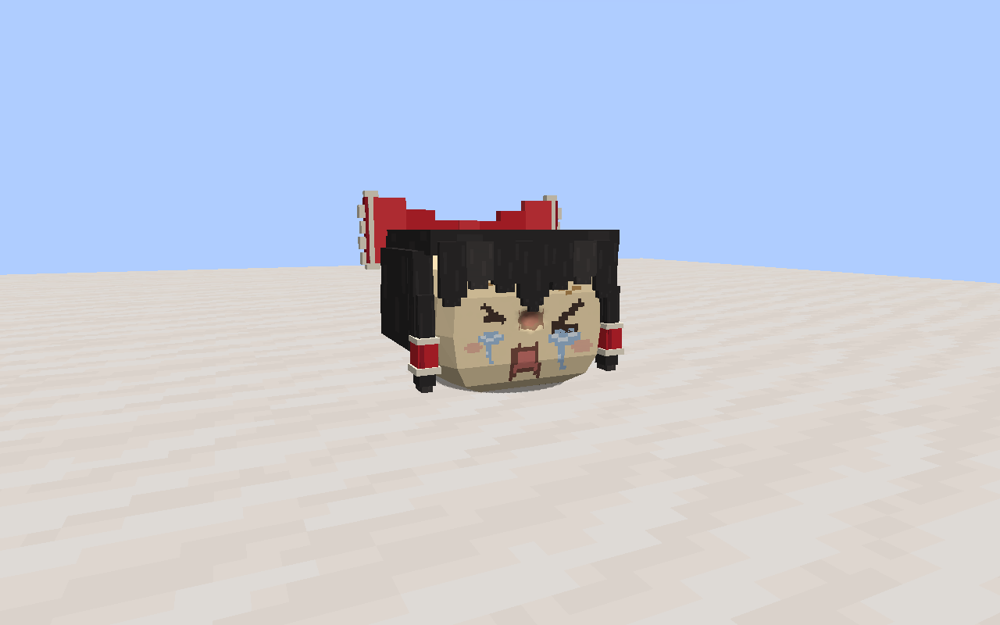

# 灵梦不足形态本轮验收

2026-09-14。适用模型指纹与固定试玩包见 [release.json](release.json)，制作输入与对应关系见 [来源登记](../../manifest.json)。新造型待用户确认。

本轮通过完整隔离构建，实际类输出、资源和运行 classpath 未使用根 `build/`；记录见 [build.log](build.log) 和 [isolation.json](isolation.json)。实际命令：

```powershell
./gradlew.bat build createP0GameTestLaunchScript createP0PreviewLaunchScript createClientLaunchScript integrationIsolation -I .local/reimu-deficient-rounded/checks.init.gradle --project-cache-dir .local/reimu-deficient-rounded/gradle-cache --no-configuration-cache
python .local/reimu-deficient-rounded/run.py freeze
python .local/reimu-deficient-rounded/run.py gametest
python .local/reimu-deficient-rounded/run.py preview
```

固定包 `.local/reimu-deficient-rounded/runtime-20260913-171128` 的 3 项引擎测试、715 条断言全部通过，覆盖伤口、遗体及核心交互；见 [测试汇总](gametest-summary.json)。这不是全项目全部玩法回归。

两种模型源、运行快照和打包资源指纹一致，供体身体顶点和连续权重保持一致，伤口指纹匹配；19 段动作共 950 个采样通过。浏览器检查覆盖 36 张表情、720 个状态，页面无错误，20 形态总览读取当前版本；见 [数据检查](checks.json) 和 [浏览器检查](browser.json)。

自行目视检查本轮四视图、行走、侧弯、伸展，以及真实客户端两种形态的正、斜、侧、背面和受伤画面。稀毛蝴蝶结在当前侧视图贴住后上部，五官未悬空；歪脸保留完整头发和大小眼。未委派独立审查，技术检查不代替用户确认。客户端控制返回的资源 ID 见 [实机控制记录](client-checks.json)。

| 稀毛灵梦 | 歪脸灵梦 |
| --- | --- |
|  |  |
|  |  |
|  |  |

实验地图固定启动指针已切换到该包，Jar 与启动类和资源逐文件一致；切换前后玩家存档指纹未变。自行启动的临时客户端已停止。本次未额外执行多人专服、长期行为或全部动作的实机录像。
