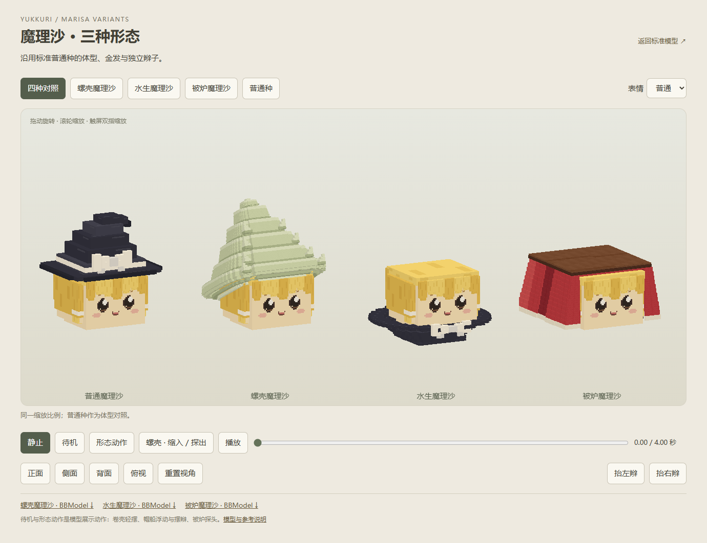

# 标准魔理沙：螺壳、水生、被炉

螺壳魔理沙已正式登记到统一素材库，并接入麻姆麻姆、佩尼佩尼：[标准模型与预览](../../yukkuri-library/TSUMURI.md)。后续螺壳编辑以统一素材库为准，本页保留三种外形制作对照。

[打开可旋转预览](index.html) · [标准普通种](../assembled/marisa/index.html) · [参考记录](REFERENCES.md)



本次完成三种**模型资产**，以 `characters/marisa.json` 的标准普通魔理沙为基础。身体、油臀、金发、透明五官、左右辫子及其骨架保持原始绑定坐标与比例。三种外形替换普通种的头顶魔女帽；水生型将其帽饰设计转为倒置帽船。项目中的 Minecraft 生物实体尚未实现，本目录也尚未接入实体、AI 或游戏内动画控制器。

| 类型 | 制作结果 | 可编辑文件 |
| --- | --- | --- |
| 螺壳魔理沙 | 六层方圆适中的塔形卷壳，整体缩小 10%，底层厚度约 2.4 单位；左右居中、后倾 25°，半圆壳口贴住金发，后缘刚好盖到油菊上方；八枚凸刺，独立 `shell` 骨骼，可缩入 | [BBModel](tsumuri/marisa.bbmodel) · [几何](tsumuri/marisa.geo.json) |
| 水生魔理沙 | 开口帽沿、下收帽冠船底、白色帽带与原帽蝴蝶结；独立 `boat`、`boat_bow` | [BBModel](aquatic/marisa.bbmodel) · [几何](aquatic/marisa.geo.json) |
| 被炉魔理沙 | 棕色木桌、红色分片被褥、奶白包边、前方开口；桌板与四面被褥分骨 | [BBModel](kotatsu/marisa.bbmodel) · [几何](kotatsu/marisa.geo.json) |

每个子目录提供 `marisa.png`、三张替换表情 PNG、`marisa.animation.json`、`animation-rig.json`、完整 `components.json` 和仅含新饰物的 `accessory-components.json`。`ordinary/` 为同一构建流程导出的普通种对照，不替换父目录已有标准成品。

预览支持四种同尺度对照、单独查看、自由旋转、缩放、正侧背和俯视、暂停与时间拖动、独立抬左/右辫、普通/开心/困倦/睡着四种表情。`静止` 是真实绑定姿态；`待机` 和 `形态动作` 是此次编写的四秒循环：螺壳轻摆、帽船浮动与摆辫、被炉向前探头及被褥微动。

**螺壳 · 缩入 / 探出** 为六秒循环：常态保持标准体型；缩入时身体宽度不变，高度压到 23%、纵深收至 78%，两辫收拢，沿斜壳口进入浅底层壳腔，探出时恢复标准体型。壳留在原地；收回状态可从开放壳口看见内部的底面，但五官不会从壳壁透出。正常状态没有包住脸与下半身的外墙或地板，壳只搭在头部上后方。斜度、扩大容积、凸刺与缩入动作按本轮用户要求适配，不是八景U原作动画的逐帧复刻。

新贴图为 **256×256**，左上角完整保留标准 **128×128** 图集及其像素 UV；右侧仅新增自绘壳、木纹、被褥材质。螺层截面介于圆形与方形之间，整体缩小 10%；壳口保留弧形，佩戴恢复左右居中，后缘降低至油菊上方一点。几何为可编辑 cuboid，与本项目方块造型一致。16 单位为一格，前方 −Z、上方 +Y；导出动画沿用标准组装器的坐标转换方式。

## 重建与验证

在本目录运行（Python + Pillow）：

```sh
python build.py
python validate.py
```

`build.py` 只读取父级标准数据与本目录模板，不读取旧的 `variants/`、提取资源或网络图片。生成文件可覆盖重建，应在脚本中修改比例或新增组件。

浏览器验证：`node verify.cjs`。默认使用项目已有 `tools/browser-check/node_modules/playwright-core` 和本机 Chrome；其他环境用 `PLAYWRIGHT_CORE_PATH` 指定 Playwright Core，调整脚本中的 Chrome 路径。

本次实际检查：15 个正/侧/背/斜/俯视角；45 个静止、待机、动作采样；缩入动作的正常、中间、完全缩入、探出和恢复共 10 张斜/侧视角图；播放、暂停、拖动视角、切换角色保持视角、独立辫子、四张表情以及手机布局。完全缩入时，扁身后的身体全部越过壳口平面，壳局部坐标下未检测到身体与壳体相交，探出后恢复尺度 1。结构验证比较继承组件、原像素、BBModel 层级、导出 cuboid（含 25° 斜壳旋转）、UV 与动画循环。结果分别在 `browser-verification.json` 与 `structural-verification.json`。

编辑模型和 JSON 已生成并作结构核对；尚未在 Blockbench 界面或 Minecraft 游戏内进行导入验收。
