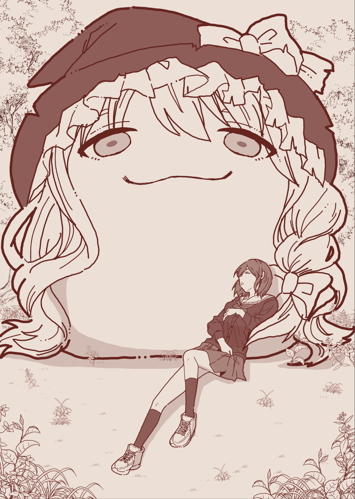
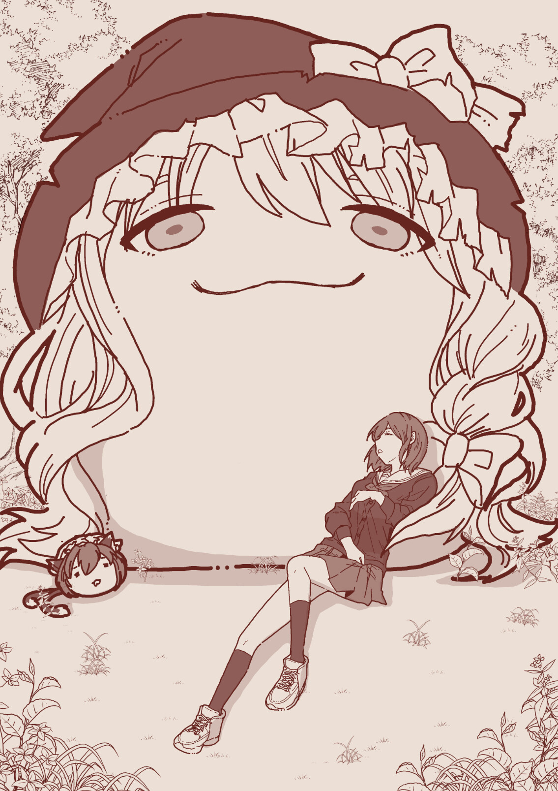

# DOS 与灵梦变体网页素材

[建模调研素材](../README.md) · [DOS 魔理沙设定](../../../hakkei-reference/lore/species/marisa/dos-marisa.md)

## 巨型 DOS 的比例画面

来源：[《どすとおねえさん》](https://blog.livedoor.jp/yukkuri_anko/archives/58445131.html)，ゆっくりプレイス归档，页面标注作者不明，2024-06-12 发布。原图分别由归档页收录于 2024-06-09、2024-06-10 的匿名投稿；博客转载者不等于原作者，原作者和授权未确认。页面副本保存在同目录 `dos-actual.html`，原图登记在 `dos-actual-images.json`。

第一幅以坐靠在巨型 DOS 鬓发旁的人类作尺度参照，能看见额头、眼睛、帽檐、缎带与大块鬓发之间的正面关系；它展示的是一幅场景画，不是正交模型图。

第二幅增加了站在鬓发下方的橙，可以比较普通小型油库里、人类与巨型 DOS 的相对体量。两幅图都没有提供侧面、背面、翼根或完整轮廓，不能用于推定这些部位，也不代表所有 DOS 版本具有相同身高和鬓发结构。

**制作范围：** 可用于构图、正面头部占比和场景尺度对照；帽子、头发、面部与参照物仍须依具体采用版本分别建模。不可把人类角色、发光效果或本篇庇护情节转成项目通用规则。图片保留在美术研究目录，不进入游戏运行资源；收藏不代表获得再发行授权。
