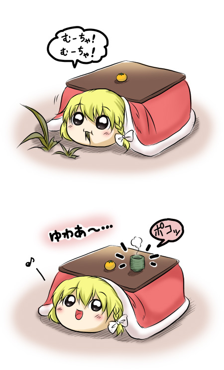

# 按用途查图

当前游戏参考以[实体、情景、情绪](../reference-library/README.md)为主分类；具体制作说明看[制作归纳](../reference-library/production-briefs.md)。本页为前轮观察摘记，不表示全部条目已进入当前游戏参考。

[参考库](README.md) · [术语表](../glossary.md) · [住所与季节](../hakkei-reference/lore/habitat-seasonal-life.md)

以下条目把“画面可见什么”和“可以据此做什么”分开。链接打开本地保存图片；全部图片的出处在各作品目录和 manifest 中。博客库 18 张、E-Hentai 子库 21 张的原图细看只核到所列结构或画格，不表示整部作品全文翻译。

## 角色与动作

| 目标 | 原图位置 | 已观察到的特征 | 制作与设定边界 |
| --- | --- | --- | --- |
| 普通灵梦、魔理沙与幼体 | [M04-001](images/M04/001-9b35bd1c.png) 第二排；[M09-002](images/M09/002-df5aca36.png) 上方 | 蝴蝶结／帽子、侧毛／辫子、同场幼成比例 | 图画透视不等于厘米尺寸；不要从单格固定生长比例 |
| 多毛幼体与家庭动作 | [M04-005](images/M04/005-8aa8405d.png) 中间两排 | 膨起侧毛、左右摇摆、伸展、翻滚 | 原作是排泄体操；借鉴姿态时保持语境，不复制歌曲 |
| 螺壳魔理沙 | [M09-001](images/M09/001-4fc8efd2.png) 末格、[M09-002](images/M09/002-df5aca36.png) | 角状突出、壳包覆、脸与金发露出，和帽型并列 | 壳耐水与本体浸水耐性分开；不是被炉型 |
| 被炉魔理沙 | [M05-001](images/M05/001-9a0cae68.jpg)、[M05-003](images/M05/003-63e5fbbe.jpg) | 棕桌板、红被褥、白边、四脚架与独立本体 | 项目归为饰物变体；破损画面用于看部件，不是标准外观；茶杯出现不自动转成游戏能力 |
| 帕秋莉与书 | [M07-001](images/M07/001-5960f723.jpg) | 月饰睡帽、紫长发、卷起发梢夹书 | 可启发持物挂点，不证明所有个体都能读懂所有书 |
| 橙近景 | [M08-006](images/M08/006-6c3752a6.png) | 猫耳、帽饰、短发、眼睛与开放口型 | 这页不足以证明尾部骨骼；尾动作另看小说核读 N08 |
| 妖梦头像与群落分工 | [M03-011](images/M03/011-023228d5.png) 中左 | 短发、头饰、严肃表情；接到外出收集消息的任务 | 可作头像补充，缺完整全向造型；职务不是全种固定职业 |
| 妖梦与橙同窝 | [EH01-007](ehentai/images/EH01/007.jpg)右栏 | 无胴体轮廓、妖梦短发黑蝴蝶结、侧面与俯身，洞口交叉枝条 | 仍缺背视和统一多向图；幽灵笑话不证明半灵能力 |
| 无胴体蕾米莉亚、芙兰 | [EH02-003](ehentai/images/EH02/003.webp) | 右侧蝙蝠翼与左侧枝状挂饰翼，头状身体、睡帽和短发 | 主体灰度不提供完整色板；翼根背面仍不清楚 |
| 普通家油与室内尺度 | [EH03-005](ehentai/images/EH03/005.webp) 上半 | 家油灵梦、魔理沙前后轮廓与远处人类同场 | 只取普通家油；透视关系不等于真实尺寸比 |
| 帕秋莉读书 | [EH14-002](ehentai/images/EH14/002.jpg)、[EH14-006](ehentai/images/EH14/006.jpg) | 长发、帽饰、贴近书页和摸帽表情 | 署名尚未确认；不把反复问候视为全种强制行为 |
| 徽章挂接 | [M02-002](images/M02/002-1a756cec.png) 上、下方 | 圆章贴在灵梦蝴蝶结和帕秋莉帽面；爱丽丝同场 | 位置参考可用；等级、续期、考试规则仍是该作者版本 |
| 莫西干人类 | [M11-002](images/M11/002-bb1f38f7.jpg) 右上 | 竖发、无袖背心、腰带、护腕 | 借服装轮廓时另做原创纹样；本篇后续是虐待场景，不能当爱派教学典型 |

### 被炉部件示例

来源：[作品目录 M05](works/M05.md)。桌上杯子和橘子属于这篇的画面；项目是否采用相关特殊能力需单独决定。

## 住所、道具与人类设施

| 目标 | 原图位置 | 已观察到的特征 | 使用边界 |
| --- | --- | --- | --- |
| 家油室内巢与卵 | [M01-002](images/M01/002-5bc89c5b.png) | 书架后棉絮巢、成幼同窝、地面圆卵、人类家具尺度 | “家油”是生态类别；此页没有完整自然孵化过程，也不证明普通种都卵生 |
| 草叶窝 | [M04-001](images/M04/001-9b35bd1c.png) 顶部 | 成束草叶围出凹窝，内有亲子 | 可做材料和铺层参考；与街头纸箱、人工观察箱分开 |
| 森林洞口结界 | [M11-002](images/M11/002-bb1f38f7.jpg) 左侧及底部 | 数根直枝斜靠洞口，后方为家庭睡处 | 本篇称其用于防同类；不是对人类有效的墙，也不是魔法效果的图证 |
| 街头筑巢材料 | [M13-001](images/M13/001-84adc53c.png) 上方 | 纸箱、泡沫箱、塑料袋、衣架、小石块 | 本页列物不等于安全材料清单；后页还有铁丝和束缚情节 |
| 冬季街头纸箱 | [M14-001](images/M14/001-05a0e489.jpg) | 巷道遮蔽、破纸箱、薄铺层、互相贴近 | 这组是流浪油困境；不能套成森林冬眠巢标准或普遍死亡率 |
| 人工观察屋 | [M12-012](images/M12/012-9ca25319.jpg) 上半；[M12 目录](works/M12.md) 10–11 | 管道、连接件、扩展空间、靠箱壁观察、人工光照 | 人造可观察设施，不是天然地洞；无法由线稿推出安全结构参数 |
| 储物间铺床 | [EH06-007](ehentai/images/EH06/007.webp)、[EH06-008](ehentai/images/EH06/008.webp) | 推拉门、园艺物资、啃木、铺床和贴近 | 角色把物资认作食物不证明可食；后段结果未读 |
| 透明箱的成长空间 | [EH11-007](ehentai/images/EH11/007.jpg)、[EH11-008](ehentai/images/EH11/008.jpg) | 同一箱体随着个体长大而拥挤、贴壁变形 | 用于表现空间不足，不抄作推荐密度 |
| 多层住所图解 | [EH13-001](ehentai/images/EH13/001.webp) | 台阶、开口、层间高度、内部小床 | 该页有虐待背景，仅取结构参考，不作为饲养范本 |
| 廊下旧桶构造 | [M15-009](images/M15/009-fbcc4e68.jpg)，图内页码8 | 旧桶横放、土覆盖、内部垫料，廊下拱形入口 | 文本明确是堆肥箱，主人投放厨余；只取构造，不写成推荐饲养方案 |
| 工厂生产与输送 | [M10-006](images/M10/006-689fc0e0.png) | 生产台、传送带、分拣人员 | 强制繁殖背景；不能用点心工厂图证明油虐用／饲料用活体装袋流程 |

上述分类也可用于委托美术时的任务描述：先给具体图号和要研究的部件，再写本项目的用途与原创改动。不要只提供博客首页或整本漫画让制作者猜目标。

## 目前还不能从图库得出的结论

- 无胴体捕食种已有 EH02 直接画面，妖梦已有 EH01 侧面与俯身；仍缺统一多向和遮挡部位。普通巨型 DOS 的直接比例图仍缺。
- EH10《寻找多毛灵梦成体》目前只核前 8 页，题名与问号轮廓不能作为成体图证。
- M06 爱丽丝图文长条仅看过画面总览，细字和完整因果尚待核读。
- 帽船已有 EH22 划行与收物画格，连续登离、靠岸仍缺；见[帽船制作归纳](../reference-library/production-briefs.md#帽船划行与载物)。
- 家油的卵、幼体画面不能代替自然孵化的连续过程；帕秋莉故事的 IF 附页也不能拼进正篇结局。
- 图片中的性格、职业、悲剧和特殊能力都先属于该作品。与已采用规则不一致时，在[冲突表](../hakkei-reference/lore/conflicts.md)中解释。
