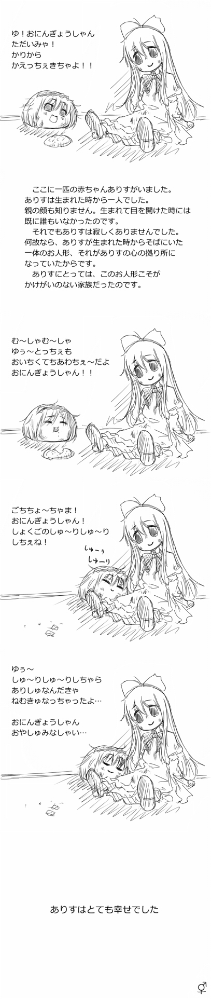
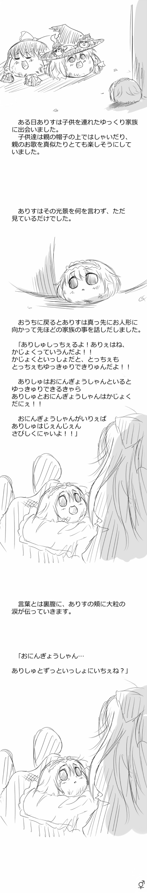

# 爱丽丝

[种族目录](../README.md) → 爱丽丝

| 项目 | 内容 |
| --- | --- |
| 分类 | 种族 |
| 上级种族 | 无；目录根种族 |
| 日文检索词 | ありす |

## 外形与分类

基础种族，以短金发与发箍识别；作品常写较强生存能力、整洁持家和适合饲养。

## 习性与作品差异

- **外观：** 《にっき》资料是金发、红发箍、卡仕达馅。[W，L10](https://w.atwiki.jp/ykansatu/pages/39.html)
- **双叶系常见母题：** 高优先级综述[L36](../../../sources-lore.md)将爱丽丝写为生存力强、擅长整洁持家、适合饲养的种类；作品中也有「攻击魔」失控个体及因此警惕爱丽丝的野外群体。
- **作品差异：** 八景社区记录繁殖相关失控状态；《解体新书》则写出理性、整齐布置巢穴并具「都会派」审美的个体。[W，L09](https://wikiwiki.jp/yukkuri8kei/ゆっくりの種類)、[A，L06](https://w.atwiki.jp/yukkuri_gyakutai/pages/3102.html)
- **生态表现：** 作品既有日常社交、觅食与结伴，也有持家、筑巢和「都会派」生活风格。

**W：[F66](https://yukkuri.fandom.com/wiki/Yukkuri_Alice)** 写爱丽丝是常见的型，饰物为红发箍，卡仕达馅，社区普遍把它当性方面的失控者：掠食型个体会袭击其他个体（尤其魔理沙与灵梦）以产下幼体，并把 Peni Peni 当作可操控的部位（上下摆作可爱或飞行、绕轴转当轮子或螺旋桨、快速旋转造出 Peni Spark 气流）。同页也写大量较温和的个体：友善、说话与行动较冷静、多用 “city-sect” 一类词汇、常在窝里当“母亲”照顾孩子，身体比看上去结实，也能在与灵梦或帕秋莉配对时当“父亲”；它们在没有手的情况下把桌椅、软床、玩具与花冠弄出来，把巢布置得整齐，并把做出一件像样的玩具当作成年仪式。同页另写它们极少生下 Shanghai 型与 Hourai 型。

**项目采用：** 爱丽丝的家务系数 ×1.5。掠食写法实现为真实规则「攻击素鸡立」：12 格内找合格成体、追击 1.7 倍速、接触 240 tick，在固定时点作一次受孕抽取建立茎生胎次，攻击方消耗体力，体能不足会耗尽（见[成体发情与攻击素鸡立](../../../../../docs/FEATURES.md#成体发情与攻击素鸡立)）。项目无手工艺，不做桌椅、玩具与花冠，也不允许操控 Peni Peni 或飞行；子代只有爱丽丝型，不另生 Shanghai／Hourai 型；台词按制作源选句。

## 作品图片参考

**REF09 · 爱丽丝进食、依偎与睡眠**。只参考左侧圆身爱丽丝；右侧长发有身体者是故事中的人偶，不是爱丽丝身体种素材。

出处：[ありしゅとおにんぎょうさんのお話](http://blog.livedoor.jp/yukkuri_anko/archives/29925822.html)，转载页署名：おねにーあき。原图已保存到本库，仅作作品研究参考。

**REF10 · 爱丽丝侧背、低落与流泪**。参考短发、发箍、侧背和表情；首格另有普通灵梦、魔理沙及幼体的群像。

出处：[ありしゅとおにんぎょうさんのお話](http://blog.livedoor.jp/yukkuri_anko/archives/29925822.html)，转载页署名：おねにーあき。原图已保存到本库，仅作作品研究参考。

## 相关资料

[形态与生态类别](../forms.md) · [共通生态](../../ecology.md) · [口吻与发音](../../../dialogue/species-variants.md) · [作品来源](../../../sources-lore.md)

本地图片的出处、核对范围与用途见[美术参考索引](../../../../art-references/visual-guide.md)。
