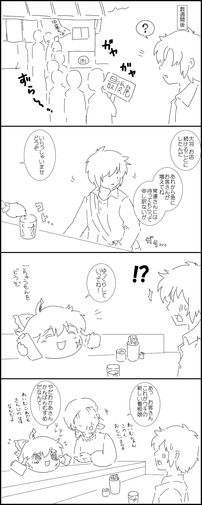

# 橙

[种族目录](../README.md) → 橙

| 项目 | 内容 |
| --- | --- |
| 分类 | 种族 |
| 上级种族 | 无；目录根种族 |
| 日文检索词 | ちぇん |

## 外形与分类

以猫耳、绿帽及尾部识别；短口癖、视线和尾部姿态常用来表达情绪与意图。

## 习性与作品差异

《ゆっくりちぇんを飼ってみた》以有限句式、双尾表达开心及偷吃后的回避眼神呈现橙的交流方式。[A，L03](https://w.atwiki.jp/slowlove/pages/400.html)

《にっき》资料写有绿帽、猫耳、巧克力馅、速度快但身体较弱。[W，L10](https://w.atwiki.jp/ykansatu/pages/39.html) 这些特征限该游戏资料，不能直接推广到其他作品。

**W：双叶系母题（[L36](../../../sources-lore.md)）。** 高优先级综述将橙概括为体型娇小、行动敏捷、生存能力较强、难以正面对抗其他油库里；她在普通种中的创作出场率也较低。《にっき》则补充了速度快、身体较弱的游戏版本。

## 作品图片参考

**REF11 · 橙的正面、猫耳与表情**。参考圆身、猫耳、鬓发和笑脸；头上物件与脸部记号属于该故事，不直接转为种族标准。

出处：[ちぇん！ ちぇん！！ ちぇん！！！](http://blog.livedoor.jp/yukkuriplace_anko/archives/43838612.html)，转载页署名：和菓子あき。原图已保存到本库，仅作作品研究参考。

## 相关资料

[形态与生态类别](../forms.md) · [共通生态](../../ecology.md) · [口吻与发音](../../../dialogue/species-variants.md) · [作品来源](../../../sources-lore.md)

本地图片的出处、核对范围与用途见[美术参考索引](../../../../art-references/visual-guide.md)。
