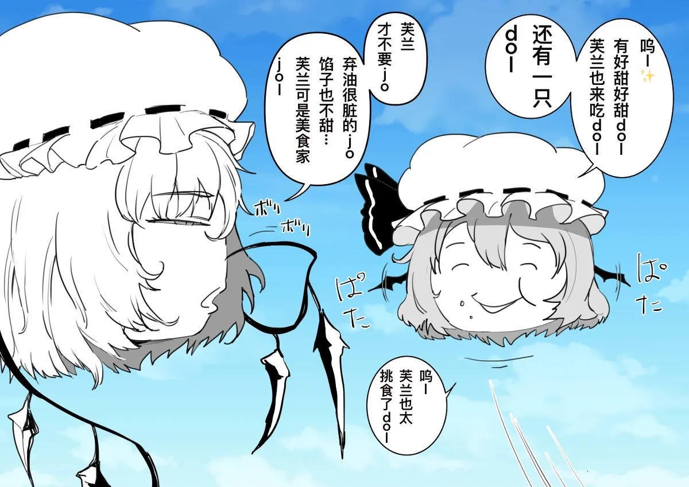

# 芙兰

[种族目录](../README.md) → 芙兰

| 项目 | 内容 |
| --- | --- |
| 分类 | 种族 |
| 上级种族 | 无；目录根种族 |
| 日文检索词 | ふらん |

## 外形与分类

双叶系创作中较少见的捕食种，生态写法仍在形成；种族资料与蕾米莉亚并列整理。

## 习性与作品差异

《观察日记》攻略记录飞行、翅膀、尖牙，以及与蕾米莉亚共享的等级相关捕食行为。[W，L12](https://w.atwiki.jp/ykansatu/pages/16.html)

**W：创作母题（[L36](../../../sources-lore.md)）。** 高优先级综述将芙兰列为两种捕食种之一，也指出其生态写法相对少见；部分作者依据翅膀构造，采用不同的分类方式。

- **内馅：** 用户明确指定捕食种为肉包；本项目据此采用肉包馅配色，具体 RGB 为项目美术，不改变捕食行为。

**W：[F86](https://yukkuri.fandom.com/wiki/Yukkuri_Flandre)** 写芙兰是捕食种，饰物为粉帽与红丝带，馅写作红豆包（anman）；翅膀像挂着彩色结晶的枯枝、仍能飞，伤口几秒愈合；性情极暴烈，会专门折磨别的个体，野生的会把死了或未死的猎物插在巢周围的尖桩上作装饰，因此受施虐者与想找看守的人喜欢，最爱的消遣之一是欺负蕾米莉亚。同页也说有些作品里的芙兰只是强而天真、不理解死；它与 Meiling 型关系特别、会为它出手，与 Yuuka、魔理沙、Koishi 型也能相处。

**项目采用：** 芙兰与蕾米莉亚同为捕食种，走同一套捕猎与飞行规则；项目没有再生、尖桩装饰与巢饰，捕食只为真实饥饿，见[捕食种](../../../../../docs/FEATURES.md#捕食种)与[设定差异](../../conflicts.md)。Meiling、Yuuka 等型未实现。

## 作品图片参考

[EH02《地球的生物系列·捕食种篇》](../../../../art-references/ehentai/works/EH02.md)第 3 页，封面署名ぼっキー、译者 shku。左侧芙兰为无胴体头状身体、睡帽、枝状翼与悬挂棱形饰物；右侧蕾米莉亚可作翼形对照。画面未给完整色板及翼根背面，也不能证明超自然破坏能力。

## 相关资料

[形态与生态类别](../forms.md) · [共通生态](../../ecology.md) · [口吻与发音](../../../dialogue/species-variants.md) · [作品来源](../../../sources-lore.md)
