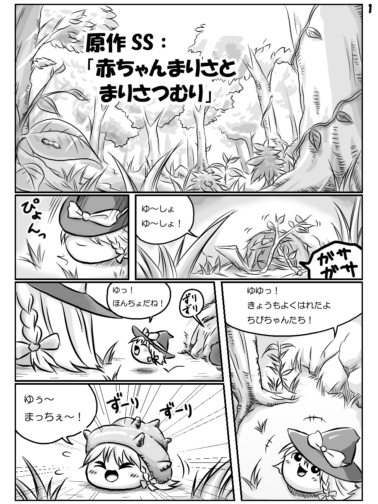
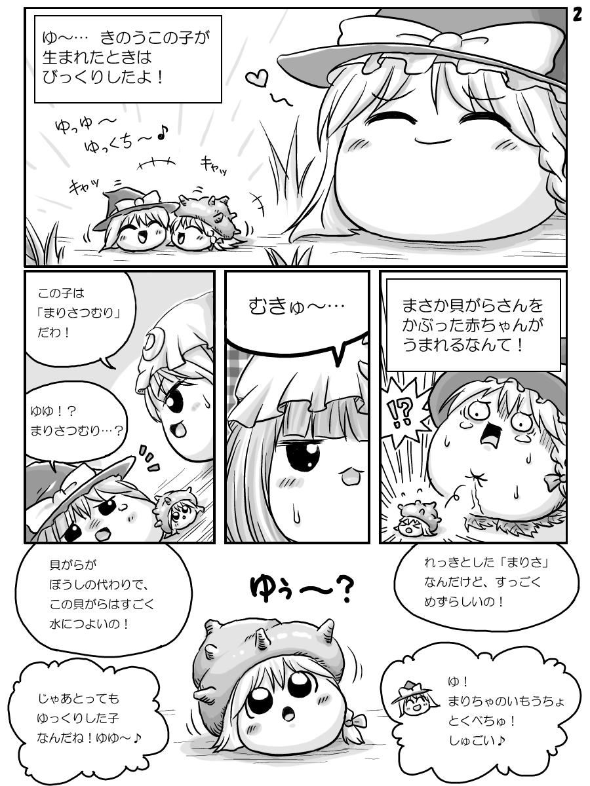

# 魔理沙

[种族目录](../README.md) → 魔理沙

| 项目 | 内容 |
| --- | --- |
| 分类 | 种族 |
| 上级种族 | 无；目录根种族 |
| 日文检索词 | まりさ |

## 外形与分类

基础种族，以帽子、金发和侧发识别；本项目将螺壳魔理沙与 DOS 单列为亚种，被炉魔理沙按饰物变体介绍，帽船水生类型另见专页。

## 习性与作品差异

- **社区八景记录：** 常任探险队长，配对倾向父方，较容易出现强硬气性。[W，L09](https://wikiwiki.jp/yukkuri8kei/ゆっくりの種類)
- **双叶系常见母题：** 高优先级综述[L36](../../../sources-lore.md)将魔理沙种概括为大胆、爱冒险、容易犯傻，常以自信甚至自大的口吻称赞自己。帽内空间、帽船和较坚韧的形象也经常用于野外生存题材。
- **器官与行为素材：** 《解体新书》描述帽子携带食物、幼体及在缓水中渡河。[A，L06](https://w.atwiki.jp/yukkuri_gyakutai/pages/3102.html) 水生魔理沙以帽船漂浮为特点，具体生态见[专页](aquatic-marisa.md)。
- **社区条目：** **W：[F126](https://yukkuri.fandom.com/wiki/Yukkuri_Marisa)** 把魔理沙写成第二普遍的类型，爱称 Yukkurisa，饰物为黑帽与左侧单辫上的蝴蝶结，黑豆沙馅；常写它与灵梦配对并充当“父亲”，也有与帕秋莉、芙兰、爱丽丝、Nitori 搭配的写法。同页写魔理沙有暴力倾向，口癖 “Drop dead easy!”，会用陷阱折磨其他个体，极危险时可能舍下家人；部分故事让它放 Master Spark。许多故事称魔理沙最强，同页自己补充过被其他型打破、自夸只是自夸；非飞行型里它最想“飞”，会找高处以及小扫帚或像扫帚的小东西找感觉，另写有认蘑菇的本事。

**帽子：** 同页写魔理沙的饰物比其他型更有用，能装食物、运幼体、当船，也因此更依赖帽子；失帽率高于其他型，失帽个体常以瓶盖、盒子、冰淇淋筒或团子杯替代。帽船写法不一：有的只能浮一会儿，有的会泡水下沉，帽子能否挡雨也各篇不同。

**变体：** 同页分别写帽船型[水生魔理沙](aquatic-marisa.md)、壳型[螺壳魔理沙](tsumuri.md)、[被炉魔理沙](kotatsu-marisa.md)与巨型[ DOS 魔理沙](dos-marisa.md)；另有画师 Sales Guy 起的 Para-Marisa（饰帽过大、以衣夹固定在辫子上，帽子拖地却能当降落伞，从高处跳下不受伤，甚至成群随风飞行）与红发魔理沙（早产儿 5–10% 会红发，多出现在 Mima 型附近，长大后戴紫帽、持 Mima 的法杖，极稀有且多数活不到子油期）。两者都没有对应亚种页面，也不在本项目范围内。

**项目采用：** 魔理沙是十个已登记种族之一，相扑挑战 ×2、挑衅阈值 ×1.5，探险队长只由魔理沙担任（项目设计，见[种族与亚种](../../../../../docs/FEATURES.md#种族与亚种)）；叼嘴与帽檐运输按真实体型和帽檐空间结算，见[运输](../../../../../docs/FEATURES.md#聚落族规与迁徙)。项目的帽船只属于水生魔理沙亚种，陆生魔理沙不乘帽船；没有 Master Spark、飞行与蘑菇识别，帽子的用途、失帽后改用其他饰物、Para-Marisa 与红发魔理沙依次见[设定差异](../../conflicts.md)。

## 作品图片参考

**REF03 · 普通帽型与螺壳型对照**。观察普通魔理沙的侧背轮廓、幼体与壳型全貌。

出处：[赤ちゃんまりさとまりさつむり](http://blog.livedoor.jp/yukkuriplace_anko/archives/6522195.html)，转载页署名：キリライターあき。原图已保存到本库，仅作作品研究参考。

**REF04 · 壳型近景与幼成比例**。下方是螺壳、前发与脸的近景；上方有普通帽型、壳型幼体和成体对照。

出处：[赤ちゃんまりさとまりさつむり](http://blog.livedoor.jp/yukkuriplace_anko/archives/6522195.html)，转载页署名：キリライターあき。原图已保存到本库，仅作作品研究参考。

## 相关资料

[螺壳魔理沙](tsumuri.md) · [被炉魔理沙](kotatsu-marisa.md) · [DOS 魔理沙](dos-marisa.md) · [水生魔理沙](aquatic-marisa.md)

[形态与生态类别](../forms.md) · [共通生态](../../ecology.md) · [口吻与发音](../../../dialogue/species-variants.md) · [作品来源](../../../sources-lore.md)

本地图片的出处、核对范围与用途见[美术参考索引](../../../../art-references/visual-guide.md)。
