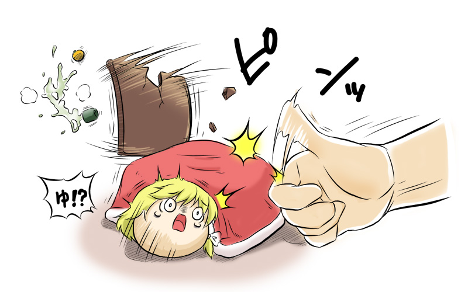

# 被炉魔理沙

[种族目录](../README.md) → [魔理沙](README.md) → 被炉魔理沙

| 项目 | 内容 |
| --- | --- |
| 分类 | 魔理沙的被炉饰物变体（本项目）；异作也有亚种分类 |
| 上级种族 | [魔理沙](README.md) |
| 日文检索词 | こたまりさ、こたつむり |

## 外形与分类

以桌板、被褥状饰物识别的魔理沙类型，与螺壳魔理沙分别介绍。不同作品可能将其视为亚种或饰物变体。

本项目按 2026-10-08 [采用决定 A2](../../conflicts.md)取饰物变体分类与冬活夏眠习性，仍保留独立资料页。分类取舍不表示随手替换饰物就能在游戏内转变；该类型仍在开发计划中。

## 习性与作品差异

以下按作品分别介绍，设定不能自动混用。来源登记见[世界观来源](../../../sources-lore.md)。

| 来源 | 核读结论 | 使用边界 |
| --- | --- | --- |
| L12，《观察日记》社区种类页的「こたまりさ」段 | 被炉取代通常饰物，口吻沿用魔理沙 | 该游戏将其按饰物差异处理，还允许其他种继承饰物；本资料单列魔理沙类型，跨种继承仅属该游戏版本 |
| L22，yukkuri_original 社区「まりさつむり」页 | 本页实际描述被炉型：慢行、较温和、耐寒怕热；繁殖方式未确认 | 页名与螺壳型资料重名，必须按外观辨认；性格与耐性仍属资料候选 |
| L23，《こたつむり愛で完全版》，转载归类署名ウサミミ薬局あき | 描写桌板与被褥状饰物、冬季活动、内部发热和夏季避热 | 仅代表该篇；作者主动标明强化性能设定。尚未追到首发，未核验插图，不将其成长数字推广到其他作品 |

L23 与 L22 还包含食物或器物生成等特殊设定；茶杯、橘子生成及其他超常能力仅代表相应作品的版本。

## 作品图片参考

**REF05 · 被炉全貌与进食**。观察桌板、红色被褥、金发、侧发结和探头进食；茶杯、橘子只是该作品画面，不能仅凭画面证明具有生成物品的能力。

出处：[こたつむりちゃん](http://blog.livedoor.jp/yukkuri_anko/archives/30919135.html)，转载页署名：キリライターあき。原图已保存到本库，仅作作品研究参考。

**REF06 · 被炉饰物结构与受惊表情**。画面有手指弹开桌板的动作；参考桌板与被褥的分离关系、受惊脸，情节仅代表该作品。

出处：[こたつむりちゃん](http://blog.livedoor.jp/yukkuri_anko/archives/30919135.html)，转载页署名：キリライターあき。原图已保存到本库，仅作作品研究参考。

## 相关资料

所属种族：[魔理沙](README.md)。同一父类下的条目分别维护定义与美术，名称相近不合并。

[形态与生态类别](../forms.md) · [共通生态](../../ecology.md) · [口吻与发音](../../../dialogue/species-variants.md) · [作品来源](../../../sources-lore.md)

本地图片的出处、核对范围与用途见[美术参考索引](../../../../art-references/visual-guide.md)。
