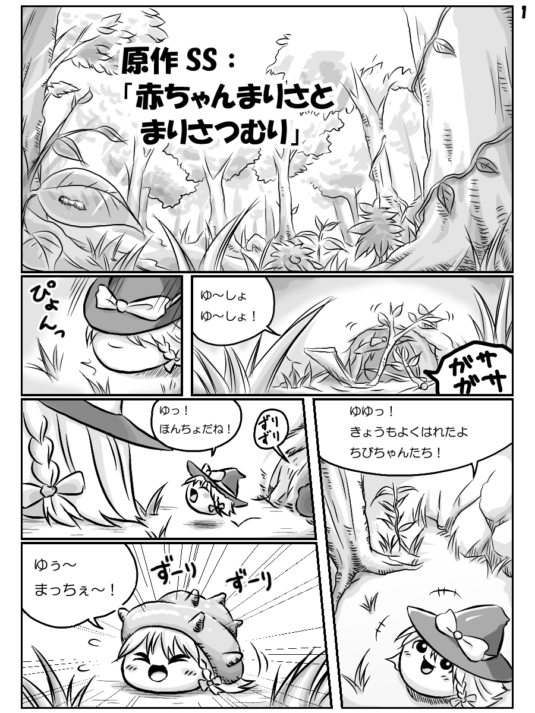
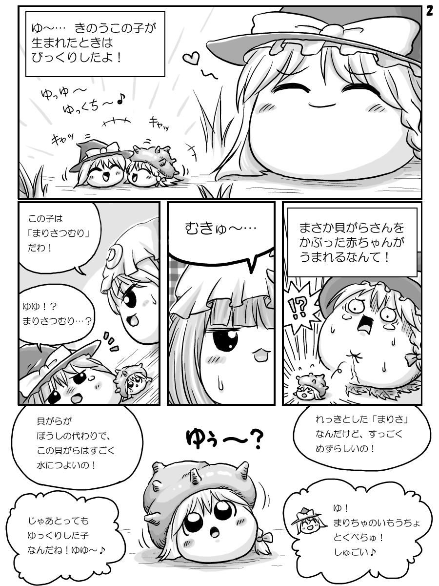

# 螺壳魔理沙

[种族目录](../README.md) → [魔理沙](README.md) → 螺壳魔理沙

| 项目 | 内容 |
| --- | --- |
| 分类 | 亚种 |
| 上级种族 | [魔理沙](README.md) |
| 日文检索词 | つむり、まりさつむり |

## 外形与分类

较稀有的魔理沙亚种，以螺壳饰物识别；部分作品赋予较强耐水性，但不等于本体可以无限浸水。

## 习性与作品差异

八景社区记载卷壳饰物、较强耐水、较慢移动及较大落下风险。[W，L09](https://wikiwiki.jp/yukkuri8kei/ゆっくりの種類)

《赤ちゃんまりさとまりさつむり》明确描写稀有亚种及壳的耐水作用，同时保留本体长期浸水受损的情节；这是该篇规则，不据此赋予所有壳型无限耐水或潜水能力。[A，L24](https://w.atwiki.jp/yukkuri_gyakutai/pages/2013.html)

## 社区条目与项目采用

**W：[F126](https://yukkuri.fandom.com/wiki/Yukkuri_Marisa)** 把壳型写成最早被确认的带壳油库里：头顶是海螺状壳而不是黑帽，来历有多种说法（失帽后换壳、突变、生于近水处、人造后流入野外）。同页写水中的壳型浸水不溶、能整天生活在水中，是最早被算作 Water Yukkuri 的类型之一；陆生个体壳较尖、水下个体较平。同页的陆生壳型不保证防水，记有用壳挡雨却被一小滩嘘嘘泡死、被扔进水里溶解的例子，另有壳能顶住多数捕食者、但会被摔落或外力弄掉，壳重到陆生带壳个体只能拖行或滑行、不能跳。

项目把螺壳魔理沙实现为独立亚种：通常 1/160、亲本同亚种 1/4；移速 −35%、进水增量约 1/4；持壳时受惊或本地降雨会缩壳，缩壳只对外伤白名单减半，不防水、火、冻、饥与口干，失壳后不再缩壳。项目没有浸水不溶的全水生壳型，见[设定差异](../../conflicts.md)。

## 作品图片参考

**REF03 · 普通帽型与螺壳型对照**。观察普通魔理沙的侧背轮廓、幼体与壳型全貌。

出处：[赤ちゃんまりさとまりさつむり](http://blog.livedoor.jp/yukkuriplace_anko/archives/6522195.html)，转载页署名：キリライターあき。原图已保存到本库，仅作作品研究参考。

**REF04 · 壳型近景与幼成比例**。下方是螺壳、前发与脸的近景；上方有普通帽型、壳型幼体和成体对照。

出处：[赤ちゃんまりさとまりさつむり](http://blog.livedoor.jp/yukkuriplace_anko/archives/6522195.html)，转载页署名：キリライターあき。原图已保存到本库，仅作作品研究参考。

## 相关资料

所属种族：[魔理沙](README.md)。同一父类下的条目分别维护定义与美术，名称相近不合并。

[形态与生态类别](../forms.md) · [共通生态](../../ecology.md) · [口吻与发音](../../../dialogue/species-variants.md) · [作品来源](../../../sources-lore.md)

本地图片的出处、核对范围与用途见[美术参考索引](../../../../art-references/visual-guide.md)。
