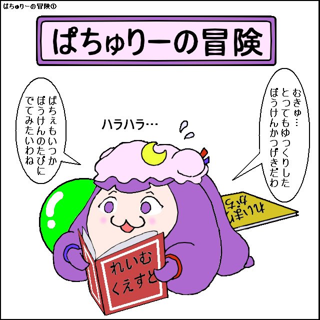
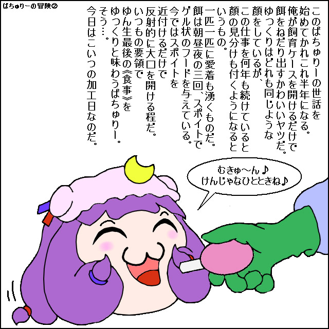

# 帕秋莉

[种族目录](../README.md) → 帕秋莉

| 项目 | 内容 |
| --- | --- |
| 分类 | 种族 |
| 上级种族 | 无；目录根种族 |
| 日文检索词 | ぱちゅりー |

## 外形与分类

独立种族。爱读书、知识型、身体较弱，并常在群体中承担记录、指导或传递知识的角色。

## 习性与作品差异

**双叶系常见母题：** 高优先级综述[L36](../../../sources-lore.md)将帕秋莉概括为爱读书、知识型但身体较弱；作品会写到识字、数数、指导同伴，也会让她把错误知识传给群体，形成知识声望与实际经验并存的角色面貌。

《ゆっくり飼育書》也写到喜爱阅读、记忆较强、常担任指导、偶尔不懂装懂且身体脆弱的帕秋莉。[A，L11](https://w.atwiki.jp/yukkuri_gyakutai/pages/4249.html)

## 作品图片参考

**REF07 · 帕秋莉全貌与持书姿态**。观察紫色长发、软帽、新月和小缎带；持书方式是该作者的画法，不新增身体或能力规则。

出处：[ぱちゅりーの冒険](http://blog.livedoor.jp/yukkuri_anko/archives/32004604.html)，转载页署名：適当あき。原图已保存到本库，仅作作品研究参考。

**REF08 · 帕秋莉张嘴进食**。观察闭眼笑、口部、前发与帽缘遮挡。

出处：[ぱちゅりーの冒険](http://blog.livedoor.jp/yukkuri_anko/archives/32004604.html)，转载页署名：適当あき。原图已保存到本库，仅作作品研究参考。

## 相关资料

[形态与生态类别](../forms.md) · [共通生态](../../ecology.md) · [口吻与发音](../../../dialogue/species-variants.md) · [作品来源](../../../sources-lore.md)

本地图片的出处、核对范围与用途见[美术参考索引](../../../../art-references/visual-guide.md)。
