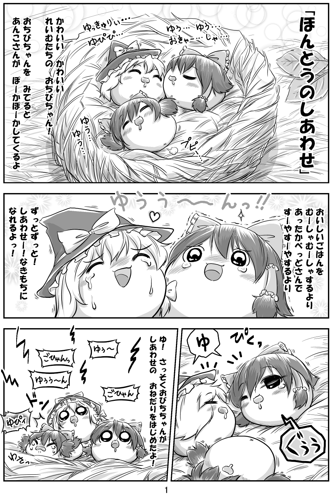

# 灵梦

[种族目录](../README.md) → 灵梦

| 项目 | 内容 |
| --- | --- |
| 分类 | 种族 |
| 上级种族 | 无；目录根种族 |
| 日文检索词 | れいむ |

## 外形与分类

基础种族，以蝴蝶结与双侧鬓发识别；多毛灵梦单独归入其命名不足油亚型。

## 习性与作品差异

- **社区八景记录：** 基本种，独处时较偏向唱歌，亲近/撒娇倾向较高，配对中常任母方；这只是倾向。[W，L09](https://wikiwiki.jp/yukkuri8kei/ゆっくりの種類)
- **双叶系常见母题：** 高优先级综述[L36](../../../sources-lore.md)将灵梦种概括为能力普通或欠能、偏爱同类与育儿，配偶常写作魔理沙种；喜剧中也常以自私、懒散、倚赖配偶的丑角登场，并存在温和、能干等反差版本。
- **外观与身体：** 《にっき》种族资料以红蝴蝶结、双侧鬓发、细豆沙描述；这是该游戏资料，不能据此统一其他作品的馅料细分。[W，L10](https://w.atwiki.jp/ykansatu/pages/39.html)
- **环境与社会：** 多以普通种的水源与食物习性生活；身体娇弱和家族意识常同时出现，喜剧丑角与亲子照料者都是常见写法。
- **社区条目：** **W：[F151](https://yukkuri.fandom.com/wiki/Yukkuri_Reimu)** 写灵梦是站点最普遍、最早出现的类型，爱称 Yukkureimu，饰物为蝴蝶结与两条发带，红豆沙馅，稀有度记作常见；正文说它是最“油库里”的油库里，通常迟钝、天真、自私，同时友善、育儿时很母性，好坏各按个体。同页记灵梦常与魔理沙配对，灵梦当“母亲”留窝育儿、清理巢穴并就近采食，魔理沙当“父亲”狩猎、筑巢、护家，一方死去后另一方多半不再配对。

**发辫与飞行：** 同一页记 2009 年起流行的一种画法，灵梦把两侧鬓发当翅膀扇着飞，用来采食、逃跑和玩耍，并把它们叫作 Piko Piko 先生；较新的画多把辫子当手拿东西。同页又记其他个体大多认得灵梦，Shinmyoumaru 型会把它当保护者并挤在它身边，灵梦会像收孩子一样收养它们；Kasen 型跟在后面说教，蕾米莉亚、芙兰、土蜘蛛型与正邪型则骚扰或捕食。

**变体：** 该页列三种写法。紫眼灵梦约 1/500，多出现在 Mima 型附近，饰物颜色通常不变。Wasa Wasa 灵梦的辫子蓬松，没有常见的长辫与红色饰物，据说比普通灵梦更吵更好动，受过训练后同样温和，需求很高。另有把丝带当筏的“水生灵梦”，多为假货，被当作水生卖掉的普通个体容易得不如意症，真货则更会划。同页把肥胖好怒的个体写成 Deibu，自称 Deibu、子代称 Weibu。

**项目采用：** 灵梦是十个已登记种族之一，颊囊 2 份、独唱 ×1.5、亲昵增长 ×1.3（项目设计，见[种族与亚种](../../../../../docs/FEATURES.md#种族与亚种)）；灵梦与魔理沙配对时一律灵梦怀孕、魔理沙为父，与上文的母父分工一致。蓬松辫子写成有独立出现率的亚种[多毛灵梦](wasa-reimu.md)；肥胖好怒的写法写成后天转变的灵胖，体型扩 1.5 倍、不可逆，不是人格标签，也没有 Weibu 称呼；辫子只是真实身体部位，无飞行。紫眼、带筏水生灵梦与假饰物买卖都没有实现，捕食关系只到蕾米莉亚与芙兰，其余见[设定差异](../../conflicts.md)。

## 作品图片参考

**REF01 · 毛簇与亲子比例**。观察圆团状鬓发、蝴蝶结、帽子和群体大小；不据画面反推每个角色的亚种。

出处：[ほんとうのしあわせ](http://blog.livedoor.jp/yukkuri_anko/archives/29582969.html)，转载页署名：キリライターあき。原图已保存到本库，仅作作品研究参考。

## 相关资料

本项目新增成长设定：营养良好且处于低友善度环境的灵梦种，成熟后可能转变为灵胖。详细条件和待定参数见[灵胖成长转变](../../../../reimu-deibu-development.md)，不将其视为上述参考作品的共同规则。

[多毛灵梦](wasa-reimu.md)

下级条目：[多毛灵梦](wasa-reimu.md)。

[形态与生态类别](../forms.md) · [共通生态](../../ecology.md) · [口吻与发音](../../../dialogue/species-variants.md) · [作品来源](../../../sources-lore.md)

本地图片的出处、核对范围与用途见[美术参考索引](../../../../art-references/visual-guide.md)。
