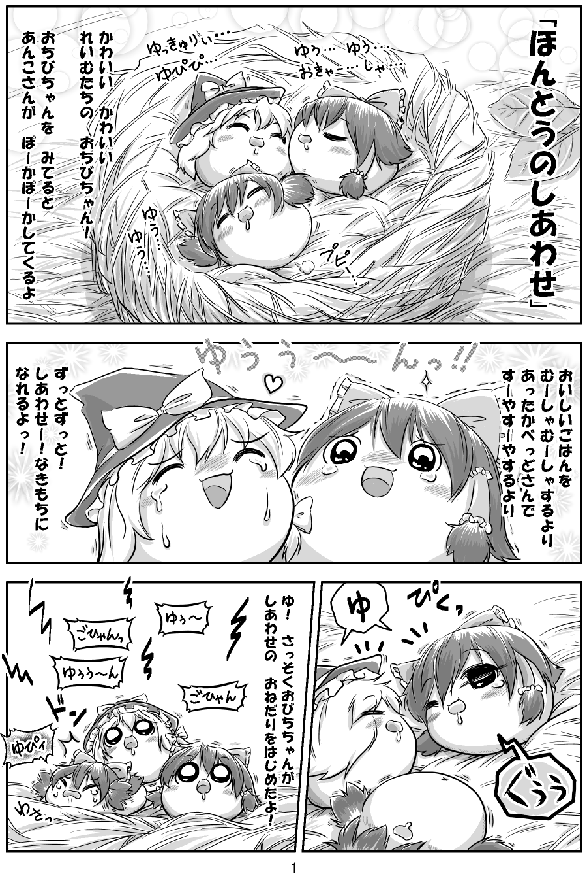
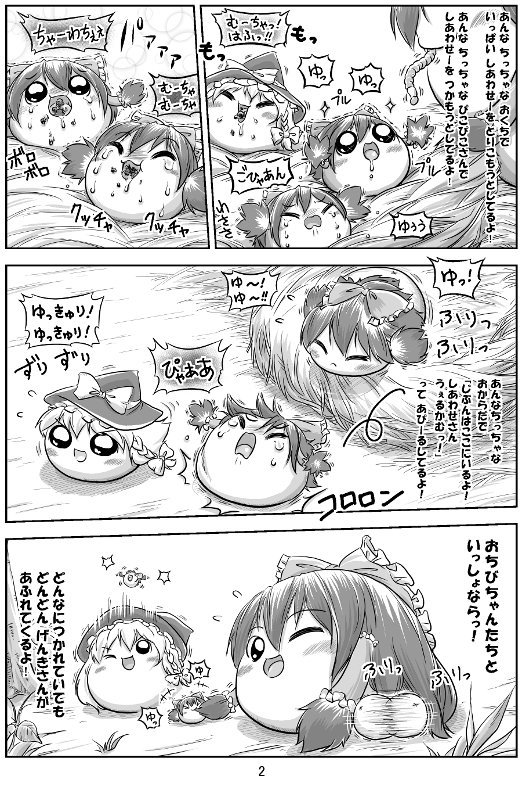

# 多毛灵梦

[种族目录](../README.md) → [灵梦](README.md) → 多毛灵梦

| 项目 | 内容 |
| --- | --- |
| 分类 | 命名不足油亚型 |
| 上级种族 | [灵梦](README.md) |
| 日文检索词 | わされいむ、わさ |

## 外形与分类

灵梦下有独立名称的亚型，以球状蓬松鬓发识别。本资料沿用“不足油”分类；分类与性格描述存在作品差异。

## 习性与作品差异

八景社区将其视为灵梦亚型，最明显特征是球状蓬松鬓发；该页明确外表差异并不使其无法被正常训练，且不保证后代继承。[W，L09](https://wikiwiki.jp/yukkuri8kei/ゆっくりの種類)

多毛灵梦的学习表现、生育资格与其他不足形态分别处理；具体游戏规则见[游戏文档索引](../../../../../docs/README.md)。八景社区没有给出成功率统计，也不能由毛发直接锁定个体品行。

## 作品图片参考

新增阅读入口：[EH10《寻找多毛灵梦成体》](../../../../art-references/ehentai/works/EH10.md)，转载题署もんs并标机翻。当前只核前 8 页的问题、庭院布置和幼体事件，尚未核到成体结果；不以标题或首页问号轮廓填补成体造型，也不把该作损失数量转成普遍存活率。

**REF01 · 毛簇与亲子比例**。观察圆团状鬓发、蝴蝶结、帽子和群体大小；不据画面反推每个角色的亚种。

出处：[ほんとうのしあわせ](http://blog.livedoor.jp/yukkuri_anko/archives/29582969.html)，转载页署名：キリライターあき。原图已保存到本库，仅作作品研究参考。

**REF02 · 毛簇型进食与转向**。观察进食、碎屑、侧向轮廓与弹跳。

出处：[ほんとうのしあわせ](http://blog.livedoor.jp/yukkuri_anko/archives/29582969.html)，转载页署名：キリライターあき。原图已保存到本库，仅作作品研究参考。

## 相关资料

所属种族：[灵梦](README.md)。同一父类下的条目分别维护定义与美术，名称相近不合并。

[形态与生态类别](../forms.md) · [共通生态](../../ecology.md) · [口吻与发音](../../../dialogue/species-variants.md) · [作品来源](../../../sources-lore.md)

本地图片的出处、核对范围与用途见[美术参考索引](../../../../art-references/visual-guide.md)。
