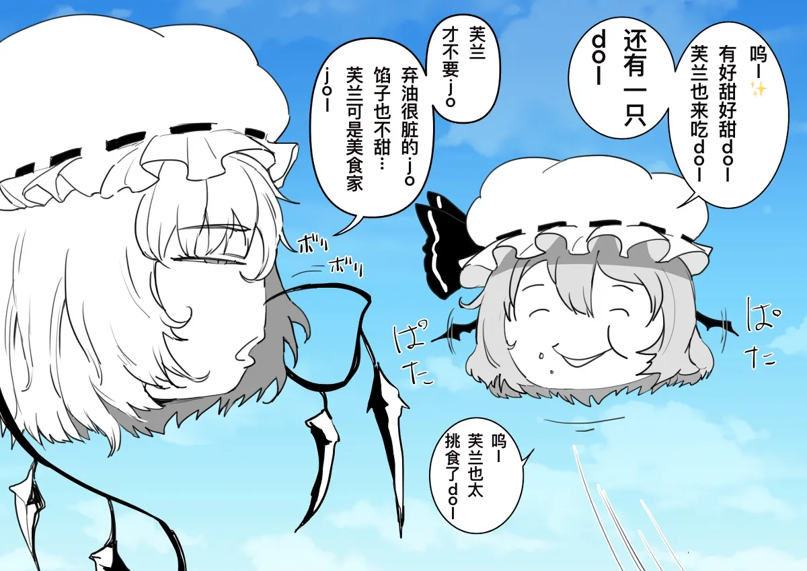

# 蕾米莉亚

[种族目录](../README.md) → 蕾米莉亚

| 项目 | 内容 |
| --- | --- |
| 分类 | 种族 |
| 上级种族 | 无；目录根种族 |
| 日文检索词 | れみりゃ |

## 外形与分类

独立种族，部分作品将其描写为能够飞行的捕食类型。

## 习性与作品差异

《观察日记》攻略将其列为飞行捕食种，捕食还受该游戏等级及开关影响。[W，L12](https://w.atwiki.jp/ykansatu/pages/16.html) 飞行不等于必定捕食同伴；食性与能力仍需区分作品。

**W：双叶系母题（L36）。** 高优先级综述把蕾米莉亚列为常见捕食种；作品既有低智能、难以对话的描写，也有狩猎故事中展现高智慧的版本。另有作品因普通种造成的环境压力而较宽待捕食种。这些是创作中的能力与社会待遇差异，不表示每只蕾米莉亚都会捕食、智能固定或必然受到善待。

## 作品图片参考

[EH02《地球的生物系列·捕食种篇》](../../../../art-references/ehentai/works/EH02.md)第 3 页，封面署名ぼっキー、译者 shku。右侧蕾米莉亚为头状身体、短发、睡帽与蝙蝠翼；左侧是芙兰。主体灰度不能补出完整色板，翼根背面仍被遮挡；对白中的偏好只属于该作。

## 相关资料

[形态与生态类别](../forms.md) · [共通生态](../../ecology.md) · [口吻与发音](../../../dialogue/species-variants.md) · [作品来源](../../../sources-lore.md)
