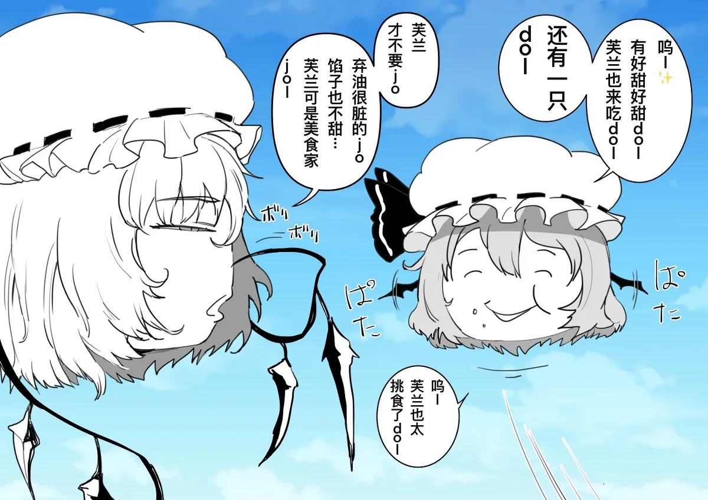

# 蕾米莉亚

[种族目录](../README.md) → 蕾米莉亚

| 项目 | 内容 |
| --- | --- |
| 分类 | 种族 |
| 上级种族 | 无；目录根种族 |
| 日文检索词 | れみりゃ |

## 外形与分类

独立种族，部分作品将其描写为能够飞行的捕食类型。

## 习性与作品差异

《观察日记》攻略将其列为飞行捕食种，捕食行为受该游戏的等级及开关控制。[W，L12](https://w.atwiki.jp/ykansatu/pages/16.html)

**W：双叶系母题（[L36](../../../sources-lore.md)）。** 蕾米莉亚是常见捕食种。作品既写低智能、难以对话的个体，也有狩猎时展现高智慧的版本；普通种造成的环境压力也使部分创作对捕食种采取较宽容的态度。

- **内馅：** 用户明确指定捕食种为肉包；本项目据此采用肉包馅配色，具体 RGB 为项目美术，不改变捕食行为。

**W：[F153](https://yukkuri.fandom.com/wiki/Yukkuri_Remilia)** 写蕾米莉亚多按 Makako 画的带胴体形象被当宠物角色：经常闭着眼笑、穿蓬松裙子，长着能飞的翅膀；在野外多为捕食者，以别的油库里为食，圈养时可喂各种食物。同页写它们伤口几秒就愈合、近似有限不死，持续受伤时慢一些；失去翅膀就不能飞，直到长回来。无胴体个体常用两条鸟足抓东西，受攻击时会打滚发怒、呼救 Sakuya 型或飞回红魔馆；带胴体的个体只要甜食（布丁），会把其他食物丢掉。馅为各种肉。同页写它们常被芙兰欺负，Sakuya 型会试图配对或保护它。

**项目采用：** 蕾米莉亚与芙兰是仅有的两个捕食种，能在森林、黑森林与针叶林低权重生成、可飞行，饥饿时在 60 格内找普通个体捕猎，见[捕食种](../../../../../docs/FEATURES.md#捕食种)。项目按用户指定的肉包馅配色，没有再生与不死，伤势照常按等级结算；没有胴体、红魔馆与 Sakuya 型，甜食偏好只按甜食降一次不安结算，见[设定差异](../../conflicts.md)。

## 作品图片参考

[EH02《地球的生物系列·捕食种篇》](../../../../art-references/ehentai/works/EH02.md)第 3 页，封面署名ぼっキー、译者 shku。右侧蕾米莉亚为头状身体、短发、睡帽与蝙蝠翼；左侧是芙兰。主体灰度不能补出完整色板，翼根背面仍被遮挡；对白中的偏好只属于该作。

## 相关资料

[形态与生态类别](../forms.md) · [共通生态](../../ecology.md) · [口吻与发音](../../../dialogue/species-variants.md) · [作品来源](../../../sources-lore.md)
